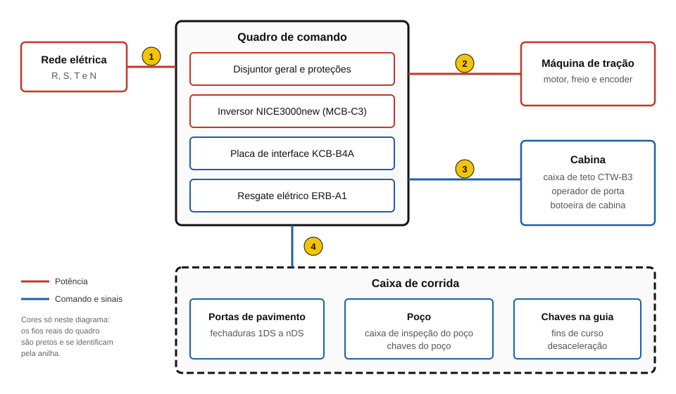
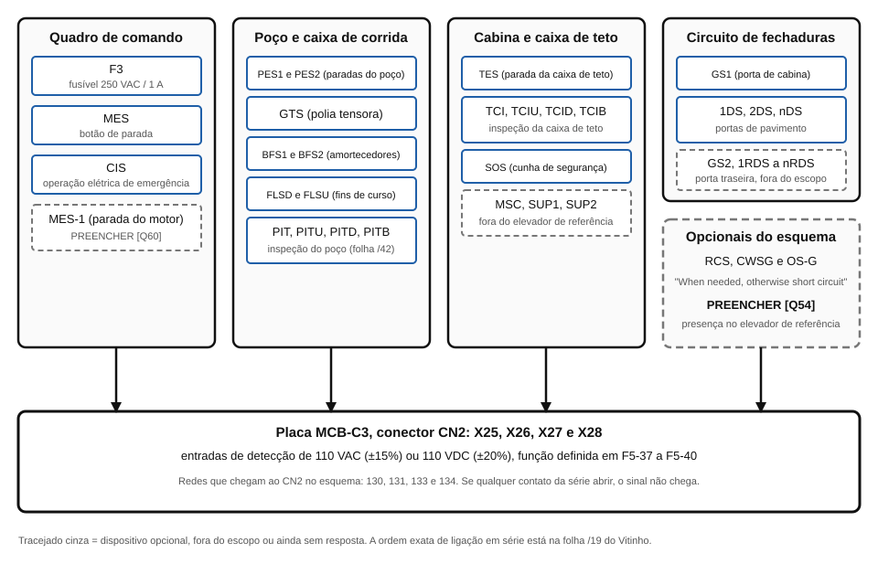

# Capítulo 1. Princípios e cadeia de segurança

> RASCUNHO v0.1 de 14/11/2026. Aguarda aprovação do Gelson e assinatura da Qualidade. Contém selos abertos: `PREENCHER [Q47]`, `PREENCHER [Q54]`, `PREENCHER [Q59]` e `PREENCHER [Q60]`. Eles bloqueiam o build de lançamento.

**Parte I. Fundamentos**

## 1.1 O que você vai aprender

Ao terminar este capítulo você será capaz de:

1. Explicar quais são os blocos de um elevador sem casa de máquinas e como o quadro de comando se liga a cada um.
2. Dizer o que é a cadeia de segurança e o que acontece quando um contato dela abre.
3. Dizer o que é o circuito de fechaduras e por que o elevador não se move com uma porta aberta.
4. Seguir as regras de segurança do fabricante antes de tocar no quadro de comando.

Este capítulo explica o princípio. A ligação fio a fio está nos capítulos 3 e 4, e os cabos de campo, nos capítulos 8, 10 e 11.

## 1.2 O elevador sem casa de máquinas

Um elevador sem casa de máquinas, abreviado MRL (do inglês *Machine Room-Less*), não tem uma sala própria para a máquina. O esquema do fabricante trata os dois casos em folhas separadas: a alimentação principal com casa de máquinas está na folha /7 e a sem casa de máquinas, na folha /8. Em alguns pontos o próprio esquema avisa a diferença. Por exemplo, o botão de parada do volante (MES-2) fica num bloco marcado "Use for MR", só para elevador com casa de máquinas, e o jumper SZ é marcado "Use for MRL".

A Figura 1.1 mostra os blocos. O quadro de comando recebe a rede elétrica, comanda a máquina de tração e o freio, e conversa com a cabina e com a caixa de corrida.

**Figura 1.1.** Blocos do elevador sem casa de máquinas.
1. Alimentação da rede (R, S, T e N) até o quadro de comando.
2. Potência do inversor para o motor e o freio.
3. Cabo de manobra entre o quadro de comando e a caixa de teto (conectores AA e AB no quadro, CA e CB na caixa de teto).
4. Cabos de poço até a caixa de corrida (o cabo BA leva a cadeia de segurança e as fechaduras).

Fonte: esquema Vitinho 19061867-ZL, folhas /7, /8, /19 e /34 (páginas PDF 9, 10, 21 e 36; a página PDF é o número da folha mais 2).

> **NOTA.** As cores da Figura 1.1 valem só para o desenho: vermelho para potência e azul para comando. Os fios reais do quadro de comando são pretos e se identificam pela anilha, não pela cor.

No elevador de referência deste livro, o quadro de comando fica no último pavimento, à direita da caixa de corrida. O elevador tem 3 paradas, 1 porta e motor de 7,5 kW em 380 V. Essa configuração vem do responsável técnico do livro e vale para todos os exemplos.

## 1.3 Cadeia de segurança

A cadeia de segurança é uma série de contatos elétricos ligados um depois do outro. Para o sinal de 110 V chegar ao controlador, todos os contatos precisam estar fechados. Se um só abrir, o sinal deixa de chegar. É por isso que ela serve como proteção: qualquer um dos dispositivos pode interromper o movimento.

O manual do controlador diz que a cadeia de segurança é importante para o funcionamento seguro e confiável do elevador e que os sinais válidos de retorno da cadeia e do circuito de fechaduras são necessários para o elevador andar.

**Onde o sinal chega.** Na placa principal MCB-C3, o conector CN2 tem as entradas X25 a X28. Elas são entradas de detecção de tensão mais alta: 110 VAC (±15%) ou 110 VDC (±20%). A função de cada uma, cadeia de segurança ou circuito de fechaduras, é definida pelos parâmetros F5-37 a F5-40. No esquema, as redes 130, 131, 133 e 134 chegam a esse conector.

Fonte: manual NICE3000new (20181130), pág. PDF 61 (impressa 60), tabela do conector CN2; pág. PDF 199 (impressa 198), parâmetros de entrada.

### Os dispositivos da cadeia, por local

A Figura 1.2 agrupa os dispositivos pelo lugar onde ficam. A ordem exata de ligação em série está na folha /19 do esquema.

**Figura 1.2.** Dispositivos da cadeia de segurança e do circuito de fechaduras do elevador de referência, por local.

Fonte: esquema Vitinho 19061867-ZL, folhas /19 (cadeia, pág. PDF 21), /34 (caixa de teto, pág. PDF 36), /41 (poço, pág. PDF 43) e /43 (fechaduras, pág. PDF 45); manual NICE3000new, pág. PDF 61.

| Local | Dispositivo | Nome no esquema (tradução) |
|---|---|---|
| Quadro de comando | F3 | fusível da cadeia de segurança, 250 VAC / 1 A |
| | MES | botão de parada de emergência |
| | CIS | chave de operação elétrica de emergência (no esquema também aparece como "chave de inspeção de emergência") |
| | MES-1 | botão de parada do motor ("Motor emg. stop button"); presença no elevador de referência: `PREENCHER [Q60]` |
| Poço e caixa de corrida | PES1 e PES2 | botões de parada do poço (o PES1 fica na botoeira de inspeção do poço) |
| | GTS | chave elétrica da polia tensora |
| | BFS1 e BFS2 | chave do amortecedor 1 e chave do amortecedor 2 |
| | FLSD e FLSU | fim de curso inferior e fim de curso superior |
| | PIT, PITU, PITD e PITB | chave de inspeção do poço e botões de subir, descer e comum da inspeção do poço |
| Cabina e caixa de teto | TES | botão de parada de emergência da caixa de teto |
| | TCI, TCIU, TCID e TCIB | chave e botões de inspeção da caixa de teto |
| | SOS | chave elétrica da cunha de segurança |
| Circuito de fechaduras | GS1 | contato de fechadura da porta de cabina |
| | 1DS, 2DS e nDS | contatos de fechadura das portas de pavimento (uma por pavimento) |

Fonte: esquema Vitinho 19061867-ZL, folhas /14 (pág. PDF 16), /19, /34, /41, /42 (pág. PDF 44) e /43. Para BFS1 e BFS2 o esquema Vitinho só traz "Buffer switch 1" e "Buffer switch 2".

**O que o esquema marca como opcional.** Alguns contatos têm a instrução "When needed, otherwise short circuit" (quando necessário; senão, curto): RCS (chave do rope gripper), CWSG (chave elétrica da cunha de segurança do contrapeso) e OS-G (chave elétrica do limitador de velocidade do contrapeso). Se cada um deles existe no elevador de referência: `PREENCHER [Q54]`.

Outros itens aparecem no esquema, mas ficam fora do elevador de referência: MSC (desenhado com um curto na caixa de teto), SUP1 e SUP2 (chaves de espera), a porta traseira (GS2 e 1RDS a nRDS) e o botão de parada do volante (MES-2), que é só para casa de máquinas.

**Função de cada chave.** O que cada dispositivo detecta e por que ele existe: `PREENCHER [Q59]`.

**Botoeira de inspeção do poço.** A folha /42 mostra a botoeira de inspeção do poço (PES1, PIT, PITU, PITD e PITB) ligada à placa MCTC-PTB-A1 dentro da caixa de inspeção do poço. A operação em inspeção está no capítulo 12.

> **ATENÇÃO.** O elevador de referência tem o conjunto de dispositivos da tabela acima. Um elevador diferente pode ter mais ou menos contatos. Confira sempre o esquema do seu elevador antes de interpretar uma falha da cadeia.

### Se o seu elevador tiver outra configuração

| Se o seu elevador tiver | O que muda na cadeia |
|---|---|
| Casa de máquinas (MR) | Entra o botão de parada do volante, MES-2, e o jumper SZ não se aplica. |
| Porta traseira | Entram GS2 e os contatos 1RDS a nRDS. |
| Mais de 3 paradas | A série das fechaduras ganha um contato de pavimento por parada (a letra n do esquema). |

Fonte: esquema Vitinho 19061867-ZL, folhas /19, /34 e /43.

## 1.4 Circuito de fechaduras

O circuito de fechaduras é uma série de contatos que confirma que a porta de cabina e todas as portas de pavimento estão fechadas e travadas. O manual do controlador diz que ele garante que as portas de pavimento e de cabina estejam fechadas antes de o elevador partir. No elevador de referência, ele é formado por GS1 e pelos contatos 1DS, 2DS e 3DS.

O manual recomenda configurar os sinais de retorno da cadeia de segurança e das fechaduras como entrada NO (normalmente aberta). Se forem configurados como NC, o sistema considera a entrada ativa mesmo sem sinal, e não consegue detectar o estado real do circuito. Isso cria risco de segurança.

> **ATENÇÃO.** Não configure como NC o retorno da cadeia de segurança nem o das fechaduras. O sistema deixa de perceber o estado real do circuito.

Fonte: manual NICE3000new (20181130), pág. PDF 199 (impressa 198), parâmetros de entrada 04, 05, 29 e 31.

### O que o controlador faz quando a cadeia ou as fechaduras abrem

O manual traz duas falhas que correspondem a esses circuitos:

| Falha | Nome no manual (tradução) | O que o manual manda verificar |
|---|---|---|
| Err41 | cadeia de segurança desconectada | as chaves da cadeia e seus estados; se a alimentação externa está normal; se o contator da cadeia atua corretamente; a característica do sinal (NO ou NC) do contato de retorno |
| Err42 | fechadura desconectada com a cabina em movimento | o contato das fechaduras de pavimento e de cabina; se o contator das fechaduras atua corretamente; a característica do sinal (NO ou NC) do contato de retorno; se a alimentação externa está normal |

O manual também informa que a Err41 não é registrada com o elevador parado.

Fonte: manual NICE3000new (20181130), pág. PDF 281 (impressa 280), tabela de falhas, e pág. PDF 288, notas.

## 1.5 Bypass de porta

O esquema traz o bypass de porta, ligado ao plugue S2 da placa KCB-B4A. O desenho mostra três pontos de bypass: o contato da porta de cabina (GS1), o contato das portas de pavimento (DS) e o contato da porta traseira (GS2). O bypass substitui os contatos de fechadura. Enquanto ele está ativo, o elevador não verifica se a porta está fechada.

O esquema avisa que, depois de acionado o dispositivo de bypass, o dispositivo de alarme sonoro e visual da parte de baixo da cabina é acionado e emite o sinal.

> **PERIGO.** Com o bypass de porta ativo, o elevador não verifica se a porta está fechada.

Como posicionar os plugues S1 e S2 na montagem e na manutenção está no capítulo 4.

Fonte: esquema Vitinho 19061867-ZL, folha /14 (nota 1, pág. PDF 16) e folha /19 (pág. PDF 21).

## 1.6 Inspeção e operação elétrica de emergência

Quando a chave de inspeção ou de operação de emergência está ativa, o elevador entra no estado de inspeção ou de operação de emergência. O sistema cancela todo o movimento automático, inclusive as aberturas e fechamentos automáticos de porta. Com o sinal de subir ou de descer válido, o elevador anda na velocidade de inspeção (F3-11) ou na de operação de emergência. Para a velocidade de emergência o manual se contradiz: o texto desta seção cita F3-26, mas a tabela de parâmetros traz F3-25 como "Emergency electric RUN speed" (padrão 0,250 m/s) e F3-26 como a velocidade do autoajuste do poço (págs. PDF 196 e 200). Confira no seu controlador qual parâmetro vale. O sinal de inspeção tem prioridade sobre o de emergência: com os dois ativos, o elevador anda como em inspeção.

Fonte: manual NICE3000new (20181130), pág. PDF 200 (impressa 199), parâmetros de entrada 08, 09, 10 e 84; págs. PDF 194 e 196, parâmetros F3-11, F3-25 e F3-26.

## 1.7 Segurança do trabalho no quadro de comando

As regras abaixo são do manual do controlador. Elas não substituem os procedimentos da empresa nem as normas aplicáveis.

> **PERIGO.** Só profissional habilitado pode instalar, ligar, manter, inspecionar ou trocar peças do equipamento.

> **PERIGO.** Nunca faça ligações com o equipamento energizado, porque há risco de choque elétrico. Desligue toda a alimentação e espere no mínimo 10 minutos para a tensão residual descarregar com segurança.

Procedimento antes de ligar ou mexer nos bornes:

1. Desligue todas as alimentações.
2. Espere no mínimo 10 minutos.
3. Confirme que o equipamento está aterrado de forma confiável.
4. Use pulseira antiestática.
5. Só então faça a ligação ou a verificação.

> **NOTA.** A pulseira antiestática evita dano ao equipamento ou ao circuito interno do produto.

> **ATENÇÃO.** Nunca ligue o cabo de alimentação da rede aos bornes de saída U, V e W. Há risco de dano ao equipamento e até de incêndio.

> **CUIDADO.** Depois da ligação, confirme que não ficaram parafusos soltos nem fios expostos dentro do quadro de comando.

> **PERIGO.** Com o equipamento energizado, nunca toque em terminais, nunca abra a porta do quadro de comando nem a proteção, e nunca retire peças. O equipamento pode partir de forma repentina.

> **CUIDADO.** Durante a operação, não toque na carcaça, no ventilador nem no resistor: há risco de queimadura.

Fonte: manual NICE3000new (20181130), "Safety Instructions", págs. PDF 20 e 21 (impressas 19 e 20).

**Bloqueio e etiquetagem do quadro de comando (LOTO)** e **exigências de norma sobre a segurança do trabalho em instalações elétricas:** `PREENCHER [Q47]`.

## 1.8 Teste o que você aprendeu

1. Com a cabina em movimento, uma porta de pavimento abre. O que o manual diz sobre a falha que o controlador registra? *(Seção 1.4: Err42, fechadura desconectada com a cabina em movimento.)*
2. Quais são os cinco passos antes de mexer nos bornes? *(Seção 1.7.)*
3. Quanto tempo se espera depois de desligar? *(Seção 1.7: no mínimo 10 minutos.)*
4. O que acontece quando o bypass de porta está ativo? *(Seção 1.5: o elevador deixa de verificar a porta, e o esquema liga o alarme sonoro e visual da parte de baixo da cabina.)*
5. Por que a cadeia de segurança é uma série de contatos? *(Seção 1.3: se um só abrir, o sinal não chega ao controlador.)*

## Fontes do capítulo

- Manual NICE3000new, `Manual_Usuario_Controlador_NICE3000new_Completo.pdf` (368 páginas, edição 20181130), págs. PDF 20, 21, 61, 199, 200, 281 e 288.
- Esquema Vitinho 19061867-ZL (2023-07-18), folhas /7, /8, /14, /19, /34, /41, /42 e /43.
