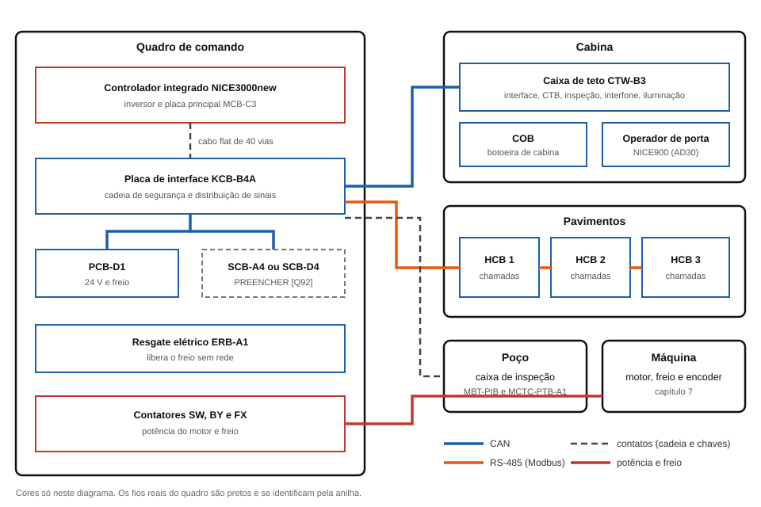

# Capítulo 2. Visão geral do sistema

> RASCUNHO v0.1 de 14/11/2026. Aguarda aprovação do Gelson e assinatura da Qualidade. Sem selos (Q92 virou conferência de obra em 15/11/2026).

**Parte I. Fundamentos**

## 2.1 O que você vai aprender

Ao terminar este capítulo você será capaz de:

1. Nomear os componentes do sistema, do quadro de comando à cabina e aos pavimentos, e dizer o que cada um faz.
2. Dizer por onde cada componente conversa com os outros: CAN ou RS-485.
3. Seguir as regras de cabo e de topologia dos dois barramentos.
4. Saber em que capítulo está cada componente.

Este capítulo dá o mapa. A ligação fio a fio de cada peça está nos capítulos seguintes.

## 2.2 O sistema em uma figura

O NICE3000new junta, no mesmo equipamento, o controlador do elevador e o inversor vetorial de corrente alternada. Segundo o manual, o sistema inclui o controlador integrado, a placa do topo da cabina, a placa de chamada dos pavimentos, a placa de chamada da cabina e, como opcionais, o módulo de abertura antecipada da porta e o monitoramento remoto. O controlador comanda o motor a partir do sinal do encoder e registra, por pulsos, a posição de todas as chaves do poço. Isso permite o nivelamento preciso e a viagem direta. Fonte: manual NICE3000new, seção 1.5, pág. PDF 35 (impressa 34).

**Figura 2.1.** Componentes do sistema do elevador de referência e os barramentos que os ligam.
Fonte: esquema Vitinho 19061867-ZL, folhas /24 e /45 (págs. PDF 26 e 47); manual NICE3000new, págs. PDF 35 e 36; manual da caixa de teto MCTC-CTW-B3.

## 2.3 Os componentes

| Componente | O que é | Onde fica | Capítulo |
|---|---|---|---|
| Controlador integrado NICE3000new, com a placa principal MCB-C3 | Junta o controlador do elevador e o inversor; comanda o motor e a lógica | quadro de comando | 3 |
| Placa de interface KCB-B4A | "Control cabinet interface board": recebe a alimentação de comando, concentra a cadeia de segurança e distribui os sinais para o cabo de manobra, o poço e a máquina | quadro de comando | 3 |
| Placa fonte do freio PCB-D1 | "Brake power board of CAN": gera os 24 V do quadro e a tensão do freio, e conversa com a KCB por CAN | quadro de comando | 3 |
| Resgate elétrico ERB-A1 | Libera o freio quando a rede falta | quadro de comando | 3 e 13 |
| Caixa de teto MCTC-CTW-B3 | Caixa integrada do topo da cabina: reúne a placa de interface do teto, a placa de controle do teto (CTB), a inspeção do teto, o interfone e a iluminação | topo da cabina | 8 |
| Placa de chamada da cabina (COB) | Recebe os botões de andar e os de abrir e fechar a porta | cabina | 8 |
| Operador de porta NICE900 (AD30) | Controlador de porta | cabina | 9 |
| Placas de chamada e display dos pavimentos (HCB) | Registram e mostram as chamadas de cada pavimento | pavimentos | 10 |
| Caixa de inspeção do poço (MBT-PIB) com a placa MCTC-PTB-A1 | Reúne a parada e a inspeção do poço | poço | 11 |
| Módulo de abertura antecipada SCB-A4 ou SCB-D4 (opcional) | "Advanced door-open module": ligado à KCB por CAN | quadro de comando | 8 |
| Máquina de tração, freio e encoder | Movem a cabina | ver o capítulo 7 | 7 |

O módulo é opcional: ele entra quando o pedido tem abertura antecipada de porta ou renivelamento com porta aberta. Confira no pedido do seu elevador e no quadro.

Fonte: esquema Vitinho 19061867-ZL, folhas /3.a, /21, /24, /42 e /45 (págs. PDF 5, 23, 26, 44 e 47); manual NICE3000new, pág. PDF 35; manual da caixa de teto MCTC-CTW-B3, págs. PDF 1 e 2; documento "Parametrização de Controlador de Porta NICE900".

## 2.4 Como os componentes conversam

O sistema usa dois barramentos. Um terceiro tipo de ligação, os sinais por contato (cadeia de segurança, fechaduras e chaves), está no capítulo 1.

### CAN, entre as placas

O CAN liga o controlador às placas do quadro e da cabina. No esquema, os fios CAN+ e CAN- da KCB seguem para quatro destinos:

| Destino | Conector da KCB | Conector do destino |
|---|---|---|
| Placa de controle da caixa de teto, pelo cabo de manobra | AB pinos 5 e 6 | CB pinos 5 e 6 |
| Placa fonte do freio PCB-D1 | KY12 pinos 1 e 2 | J4 pinos 2 e 5 |
| Módulo de abertura antecipada SCB-A4/D4 | KY13 pinos 7 e 8 | CN2 pinos 7 e 8 |
| Reserva ("Standby") | KY10 pinos 4 e 5 | sem uso no desenho |

O desenho mostra ainda, dentro da caixa de teto, ligações CAN para uma régua magnética (MSC) e para cortinas de luz. A régua magnética fica fora do elevador de referência.

O manual diz que a placa principal troca com a placa do topo da cabina, por CAN, o andar e o sentido de marcha. Fonte: esquema Vitinho, folha /24 (pág. PDF 26); manual NICE3000new, pág. PDF 68.

### RS-485, para os pavimentos

O RS-485 (Modbus) liga a placa principal às placas de chamada e display dos pavimentos. Cada placa recebe 24 V (redes 301 e 302) e os sinais 485+ e 485- (MOD+ e MOD-). Em cada pavimento, a placa registra os botões de subida e de descida e acende o indicador. Fonte: esquema Vitinho, folha /45 (pág. PDF 47).

Regras do manual para o RS-485:

1. Cada placa de chamada de pavimento tem um **endereço único**. Se dois tiverem o mesmo, a comunicação fica anormal.
2. O endereço **0** é o do display da cabina. Os endereços **1 a 40** são das placas de pavimento.
3. O programa padrão atende no máximo **40 pavimentos**. Para mais de 40, é preciso um programa especial, e o manual manda contatar o fabricante.
4. Use **par trançado** no cabo de RS-485.
5. A topologia do barramento é **em cadeia** (de nó em nó) ou **com derivação**. Na derivação, o cabo entre o barramento e cada nó deve ser o mais curto possível, de preferência com **menos de 3 m**.
6. A ligação **em estrela é proibida**.

> **ATENÇÃO.** Não ligue o RS-485 em estrela. O manual proíbe essa topologia.

Fonte: manual NICE3000new, seção 2.3.4, págs. PDF 68 e 69 (impressas 67 e 68); a regra do par trançado está nas precauções de EMC, pág. PDF 70 (impressa 69).

## 2.5 Alimentação, em uma frase

Os 24 V de comando (redes 301 e 302) saem da PCB-D1. A KCB os distribui ao cabo de manobra, ao cabo dos botões dos pavimentos (BB) e ao resgate elétrico. A alimentação de 220 V do ventilador, da luz da cabina e do resgate elétrico vem do QFB3 pelas redes 501 e 502. O capítulo 3 traz o desenho completo.

## 2.6 Se o seu elevador tiver outra configuração

| Se o seu elevador tiver | O que muda |
|---|---|
| Porta traseira | Entram a segunda cortina de luz, a placa de chamada traseira e os contatos de fechadura traseiros (capítulos 1 e 8) |
| Mais de 3 pavimentos | Entram mais placas de chamada no RS-485, cada uma com endereço único (até 40 no programa padrão) |
| Pesagem | Entra a célula de carga na entrada analógica do controlador (capítulo 3) |
| Casa de máquinas | Entram o volante e o botão de parada do volante (capítulo 1) |

Fonte: esquema Vitinho 19061867-ZL, folhas /19, /24 e /45; manual NICE3000new, págs. PDF 61 e 68.

## 2.7 Teste o que você aprendeu

1. Qual placa recebe os sinais da cadeia de segurança e em quais bornes? *(Capítulo 1: a MCB-C3, nos bornes X25 a X28 do CN2.)*
2. Que barramento liga as botoeiras e os displays dos pavimentos? *(Seção 2.4: o RS-485.)*
3. Qual é a função da PCB-D1 e da ERB-A1? *(Seção 2.3: a PCB-D1 gera os 24 V e a tensão do freio; a ERB-A1 libera o freio sem rede.)*
4. Quantos pavimentos o programa padrão atende e qual topologia o manual proíbe? *(Seção 2.4: 40 pavimentos; a ligação em estrela.)*
5. Em que capítulo está a ligação de cada componente? *(Tabela da seção 2.3.)*

## Fontes do capítulo

- Manual NICE3000new, `Manual_Usuario_Controlador_NICE3000new_Completo.pdf` (368 páginas, edição 20181130), págs. PDF 35, 36, 61, 66 a 69.
- Esquema Vitinho 19061867-ZL (2023-07-18), folhas /3.a, /19, /21, /24, /42 e /45.
- Manual da caixa de teto `Manual_Caixa_de_Teto_MCTC-CTW-B3_EN.pdf`, págs. PDF 1 e 2.
