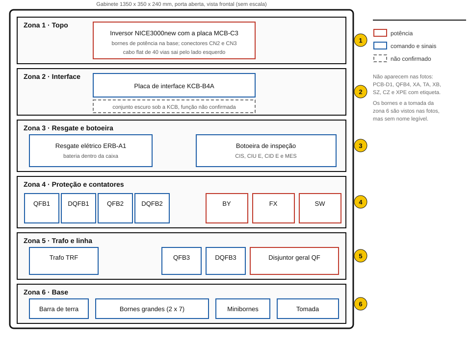
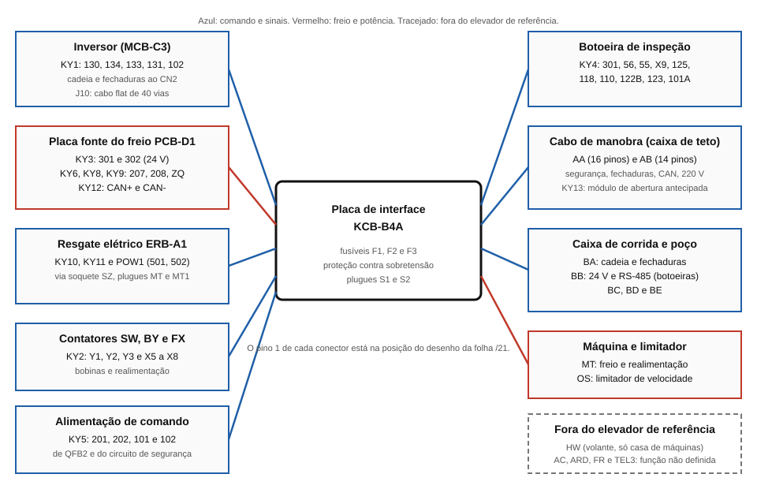
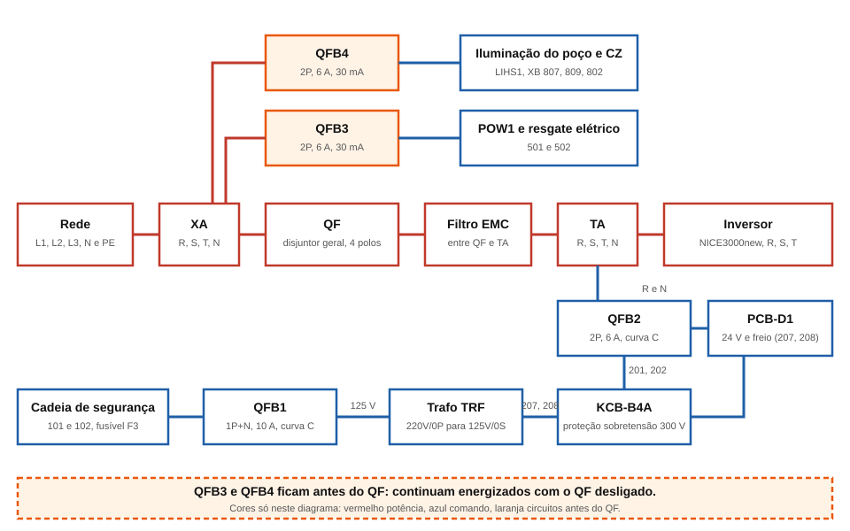
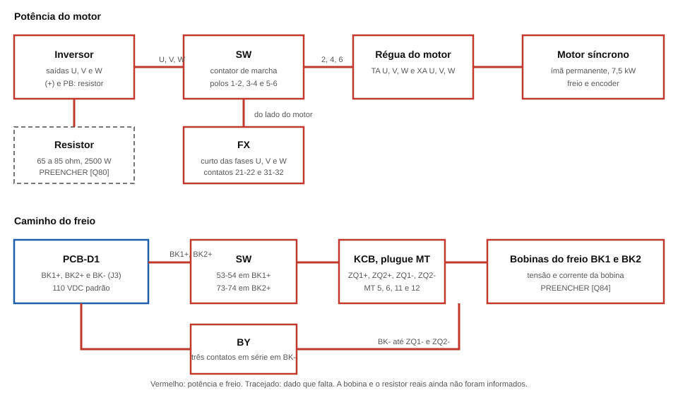

# Capítulo 3. Componentes do quadro de comando

> RASCUNHO v0.1 de 14/11/2026. Aguarda aprovação do Gelson e assinatura da Qualidade. Selos abertos: `PREENCHER [Q81]` a `PREENCHER [Q85]` e `PREENCHER [Q88]` (Q79, Q80, Q86 e Q87 resolvidos em 15/11/2026). Texto aprovado pelo Gelson em 14/11/2026 (as respostas Q79 a Q88 seguem em aberto). Fatos levantados em `sources/cap03_fichas_potencia.md`, `sources/cap03_fichas_controle.md` e `sources/cap03_fotos.md`.

**Parte II. O quadro de comando**

## 3.1 O que você vai aprender

Ao terminar este capítulo você será capaz de:

1. Nomear cada componente do quadro de comando do elevador de referência e dizer o que ele faz.
2. Dizer em quais bornes e conectores cada componente recebe e entrega energia e sinal.
3. Saber qual a fonte de cada dado, para conferir no esquema e no manual.
4. Reconhecer onde o quadro real difere do esquema.

O elevador de referência é o de 7,5 kW em 380 V trifásico, sem casa de máquinas, com 3 paradas e 1 porta, com máquina síncrona de ímã permanente. As variantes de 15 kW e de 220 V não estão neste capítulo.

> **PERIGO.** Antes de abrir o quadro de comando ou tocar em qualquer borne, desligue toda a alimentação e espere no mínimo 10 minutos para a tensão residual descarregar. Confirme que o equipamento está aterrado de forma confiável e use pulseira antiestática. Fonte: manual NICE3000new, "Safety Instructions", págs. PDF 20 e 21.

> **NOTA.** Há partes do quadro que ficam ligadas antes do disjuntor geral QF. O esquema avisa: depois de desligar o QF ainda há tensão nos circuitos do QFB3 e do QFB4. Fonte: esquema Vitinho, folha /8 (pág. PDF 10).

## 3.2 O quadro de comando visto de fora

O quadro de comando reúne, de cima para baixo no quadro real, estes grupos de componentes. A lista vem das fotos de 12 e 13/11/2026, que mostram tudo na coluna do meio do gabinete.

| Zona (de cima para baixo) | O que as fotos mostram | Confirmado por etiqueta |
|---|---|---|
| 1. Topo | Inversor com a placa MCTC-MCB-C3 montada sobre ele e, abaixo dela, os conectores de controle e os bornes de potência | MCB-C3, bornes S, T, U, V, W e terra (o R não ficou legível) |
| 2. Interface | Placa de interface KCB-B4A, com conectores, três fusíveis e relés. Abaixo dela há um conjunto escuro de função não identificada | KCB-B4A |
| 3. Resgate e botoeira | À esquerda, o resgate elétrico ERB-A1. À direita, a caixa metálica da botoeira de inspeção | ERB-A1, botoeira |
| 4. Proteção e contatores | Em fileira: QFB1, DQFB1, QFB2, DQFB2, depois os contatores BY, FX e SW | todos |
| 5. Trafo e linha | À esquerda o trafo TRF. À direita QFB3, DQFB3 e o disjuntor geral QF | todos |
| 6. Base | Barramento de terra, bornes grandes em duas fileiras de 7, minibornes e tomada | ver 3.9 |

Fonte: fotos do quadro (12 e 13/11/2026), catalogadas em `sources/cap03_fotos.md`.

**Figura 3.1.** Layout do quadro de comando em seis zonas, de cima para baixo. Os callouts 1 a 6 correspondem às zonas da tabela acima. O que está em tracejado não foi confirmado nas fotos.
Fonte: fotos do quadro (12 e 13/11/2026) e desenho de furação do quadro; sem escala.

O que as fotos **não** confirmam: onde ficam a placa PCB-D1, o QFB4, os bornes XA, TA, XB e SZ, a barra XPE e a tomada CZ (nenhuma etiqueta com esses nomes foi lida), e o que há nas colunas laterais do gabinete. A posição de cada um: `PREENCHER [Q85]`.

A caixa do quadro mede 1350 x 350 x 240 mm (altura, largura e profundidade). Fonte: desenho `DES-FURACAO_QDC-1350x350x240-R04.pdf` (o próprio nome do arquivo traz as dimensões).

## 3.3 Inversor NICE3000new e placa principal MCB-C3

**O que é.** O NICE3000new é um controlador integrado de elevador. Ele junta o controle lógico (a placa MCB) e o inversor vetorial de corrente alternada no mesmo equipamento. Controla o motor pelo encoder, fala com a caixa de teto por CAN e com os chamadores por RS-485. Fonte: manual NICE3000new, pág. PDF 35 (impressa 34).

**Modelo do elevador de referência.** Para 7,5 kW em 380 V o manual indica o NICE-L-C-4007. O esquema Vitinho só escreve "NICE-L-C-40XX" e não fixa a potência. A lista de materiais da variante de 7,5 kW em 380 V especifica o código VPB-223, "NICE-L-C-4007-KZG" (Apêndice B). Confirme na plaqueta do inversor recebido, no recebimento (capítulo 4, etapa 1).

| Dado do NICE-L-C-4007 | Valor | Fonte (manual, págs. PDF) |
|---|---|---|
| Alimentação | trifásica 380 V, faixa 380 a 440 V, 50/60 Hz | Tab. 1-1, pág. 30 |
| Capacidade | 11,0 kVA | Tab. 1-1, pág. 30 |
| Corrente de entrada e de saída | 20,5 A e 18,0 A | Tab. 1-1, pág. 30 |
| Tolerância de rede | tensão de -15% a +10%; frequência de -5% a +5% | Tab. 1-2, pág. 31 |
| Sobrecarga | 60 s a 150% e 10 s a 200% da corrente nominal | Tab. 1-2, pág. 33 |
| Grau de proteção e resfriamento | IP20, ar forçado | Tab. 1-2, pág. 34 |
| Ambiente | de -10 a 50 °C (redução acima de 40 °C); altitude abaixo de 1000 m | Tab. 1-2, pág. 34 |
| Dimensões (altura, largura, profundidade) | 347 x 223 x 173,5 mm; furos 150 x 334,5 mm, diâmetro 6,5 mm | Tab. 2-2, pág. 42 |
| Massa bruta | 7 kg | Tab. 2-2, pág. 42 |

**Bornes de potência** (disposição para modelos abaixo de 37 kW: (-) (+) R S T e PB U V W). Fonte: manual, Tab. 2-7, pág. PDF 52.

| Borne | Função |
|---|---|
| R, S, T | entrada trifásica da rede; o manual não exige sequência de fases |
| (+) e PB | resistor de frenagem (modelos abaixo de 37 kW); cabo do resistor com menos de 5 m; nunca ligar o resistor direto ao barramento CC |
| (-) | barramento CC; fica sem ligação neste modelo |
| U, V, W | saída para o motor; proibido ligar capacitor ou supressor de surto; cabo blindado com a blindagem ao terra |
| PE | terra |

> **PERIGO.** Nunca ligue o cabo de alimentação da rede aos bornes de saída U, V e W. Há risco de dano ao equipamento e até de incêndio. Fonte: manual NICE3000new, pág. PDF 20.

**Cabos e proteção que o manual recomenda para o NICE-L-C-4007** (Tab. 3-2, pág. PDF 87; Tab. 2-9, pág. PDF 56; Tab. 2-17, pág. PDF 63):

| Item | Valor |
|---|---|
| Disjuntor | 32 A |
| Contator de entrada | 25 A |
| Cabo de potência e de aterramento | 4 mm² de cobre |
| Cabo de controle | 0,75 mm² (faixa de 0,2 a 0,75 mm²) |
| Torque do borne de potência | 2,5 N·m (terminal GTNR4-5) |
| Torque do borne de controle | 0,565 N·m, ponteira tubular com 6 mm de condutor exposto |
| Resistor de frenagem | de 65 a 85 ohm e 2500 W; unidade de frenagem interna (Tab. 3-12, pág. PDF 100) |

A lista de materiais da variante de 7,5 kW em 380 V especifica o resistor VPMP-901, de 75 ohm e 2500 W, dentro da faixa do manual (Apêndice B). No esquema ele aparece como "DBR-B Braking resistor box", ligado a (+) e PB, e a folha /9 não dá valor. Fonte: esquema Vitinho, folha /9 (pág. PDF 11).

**Conectores de controle da MCB-C3** (manual, Tab. 2-15, págs. PDF 61 e 62):

| Conector | Sinais | Função |
|---|---|---|
| CN1 | X1 a X16 | entradas digitais de 10 a 30 VDC, nominal 24 VDC |
| CN9 | X17 a X24 e Al-M/Al+ | entradas digitais e entrada analógica para célula de carga |
| CN2 | XCOM, X25, X26, X27, X28, XCOM | entradas de detecção de tensão: 110 VAC ±15% ou 110 VDC ±20%; usadas na cadeia de segurança e no circuito de fechaduras; funções em F5-37 a F5-40 |
| CN7 | Y1/M1 a Y6/M6 | saídas a relé, contato NA, 5 A / 250 VAC |
| CN3 | +12V, M24V, MOD+/-, CAN1+/- | alimentações externas, RS-485 dos chamadores e CAN da caixa de teto |
| CN4 | MOD2+/-, CAN2+/-, CAN3+/- | monitoramento remoto, operação em grupo e reserva |
| CN5, CN8, CN12 | DB9, USB, RJ45 | comissionamento e painel de operação |

O esquema Vitinho desenha só o CN2 e as ligações da MCB com a KCB. Os demais conectores vêm do manual. A numeração do CN3 no esquema (folha /47) difere da do manual, que põe o CAN2 no CN4. Fonte: esquema Vitinho, folhas /16 e /47; manual págs. PDF 61 e 62.

**Aterramento.** O manual exige resistência do cabo de terra do circuito principal menor que 10 ohm e proíbe ligar o PE ao neutro da alimentação. O inversor e o filtro devem ir sobre o mesmo plano metálico, e o cabo entre o filtro e os bornes de entrada deve ter menos de 30 cm. Fonte: manual, págs. PDF 52 a 54 e 95.

**Disjuntor diferencial.** O manual diz que a corrente de fuga do controlador passa de 3,5 mA e manda usar disjuntor diferencial tipo B com atraso. O QF do esquema não é diferencial. Qual proteção diferencial o projeto adota: `PREENCHER [Q82]`.

**Fixação.** Montar na vertical, com quatro parafusos (é proibido fixar só os dois de cima). Folgas: lateral de 10 mm ou mais, acima e abaixo de 100 mm ou mais. Fonte: manual, págs. PDF 40 e 47.

## 3.4 Placa de interface KCB-B4A

A KCB-B4A, "Control cabinet interface board" no esquema, recebe a alimentação de comando (201 e 202), distribui as redes 207, 208, 301 e 302, concentra a cadeia de segurança (redes 101 a 134) e leva os sinais ao cabo de manobra, ao poço e à máquina. Tem proteção contra sobretensão (atua em 300 VAC e rearma em 285 VAC), três fusíveis e os plugues S1 e S2.

| Item | Valor | Fonte |
|---|---|---|
| F1 "Door/light curtain fuse" | 250 VAC / 4 A | esquema /10 (PDF 12) |
| F2 "Car fan/light curtain fuse" | 250 VAC / 4 A | esquema /11 (PDF 13) |
| F3 "Safety circuit fuse" | 250 VAC / 1 A | esquema /10 e /19 (PDF 12 e 21) |
| Proteção contra sobretensão (OVP) | atua em 300 VAC, rearma em 285 VAC | esquema /10 (PDF 12) |

**Conectores da KCB-B4A** (esquema Vitinho, folha /21, pág. PDF 23, com a numeração de pinos lida no desenho; o pino 1 está na posição do desenho):

| Conector | Pinos | O que leva |
|---|---|---|
| KY1 | 12 | cadeia de segurança e fechaduras ao CN2 da MCB: pino 1 = 130 (X25), 2 = 134 (X27), 3 = 133 (X28), 4 = 131 (X26), 6 = 102 |
| KY2 | 10 | saídas dos contatores e realimentação: Y1 (SW), Y2 (BY), Y3 (FX), Y2A, X5 a X8 |
| KY3 | 2 | 24 V: 1 = 301, 2 = 302, para a PCB-D1 |
| KY4 | 12 | botoeira de inspeção: 301, 56, 55, X9, 125, 118, 110, 122B, 123, 101A |
| KY5 | 8 | alimentação de comando: 201, 202, 101 e 102 |
| KY6, KY8, KY9 | 4 cada | alimentação da PCB-D1 (207 e 208) e retornos do freio (ZQ1-, ZQ1+, ZQ2+, ZQ2-) |
| KY10 | 10 | resgate elétrico e soquete SZ: 301, 302, CAN, FL1, DC12, T02 |
| KY11 | 6 | cadeia de segurança (122, 122A) e fechaduras do resgate (133, 131) |
| KY12 | 2 | CAN entre a KCB e a PCB-D1 |
| KY13 | 8 | módulo de abertura antecipada (FL1, FL2, 24 V, CAN) |
| POW1 | 2 | 501 e 502 (220 V para o ventilador e a luz da cabina e para o resgate elétrico) |
| AA | 16 | cabo de manobra, lado do quadro: 207, PE, 130, 131A, 133, 507, 208, 132, 125, 123, 134, 508 |
| AB | 14 | cabo de manobra: 102, 301, 302, CAN+, CAN-, FL1, 122A, FL2, DC12, L, R, DZI |
| BA | 10 | cabo do poço: PE, 118, 121, 131, 122A, 111, 132, 133, 123 |
| BB, BC, BD, BE | 4 | BB: 301, 302, MOD+, MOD-; BC: R, L, 302, DC12; BD e BE: sensores de desaceleração |
| MT | 12 | plugue do freio e do resgate elétrico (ver 3.6) |
| HW, OS, AC | 6, 6, 8 | volante (só casa de máquinas), limitador de velocidade e circuito SGC |

A numeração de pinos dos conectores BB, BC e BD no desenho é duvidosa, e a função do TEL3 e do KY10 não é definida em nenhuma folha lida. Fonte: esquema Vitinho, folha /21 e folhas /11, /19, /23 e /24. Detalhe de cada pino: `sources/cap03_fichas_controle.md`.

**Figura 3.2.** Conectores da KCB-B4A agrupados pelo componente a que cada um leva.
Fonte: esquema Vitinho 19061867-ZL, folhas /11, /13, /14, /19, /21, /23 e /24 (págs. PDF 13, 15, 16, 21, 23, 25 e 26).

**Plugues S1 e S2 (bypass).** O plugue S1 fica no conector da KCB em operação normal; o S2 faz o bypass da porta de cabina ou das portas de pavimento (ver o capítulo 1). As folhas /14, /16 e /19 descrevem os pares de pinos do S2 de formas diferentes: o pino a pino do S2 e a posição de cada jumper: `PREENCHER [Q83]`.

**Entradas e saídas da KCB.** Entradas X1 a X22 e saídas Y1 a Y7. Entre elas: X1 nível de subida, X2 zona de porta, X3 nível de descida, X4 sinal de bypass, X5 realimentação do freio 2, X6 realimentação do contator de marcha, X7 realimentação do freio 1, X8 realimentação do curto das fases U, V e W, X9 sinal de emergência, X10 e X11 emergência de subida e de descida, X25 detecção da cadeia de segurança, X26 e X28 detecção do travamento das fechaduras e X27 detecção da porta; Y1 contator de marcha, Y2 contator de freio, Y3 curto das fases U, V e W. Fonte: tabela da folha /21 (pág. PDF 23).

> **ATENÇÃO.** Nos desenhos, a caixa da KCB rotulada "Overcurrent protection circuit-Indicator light" mostra proteção de sobretensão, e não de sobrecorrente. Não confie só no rótulo ao diagnosticar. Fonte: esquema Vitinho, folhas /10 e /21 (PDF 12 e 23).

## 3.5 Placa fonte do freio PCB-D1

A PCB-D1 ("Brake power board of CAN") gera os 24 V do quadro (redes 301 e 302) e a tensão do freio, e conversa por CAN com a KCB.

| Item | Valor | Fonte |
|---|---|---|
| Alimentação | 207 e 208, vindos da KCB (KY6/1 e KY6/2), entradas L e N | esquema /10 (PDF 12) |
| Saída de 24 V | 24 VDC, corrente máxima de 7 A, proteção de sobrecorrente em 8 A | esquema /10 |
| Ajuste dos 24 V | B0-03: 1 = 24 V, 2 = 26 V, 3 = 28 V, 4 = 30 V | esquema /10 |
| Tensão do freio | ajustável de 48 a 207 VDC; padrão 110 VDC | esquema /13 (PDF 15) |
| Corrente do freio | impacto máximo de 6 A; manutenção máxima de 4 A | esquema /13 |
| Parâmetros do freio | B0-00 tensão de impacto forte, B0-01 tensão de manutenção, B0-02 tempo de corte forte (0 a 5 s, padrão 3 s) | esquema /13 |

Regra do esquema: a tensão de manutenção não pode ser maior que a de impacto forte. Os valores de B0-00 a B0-02 ajustados para o freio do elevador de referência, e a tensão e a corrente da bobina dele: `PREENCHER [Q84]`.

| Conector | Pino | Rede e destino |
|---|---|---|
| J2 | 1 e 2 | L e N, de KY6/1 (207) e KY6/2 (208) |
| J3 | 1 | BK-, pelos contatos do BY até ZQ- |
| J3 | 2 | BK1+, pelo contato 53-54 do SW |
| J3 | 3 | BK2+, pelo contato 73-74 do SW |
| J3 | 8 | PE |
| J4 | 1 e 4 | 301 e 302, para KY3/1 e KY3/2 |
| J4 | 2 e 5 | CAN+ e CAN-, para KY12/1 e KY12/2 |

Fonte: esquema Vitinho, folhas /10, /13 e /24 (PDF 12, 15 e 26). O desenho não informa quantos pinos têm J2, J3 e J4. As fotos não mostram a PCB-D1 com etiqueta: a posição dela no quadro está em `PREENCHER [Q85]`.

> **ATENÇÃO.** O esquema manda ligar totalmente separados os freios esquerdo e direito do lado da máquina. Fonte: esquema Vitinho, folha /13 (PDF 15).

## 3.6 Resgate elétrico ERB-A1

O resgate elétrico MCTC-ERB-A1 libera o freio quando a rede falta. Com a rede normal, carrega a bateria. O A1 é a versão com bateria interna e o A2 é a versão sem bateria. O esquema escreve "MCTC-ERB-A" na lista de peças e "MCTC-ERB-A1" na folha /23. O quadro de referência usa o A1: a etiqueta "MCTC-ERB-A1" é legível na foto F04, de 12/11/2026 (`sources/cap03_fotos.md`).

| Dado | Valor | Fonte (manual ERB EN) |
|---|---|---|
| Freios atendidos | tensão de excitação forte até 110 V e de manutenção até 80 V | pág. PDF 1 |
| Corrente máxima de excitação forte | 4 A | pág. PDF 1 |
| Entrada | monofásica, 220 VAC (de -15% a +10%, ou seja, de 187 a 242 V), 50/60 Hz | pág. PDF 1 |
| Saída de 24 V | até 300 mA, só para o sensor de zona de porta do resgate | pág. PDF 1 |
| Bateria | chumbo-ácido de 12 V, 7 Ah ou mais; vermelho no positivo e preto no negativo | pág. PDF 2 |
| Proteção | o freio não é liberado com a bateria abaixo de 10,2 V | pág. PDF 1 |
| Ambiente | de -10 a 50 °C, IP20 | pág. PDF 1 |
| Massa | 3,73 kg, com a bateria de 1,69 kg | pág. PDF 1 |

**Terminais** (esquema /23, pág. PDF 25; manual ERB EN, págs. PDF 1 e 2):

| Terminal | Função | No esquema |
|---|---|---|
| L e N | entrada de 220 VAC | 501 no L e 502 no N, vindos do QFB3 |
| ZQ+ e ZQ- | tensão de liberação do freio | ao plugue MT1, pinos 5 e 6 (ZQ+) e 12 e 11 (ZQ-) |
| 24V e COM | saída de 24 V para o sensor de zona de porta | o 24V fica sem fio; COM vai a KY10/3 (302) |
| MQ+ e MQ- | entrada do sinal de zona de porta | MQ+ em FL1 (KY10/8) e MQ- em 302 (KY10/6) |
| MS+ e MS- | sinal do trinco da porta | MS+ em 133 (KY11/5) e MS- em 131 (KY11/6) |
| BAT+ e BAT- | bateria interna | |

**Indicadores** (da esquerda para a direita): verde "Brake release" (aceso, há tensão de liberação), vermelho "Fault" (aceso, sobrecarga ou curto na saída do freio), amarelo "Battery" (aceso fixo, bateria cheia; piscando devagar, carregando; piscando rápido, nível baixo) e azul "Door zone" (aceso, elevador em zona de porta quando a rede falha). Os três botões, Start, Common e Forced, só valem enquanto pressionados. Fonte: manual ERB EN, pág. PDF 2, e esquema /23.

A ligação do resgate à KCB usa o soquete SZ e os plugues SZ1, SZ2, MT e MT1. O quadro real usa bornes pequenos em 5 pares no lugar da tomada de 9 pinos do esquema (informação do responsável técnico; confirmação visual pendente). A operação, a manutenção e o teste do resgate estão no capítulo 14.

## 3.7 Botoeira de inspeção

A botoeira de inspeção é o "Emergency electric operation handle KKB4-1C-02" do esquema. Reúne quatro componentes: a chave de operação elétrica de emergência CIS, o botão de subida CIU E, o botão de descida CID E e o botão de parada MES.

| Componente | Terminais | Liga a (conector KY4 da KCB) |
|---|---|---|
| CIS (quatro elementos de contato) | 1-2, 3-4, 11-12 e 13-14 | 1 a 301, 2 a X9, 11 a 123, 12 a 122B, 14 a 118 |
| CIU E | 3, 4, 13 e 14 | 4 a X10 (pino KY4/3) |
| CID E | 3, 4, 13 e 14 | 4 a X11 (pino KY4/2) |
| MES | 1 e 2 | 1 a 110 (KY4/9) e 2 a 101A (KY4/12) |

Fonte: esquema Vitinho, folha /14 (pág. PDF 16). As ligações internas de CIS, CIU E e CID E foram conferidas contra o desenho (ver o apêndice A).

Rótulos dos botões na caixa real. A etiqueta mudou entre as fotos de 12/11 (SUBIR, DESCER, ACIONAMENTO LIMITADOR, REARME LIMITADOR, AÇÃO/FREIO) e as de 13/11 (SOBE, DESCE, RESGATE, TESTE LIMITADOR, RESET LIMITADOR, AÇÃO FREIO). Vale o rótulo de 13/11 (SOBE, DESCE, RESGATE, TESTE LIMITADOR, RESET LIMITADOR, AÇÃO FREIO), o mais recente (decisão do responsável técnico em 15/11/2026).

## 3.8 Proteções e transformador

| Tag | Descrição no esquema | Tipo | Alimenta | Fonte |
|---|---|---|---|---|
| QF | disjuntor geral ("Main switch") | 4 polos; corrente não indicada | filtro EMC e depois o inversor | esquema /8 (PDF 10) |
| QFB1 | disjuntor do circuito de segurança | 1P+N, 10 A, curva C | circuito de segurança (101 e 102) | esquema /10 (PDF 12) |
| QFB2 | disjuntor da alimentação de comando | 2P, 6 A, curva C | 201 e 202 (KCB e limitador) | esquema /10 |
| QFB3 | diferencial da caixa de teto | 2P, 6 A, 30 mA | 501 e 502 (POW1 e resgate elétrico) | esquema /8 |
| QFB4 | diferencial da iluminação do poço | 2P, 6 A, 30 mA | LIHS1, iluminação do poço e tomada CZ | esquema /8 |

Os dois diferenciais (QFB3 e QFB4) ficam **antes** do QF e continuam energizados com o QF desligado. O tipo (C ou D) do QFB3 e do QFB4 aparece diferente nas folhas /7 e /8. As correntes e o poder de corte do QF e o tipo instalado: `PREENCHER [Q82]`.

**Figura 3.3.** Alimentação e proteção do quadro de comando. QFB3 e QFB4 saem antes do QF.
Fonte: esquema Vitinho 19061867-ZL, folhas /8, /9, /10 e /11 (págs. PDF 10 a 13).

Na foto, ao lado dos QFB aparecem as etiquetas DQFB1, DQFB2 e DQFB3. O esquema não tem DQFB, e o QFB4 não foi visto no quadro. Decisão do responsável técnico em 15/11/2026: o QFB4 (iluminação do poço e tomada CZ) **entra** no quadro, como no esquema; a lista de fios e a de materiais precisam ser acertadas. A lista de materiais traz três minidisjuntores monopolares C6 (VPMP-333) e três interruptores diferenciais de 30 mA (VPMP-761), o que bate com DQFB1 a DQFB3 ao lado de QFB1 a QFB3 (Apêndice B). Que circuito cada DQFB protege: `PREENCHER [Q81]`.

**Transformador TRF.** Gera a tensão de comando do circuito de segurança.

| Dado | Valor | Fonte |
|---|---|---|
| Frequência | 50 Hz | esquema /10 (PDF 12) |
| Potência | 63 VA (motores de 3,7 a 22 kW); 110 VA (30 a 37 kW) | esquema /10 |
| Primário | bornes 220V e 0P | esquema /10 |
| Secundário | bornes 125V e 0S | esquema /10 |

O primário vem de 207 e 208, que a KCB gera de 201 e 202 depois da proteção contra sobretensão. Para 7,5 kW vale a faixa de 3,7 a 22 kW, ou seja, 63 VA. O secundário de 125 V fica dentro da tolerância das entradas X25 a X28 do manual (110 VAC ±15%, ou seja, de 93,5 a 126,5 V). Fonte: manual, pág. PDF 61.

## 3.9 Contatores SW, BY e FX

| Tag | Nome no esquema | Função |
|---|---|---|
| SW | "Run contactor" | liga e desliga as três fases entre o inversor e o motor |
| BY | "Brake contactor" | liga e desliga o polo negativo (BK-) do freio |
| FX | "U.V.W short contactor" | curto das fases U, V e W do motor com FX desenergizado (só para motor síncrono, "Add when synchronous") |

**Bornes e ligações** (esquema Vitinho, folhas /9, /13 e /17, PDF 11, 15 e 19):

| Contator | Bornes de potência | Auxiliares | Bobina |
|---|---|---|---|
| SW | 1-2, 3-4, 5-6: do inversor (U, V, W) para a régua do motor | 11-12 NF, para X6; 53-54 NA, em série com BK1+; 73-74 NA, em série com BK2+ | A1 em Y1 (KY2/1); A2 em 102 |
| BY | 1-2, 3-4, 5-6: três contatos em série no BK- | 11-12 NF, para X7 | A1 em Y2 (KY2/2); A2 em 102 |
| FX | 21-22 e 31-32 (desenhados NF): curto entre as fases do motor | 13-14 NA, para X8 | A1 em Y3 (KY2/3); A2 em 102 |

O contato 53-54 do SW dá o positivo ao freio 1 e o 73-74 ao freio 2: o freio só recebe tensão com o SW fechado. Os três contatos do BY em série no BK- aparecem no esquema, que usa só dois freios; o motivo da tripla série não está explicado.

A KCB comanda as bobinas pelas saídas Y1, Y2 e Y3 e lê a realimentação por X6, X7 e X8. O manual manda ligar marcha, freio e curto do estator nas saídas Y1 a Y3, porque só elas têm supressão nos contatos. Fonte: manual NICE3000new, pág. PDF 65 (impressa 64).

**Figura 3.4.** Potência do motor e caminho do freio. O FX liga as fases do motor entre si quando está desenergizado.
Fonte: esquema Vitinho 19061867-ZL, folhas /9, /13 e /17 (págs. PDF 11, 15 e 19); manual NICE3000new, Tab. 3-12, pág. PDF 100.

Nas fotos de 12/11/2026 dá para ler: no FX, "WEG" e "CAWB 32"; no BY, "CWC012.01E" (leitura parcial); no SW, só o bloco auxiliar "BFB-22" da WEG, sem o modelo do contator. A lista de materiais especifica para a variante de 7,5 kW em 380 V o contator CWB25 (VPMP-846) e o bloco BFB-22 (Apêndice B). Corrente de emprego (AC-3), tensão de bobina e o modelo do contator SW: `PREENCHER [Q88]`. Fonte: `sources/cap03_fotos.md`, fotos F05 e F12.

## 3.10 Bornes, tomada e terra

| Tag | Função segundo o esquema | Fonte |
|---|---|---|
| XA (R, S, T, N) | entrada de rede no quadro; os bornes XA U, V, W e COM1 a COM3 voltam na folha /9 e /13 como régua do motor | esquema /8, /9, /13 |
| TA | "Barrier Terminal Block": R, S, T, N na entrada do inversor e U, V, W na saída para o motor | esquema /9 (PDF 11) |
| XB | régua de saída: 807, 809 e 802 (iluminação do poço) e 203, 205 e 202 (limitador de velocidade) | esquema /8 e /22 |
| Filtro EMC | no esquema, na "+H Hoistway"; modelo e corrente não constam | esquema /8 (PDF 10) |
| CZ | tomada, ligada ao QFB4 | esquema /8 |
| XPE | não existe no esquema Vitinho | busca em todas as folhas |

O esquema representa o terra por símbolos PE e por terminais PE da KCB. O barramento de terra do quadro real tem seis polos e as fotos o mostram cheio; o livro anterior já apontava a falta de polo para o PE da rede e do motor. Decisão do responsável técnico em 15/11/2026: o quadro passa a usar barramento de terra de **10 polos**, para receber também o PE da rede e o do motor. O que cada polo recebe: `PREENCHER [Q85]`.

## 3.11 Se o seu elevador tiver outra configuração

| Se o seu elevador tiver | O que muda neste capítulo |
|---|---|
| 15 kW | outro inversor, QF e contatores; o transformador é o mesmo (3,7 a 22 kW) |
| 220 V | inversor, trafo e origem dos 220 V de comando diferentes: ver o adendo |
| Motor assíncrono | sem o contator FX e sem a ligação ao X8; encoder de outro tipo |
| Casa de máquinas (MR) | alimentação pela folha /7; entra o botão de parada do volante (MES-2) |

Fonte: esquema Vitinho, folhas /7, /8 e /9; manual NICE3000new, tabelas 1-1 e 3-2.

## 3.12 Teste o que você aprendeu

1. Em quais bornes do inversor entra a rede e de quais sai a potência do motor? *(Seção 3.3: R, S, T na entrada; U, V, W na saída.)*
2. Qual é a função de cada contator? *(Seção 3.9: SW liga as fases do motor, BY liga o negativo do freio, FX curto-circuita as fases do motor síncrono.)*
3. O que a PCB-D1 alimenta e a partir de quê? *(Seção 3.5: os 24 V do quadro e a tensão do freio, a partir de 207 e 208.)*
4. Quais conectores da KCB levam a cadeia de segurança e as fechaduras? *(Seção 3.4: KY1 para o inversor; AA, AB e BA para o cabo de manobra e o poço.)*
5. Quais disjuntores continuam energizados com o QF desligado? *(Seção 3.8: QFB3 e QFB4.)*

## Fontes do capítulo

- Esquema Vitinho 19061867-ZL (2023-07-18), folhas /7 a /14, /16, /17, /19, /21 a /24 e /46.
- Manual NICE3000new, `Manual_Usuario_Controlador_NICE3000new_Completo.pdf` (368 páginas, edição 20181130), págs. PDF 20, 21, 30 a 35, 40 a 42, 47, 52 a 56, 61 a 65, 87, 95, 100.
- Manual do resgate elétrico, `Manual_Dispositivo_Resgate_Eletrico_ERB-A1_EN.pdf`, págs. PDF 1 e 2.
- Fotos do quadro, 12 e 13/11/2026.
