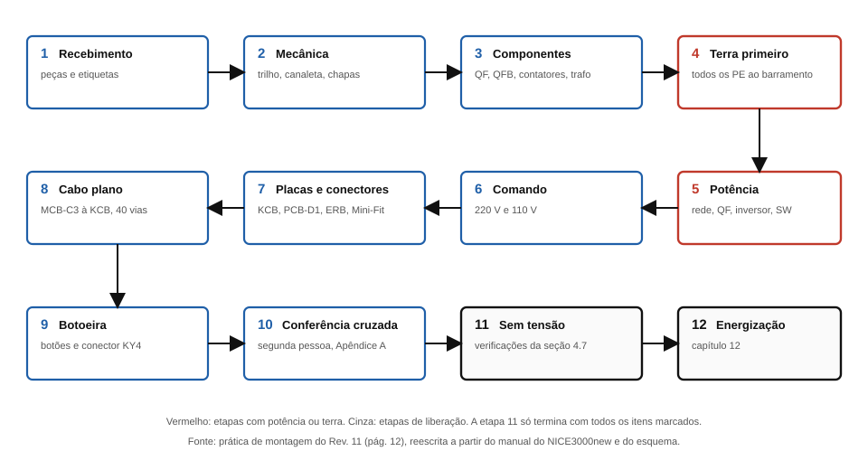

# Capítulo 4. Montagem e pré-energização

> RASCUNHO v0.1 de 15/11/2026. Aguarda aprovação do Gelson e assinatura da Qualidade. Selos abertos: `PREENCHER [Q115]`, `PREENCHER [Q116]` e `PREENCHER [Q117]`. Fontes: manual do NICE3000new (capítulo 2), esquema Vitinho 19061867-ZL, manual do resgate elétrico ERB e a prática de montagem do Rev. 11 (págs. 11 e 12), que o Rev. 12 reaproveita só no que tem fonte.

**Parte II. O quadro de comando**

## 4.1 O que você vai aprender

Ao terminar este capítulo você será capaz de:

1. Separar ferramentas, equipamentos de proteção e materiais antes de começar.
2. Fixar o inversor e dimensionar o ambiente do gabinete.
3. Seguir a ordem de montagem do quadro, do recebimento à conferência cruzada.
4. Passar e fixar os cabos de potência, de controle e de terra com os cuidados do manual.
5. Conectar o cabo plano de 40 vias entre a placa principal e a placa de interface.
6. Fazer as verificações sem tensão e registrar o resultado antes de energizar.

> **PERIGO.** Nesta etapa o quadro está desligado e ainda sem cabos de campo. Mesmo assim, trabalhe com a entrada de alimentação do laboratório desligada e bloqueada, e sinalize "quadro em montagem". O barramento CC do inversor guarda tensão depois de desligado: espere pelo menos 10 minutos e confirme que está abaixo de 36 VCC antes de ligar ou desligar fios (manual NICE3000new, seção 2.2.1).

## 4.2 Antes de começar

**Proteção e segurança.**

1. Use o equipamento de proteção conforme o procedimento da empresa (óculos, calçado de segurança isolante e luvas isolantes para a etapa energizada). As exigências da NR-10: `PREENCHER [Q47]` (capítulo 1).
2. Faça o bloqueio e a etiquetagem da entrada de alimentação do laboratório antes de mexer na potência.
3. Para manusear as placas eletrônicas (MCB-C3, KCB-B4A, PCB-D1 e ERB-A1), siga os procedimentos de descarga eletrostática e use pulseira antiestática. O manual do resgate elétrico pede isso para a fiação (seção 6, "Wiring").
4. Mantenha a bancada limpa. Tampe o topo do inversor durante a instalação para não cair metal, óleo ou água; retire a cobertura depois, para a ventilação.
5. Ao fechar o gabinete, não deixe sobra de fio ou de cobre dentro dele.

**Ferramentas e materiais que o manual determina.**

| Item | Valor | Fonte |
|---|---|---|
| Descasque nos bornes de controle do inversor | 6 mm, com ponteira tubular com luva isolante | manual NICE3000new, Tabela 2-17 e Figura 2-22 |
| Cabo de controle | de 0,2 a 0,75 mm² (AWG 24 a 18), cabo simples ou par trançado | manual, Tabela 2-17 |
| Torque dos bornes de controle do inversor | 0,565 N·m | manual, Tabela 2-17 |
| Torque dos bornes de potência do NICE-L-C-4007 | 2,5 N·m, com terminal GTNR4-5 | manual, Tabela 2-9 |
| Condutor de proteção (PE) | Verde e amarelo; seção igual à do condutor de fase até 16 mm² | manual, Tabela 2-8 |
| Chave de torque | Que cubra de 0,565 a 2,5 N·m (de 4,0 N·m para 10 mm²) | manual, Tabelas 2-9 e 2-17 |

Outros itens da bancada, sem fonte de fabricante: alicate de crimpar para cada terminal do projeto (tubular simples e duplo, forquilha, olhal, faston e Mini-Fit), extrator de pinos Mini-Fit, anilhas ou etiquetas de fio, abraçadeiras, marcador de torque (tinta), multímetro com categoria adequada para 380 V, megôhmetro e ponteira de continuidade. O torque de aperto do QF, dos disjuntores diferenciais, dos minidisjuntores, dos contatores e dos bornes de passagem: `PREENCHER [Q115]`, a ler na etiqueta ou na folha de dados do fabricante.

Fonte: manual NICE3000new, págs. PDF 54, 56 e 63; manual do resgate elétrico, seção 6.

## 4.3 O ambiente e a fixação do inversor

O inversor NICE3000new fica dentro do gabinete, fixo na chapa de fundo, na vertical. O capítulo 3 (seção 3.3) traz as folgas e as dimensões; este capítulo traz o que o manual pede do gabinete como um todo.

| Item | O que o manual pede |
|---|---|
| Altitude | Até 1000 m; acima, reduz 1% a corrente para cada 100 m, até 3000 m |
| Temperatura ambiente | De -10 °C a 50 °C; acima de 40 °C reduz 1,5% da corrente por grau |
| Umidade | Menos de 95% sem condensação |
| Local | Sem luz solar direta, sem gás corrosivo, explosivo ou combustível, sem poeira, óleo ou pó metálico, vibração até 0,6 g |
| Gabinete | O inversor deve ficar dentro de um gabinete com proteção contra fogo, choque e dano mecânico, conforme as leis locais e a IEC |
| Fixação | Quatro parafusos. É proibido fixar só os dois de cima |

**Projeto do gabinete** (manual, seção 2.1.5):

1. A temperatura dentro do gabinete não pode passar 10 °C acima da de fora.
2. Gabinete fechado precisa de ventilador ou outro meio de refrigeração, para circular o ar.
3. O ar do ventilador não deve soprar direto para o inversor, porque junta poeira e pode causar falha.
4. Deixe uma abertura na parte de baixo, para o ar subir de baixo para cima.
5. Se o ventilador não basta, use ar-condicionado no gabinete ou na casa de máquinas; mas a temperatura interna não pode ficar baixa demais, porque a condensação pode causar curto.
6. Em ambiente quente que não dá para esfriar, reduza a corrente do inversor.

O elevador de referência usa um gabinete de 1350 x 350 x 240 mm (desenho de furação DES-FURACAO), conforme o Rev. 11.

Fonte: manual NICE3000new, págs. PDF 39 a 47.

## 4.4 A ordem de montagem

A ordem abaixo é a prática de montagem da VerticalParts (Rev. 11, pág. 12), com as etapas reescritas a partir dos manuais e do esquema. Siga-a de cima para baixo e só passe à etapa seguinte com a anterior pronta. A confirmação de que esta é a ordem oficial da fábrica: `PREENCHER [Q117]`.

| Etapa | Atividade | O que fazer |
|---|---|---|
| 1 | Recebimento | Conferir as peças recebidas com o quadro comparativo da variante. Ler e anotar as etiquetas do inversor, do transformador, do resistor e do motor e freio, se houver |
| 2 | Mecânica | Fixar o trilho, a canaleta e a chapa de suporte da KCB e da botoeira, conforme o desenho de furação. Sem limalha dentro do gabinete |
| 3 | Componentes | Montar o QF, os disjuntores diferenciais (QFB), os minidisjuntores (DQFB), os contatores e blocos auxiliares, o transformador, os bornes e o barramento de terra. Etiquetar cada componente com a sua sigla |
| 4 | Terra primeiro | Ligar todos os condutores de terra (verde e amarelo) ao barramento: inversor, transformador, resgate elétrico, MCB, KCB, PCB-D1, chapa da botoeira e tomada |
| 5 | Potência | Rede para o QF, QF para o inversor (R, S, T); inversor (U, V, W) para o contator SW e depois aos bornes do motor; contator FX; resistor de frenagem em (+) e PB. Torque do manual |
| 6 | Comando em 220 V e 110 V | QFB, DQFB, transformador e as redes de 207, 208, 201, 202, 501 e 502 |
| 7 | Placas e conectores | Fixar a KCB-B4A, a PCB-D1 e o resgate elétrico. Crimpar os pinos Mini-Fit, travá-los nas carcaças e puxar cada pino de leve para testar |
| 8 | Cabo plano de 40 vias | Ligar a MCB-C3 à KCB-B4A (seção 4.6) |
| 9 | Botoeira | Montar os botões na chapa e ligar ao conector KY4 (capítulo 3, seção 3.7). Verificar a função de cada contato |
| 10 | Conferência cruzada | Uma segunda pessoa confere ponta a ponta com o Apêndice A (lista de fios conferida contra o esquema) e assina o registro |
| 11 | Sem tensão | Verificações da seção 4.7. Só avance com todos os itens marcados |
| 12 | Energização | Capítulo 12, seções 12.3 e 12.4 |

**Figura 4.1.** Ordem de montagem do quadro, da mecânica à energização.
Fonte: prática de montagem do Rev. 11, pág. 12, e seções 4.2 a 4.7.

> **ATENÇÃO.** O terra vem primeiro, antes da potência. Sem o terra ligado, uma falha de isolamento energiza a massa do quadro.

Fonte: Rev. 11, pág. 12 (ordem); manual NICE3000new, seção 2.2.1 (terra e potência).

## 4.5 Regras de fiação do manual

**Cabos de potência.**

1. Use condutor de cobre com seção de acordo com a tabela do manual (capítulo 3, seção 3.3: 4 mm² para o NICE-L-C-4007).
2. A ligação do cabo de entrada não tem sequência de fases a respeitar. Nunca ligue o cabo da rede nos bornes de saída U, V e W.
3. Na saída para o motor, não ligue capacitor nem supressor de surto. Use cabo blindado, com a blindagem ligada ao condutor de terra, e o fio de saída da blindagem o mais curto possível.
4. O cabo do resistor de frenagem deve ter menos de 5 m. Ligue-o em (+) e PB, e nunca direto no barramento CC.
5. Se o cabo do motor passa de 100 m, instale um reator de saída perto do inversor.

**Terra (PE).**

1. A resistência do cabo de terra do circuito principal deve ser menor que 10 Ω.
2. Não ligue o terminal de terra ao neutro da alimentação.
3. Use cabo verde e amarelo.
4. Instale o inversor sobre plano metálico condutor, com o fundo todo do inversor em bom contato com a chapa.
5. Se houver filtro, instale-o no mesmo plano do inversor e use cabo de menos de 30 cm entre o filtro e os bornes de entrada.

**Cabos de controle.**

1. Mantenha o cabo do motor longe de todos os cabos de controle. De preferência, passe os cabos do motor, da entrada de rede e de controle em canaletas diferentes.
2. Não passe o cabo do motor e o de controle lado a lado por muito tempo.
3. Se um cabo de controle precisa cruzar o de potência, cruze em ângulo próximo de 90°.
4. Use ponteira tubular com luva isolante, descascando 6 mm.
5. No RS-485, a topologia é "mão na mão" ou em derivação curta (de preferência menos de 3 m). A ligação em estrela é proibida. O resistor de terminação de 120 Ω só se liga nas duas pontas do barramento.

Fonte: manual NICE3000new, págs. PDF 52 a 54, 63 e 68 (seções 2.2.1 a 2.3.4).

## 4.6 O cabo plano de 40 vias entre a MCB-C3 e a KCB-B4A

O cabo plano de 40 vias sai do conector de entradas e saídas da placa MCB-C3 (dentro do inversor) e entra na placa de interface KCB-B4A. É um cabo pronto, ligado pino a pino, 1 para 1 (X1 com X1, até MOD1- com MOD1-). Não se corta nem se refaz fio nele. Todos os fios de campo saem da KCB, não do cabo plano.

| Grupo | Sinais | Observação |
|---|---|---|
| Entradas X1 a X22 | 22 entradas do inversor | O esquema (folha /13) dá a função de cada uma |
| Saídas W | 7 saídas do inversor (W1 a W6, incluindo W2A) | Passam pelos blocos Y1 a Y7 da KCB |
| Alimentação e comunicação | +24V, W7, M24, MCM (3 pinos), +12V, CAN+, CAN-, MOD1+ e MOD1- | 11 pinos, para completar 40 |

Funções das entradas que o esquema atribui às chaves de desaceleração (conectores BD e BE da KCB): **X14** é a desaceleração de subida 1 (ULS1), **X15** é a de descida 1 (DLS1), **X16** é a de subida 2 (ULS2) e **X17** é a de descida 2 (DLS2). Outras entradas citadas no esquema: X4 (bypass, plugue S1/5), X6, X7 e X8 (retorno dos contatores SW, BY e FX), X9 (inspeção), X10 e X11 (subir e descer em inspeção), X18 e X22 (retorno dos contatos do freio) e X20 (sobretemperatura do motor).

> **NOTA.** O alinhamento de M24, MCM e +12V com os bornes 301, 302 e T02 da KCB é provável pelo desenho; confirme na folha /13. O Rev. 11 tinha X15 e X16 trocados (o livro antigo punha X15 como subida 2 e X16 como descida 1). Vale o esquema, conforme a auditoria do Rev. 11.

**Conferência do cabo plano.**

1. O pino 1 do cabo (marca ou fio de referência) fica alinhado com o pino 1 impresso nas duas placas. O cabo vai reto, sem torção e sem dobra aguda.
2. Encaixe os dois conectores até travar. Nenhum pino dobrado ou fora da carcaça.
3. Teste de continuidade 1 para 1, ponta a ponta, nos 40 pinos, sem curto entre pinos vizinhos.

Fonte: esquema Vitinho 19061867-ZL, folhas /13, /14 e /20 (págs. PDF 15, 16 e 22); auditoria do Rev. 11, lote 7a.

## 4.7 Verificações sem tensão

Tudo desligado, nenhum cabo de campo conectado, QF, disjuntores diferenciais e minidisjuntores em OFF e a entrada do laboratório bloqueada.

| Verificação | Valor esperado | Fonte |
|---|---|---|
| Terminais, forquilhas, ponteiras e pinos Mini-Fit | Puxão leve em todos: nenhum solto | prática de montagem, Rev. 11 |
| Cada ponta da lista de fios | Conferida contra o esquema, com o resultado marcado | Apêndice A |
| Fio preso ou pinçado na canaleta; cobre exposto | Nenhum | prática de montagem, Rev. 11 |
| Torque dos bornes de potência e de controle do inversor | 2,5 N·m (4007) e 0,565 N·m; os demais componentes: `PREENCHER [Q115]` | manual, Tabelas 2-9 e 2-17 |
| Resistência do terra | Cabo de terra do circuito principal abaixo de 10 Ω | manual, seção 2.2.1 (terminal PE) |
| Curto entre fases e para o terra: R, S, T; U, V, W; as redes 301 e 302, 201 e 202, 501 e 502, 207 e 208; 24 V positivo e negativo | Nenhuma continuidade | manual, seção 5 (capítulo 12, seção 12.3) para R, S, T, U, V, W, 24 V, 220 V e CAN e Modbus; prática do Rev. 11 para 301 e 302, 201 e 202, 501 e 502 e 207 e 208 |
| Resistência CAN+ para CAN- | Cerca de 60 Ω (dois terminadores de 120 Ω em paralelo); se for menor que 50 Ω, há resistor a mais | manual, pág. PDF 73 |
| Resistência MOD+ para MOD- (RS-485) | Cerca de 60 Ω, com todos os equipamentos desligados | manual, pág. PDF 71 |
| Isolação à terra dos circuitos de potência, de comando e do freio | Valor mínimo: `PREENCHER [Q116]` | sem fonte lida |
| Cabo plano de 40 vias | 40 pinos conferidos 1 para 1, sem pino dobrado e com as travas fechadas | esquema /13 e /14 |
| Plugues S1 e S2 da KCB | Posição dos jumpers: capítulo 3, seção 3.4 (confirmação pendente: `PREENCHER [Q83]`) | esquema |
| Transformador | Bornes de primário e de secundário conferidos com a etiqueta (capítulo 3, seção 3.8) | esquema, folhas /7 e /8 |
| Placas | Sem componente solto; conectores Mini-Fit travados e sem pino invertido | prática de montagem, Rev. 11 |

> **ATENÇÃO.** Não ponteie a cadeia de segurança nem o circuito de fechaduras para "testar". O manual proíbe o comissionamento em velocidade normal com a cadeia de segurança em curto (capítulo 12, seção 12.3).

Quando todos os itens estiverem marcados, siga para o capítulo 12 (seções 12.3 e 12.4), para a verificação de segurança e a energização.

Fonte: manual NICE3000new, págs. PDF 54, 71, 73 e 143 a 145; esquema Vitinho; Rev. 11, pág. 12.

## 4.8 Registro da montagem

Cada quadro montado tem um registro com:

1. Número de série do quadro e variante (potência e tensão).
2. Etiquetas lidas no recebimento: inversor, transformador, resistor e, se houver, motor e freio.
3. Data, nome e assinatura de quem montou e de quem fez a conferência cruzada.
4. Resultado de cada verificação da seção 4.7, com os valores medidos.
5. Observações e desvios.

> **NOTA.** Quem assina a liberação do quadro: a Qualidade, como departamento, sem nomes no livro. Os critérios de aceitação do capítulo de qualidade estão em espera (Q49 a Q52).

Fonte: prática de montagem, Rev. 11; `STANDBY.md`.

## 4.9 Se o seu elevador tiver outra configuração

| Se o seu elevador tiver | O que muda |
|---|---|
| Variante de 15 kW em 380 V (NICE-L-C-4015) | Cabo de potência de 6 mm² e torque de 2,5 N·m (Tabela 2-9) |
| Variantes de 220 V | Outros inversores, seções e torques; adendo futuro |
| Gabinete de outro tamanho | Reavalie a ventilação (seção 4.3) e as folgas do inversor (capítulo 3) |
| Casa de máquinas | As fixações do gabinete e da botoeira mudam; as regras de fiação, não |

Fonte: manual NICE3000new, Tabelas 2-8 e 2-9.

## 4.10 Teste o que você aprendeu

1. Por que o terra é ligado antes da potência? *(Seção 4.4: sem terra, uma falha de isolamento energiza a massa do quadro.)*
2. Quanto de condutor se descasca no borne de controle e qual o torque? *(Seção 4.2: 6 mm e 0,565 N·m.)*
3. Qual deve ser a resistência entre CAN+ e CAN-, medida com tudo desligado? *(Seção 4.7: cerca de 60 Ω.)*
4. O que acontece se o cabo do resistor de frenagem passar de 5 m? *(Seção 4.5: pode danificar o inversor.)*
5. O que o cabo plano de 40 vias liga e como se verifica? *(Seção 4.6: a MCB-C3 à KCB-B4A, pino a pino 1 para 1, e continuidade nos 40 pinos.)*
6. Quanto tempo se espera antes de mexer nos fios do inversor? *(Seção 4.1: pelo menos 10 minutos, com a tensão abaixo de 36 VCC.)*

## Fontes do capítulo

- Manual NICE3000new, `Manual_Usuario_Controlador_NICE3000new_Completo.pdf`, capítulo 2, págs. PDF 39 a 74 (impressas 38 a 73); capítulo 5, págs. PDF 143 a 145.
- Esquema Vitinho 19061867-ZL, folhas /7, /8, /13, /14 e /20.
- Manual do resgate elétrico MCTC-ERB-A, seção 6.
- Livro do Quadro de Comando Rev. 11, págs. 11 e 12 (prática de montagem, só no que tem fonte), e `auditoria/lote7a_livro_p7_a_p42.md`.
