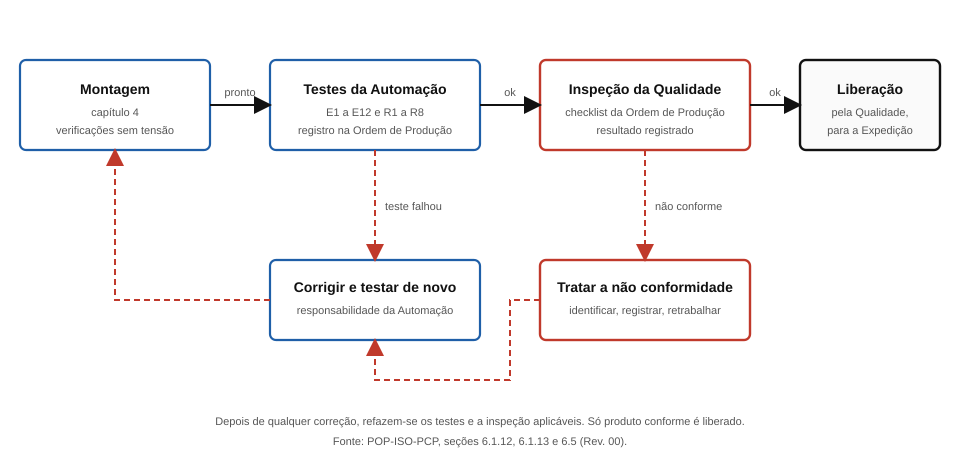

# Capítulo 5. Testes de bancada e relatório de CQ

> VERSÃO v0.2 de 15/11/2026. Aprovado pelo Gelson em 15/11/2026; aguarda a assinatura da Qualidade. Selos abertos: `PREENCHER [Q118]` e `PREENCHER [Q119]`. Fontes: POP-ISO-PCP (Rev. 00, 14/09/2026), manual do NICE3000new, manual do resgate elétrico ERB, esquema Vitinho 19061867-ZL e os testes E1 a E12 e R1 a R8 do Rev. 11 (págs. 32 e 33), conferidos pela auditoria do Rev. 11.

**Parte II. O quadro de comando**

## 5.1 O que você vai aprender

Ao terminar este capítulo você será capaz de:

1. Dizer quem faz cada etapa entre a montagem e a liberação do quadro.
2. Preparar a bancada e fazer os testes de energização do quadro, sem carga e com motor e freio desconectados.
3. Testar o resgate elétrico e a bateria.
4. Entender o que a Qualidade verifica antes de liberar o quadro e como se trata uma não conformidade.
5. Preencher o relatório de CQ.

> **PERIGO.** Este capítulo é a primeira vez que o quadro recebe tensão. Antes de ligar, faça todas as verificações sem tensão do capítulo 4 (seção 4.7). Use os equipamentos de proteção, trabalhe com a alimentação do laboratório sob controle e **não ponteie a cadeia de segurança nem o circuito de fechaduras** para testar (capítulo 1).

> **ATENÇÃO.** Nos testes E1 a E7, o motor e o freio ficam desconectados (bornes do motor e plugue MT abertos). Só os conecte na etapa E11.

## 5.2 Quem faz o quê

O procedimento da empresa (POP-ISO-PCP, seções 6.1.12 e 6.1.13) define o caminho do quadro depois da montagem:

1. A **Automação** realiza os testes definidos para o quadro de comando. Os critérios e testes aplicáveis são definidos pelo responsável técnico da Automação e incorporados à Ordem de Produção. Os resultados são registrados na Ordem de Produção ou no documento definido para isso.
2. O quadro só vai para a **Qualidade** depois de concluídos os testes aplicáveis. A conclusão satisfatória dos testes é registrada antes da inspeção final.
3. A **Qualidade** faz a inspeção final com o checklist definido na Ordem de Produção ou em documento aplicável, e registra o resultado.
4. Só produto conforme recebe a liberação final para a Expedição. A liberação final é responsabilidade da Qualidade.
5. Se algum teste falhar, o quadro continua com a Automação para corrigir e testar de novo. Se a Qualidade achar uma não conformidade, o quadro não é liberado até a situação ser tratada e a conformidade, verificada de novo.

**Figura 5.1.** Caminho do quadro: montagem, testes da Automação, inspeção e liberação pela Qualidade, expedição, com o retorno em caso de falha ou não conformidade.
Fonte: POP-ISO-PCP, seções 6.1.12, 6.1.13 e 6.5.

> **NOTA.** O POP que o livro tem está em Revisão 00, com o código "POP-ISO-PCP-xxx". Se ele foi aprovado e qual é o código final: `PREENCHER [Q119]`.

Fonte: POP-ISO-PCP, págs. 8 a 10 (seções 6.1.12, 6.1.13 e 6.5).

## 5.3 Preparação da bancada

1. Confirme que as verificações sem tensão do capítulo 4 (seção 4.7) estão concluídas e registradas.
2. Confirme que a origem dos 220 V de comando está definida para a variante (Apêndice C, pendência P2). Sem isso, não ligue os disjuntores de comando (testes E3, E4 e E8).
3. Confirme que o motor e o freio estão desconectados (E1 a E7) e que nenhum cabo de campo está ligado.
4. Tenha à mão o esquema, o manual do inversor e o formulário de registro (seção 5.7).
5. Meça com multímetro de categoria adequada à rede de 380 V.

Fonte: manual do NICE3000new, capítulo 5 (capítulo 12 deste livro, seção 12.3); Rev. 11, pág. 32.

## 5.4 Testes de energização do quadro (E1 a E12)

Faça os testes em ordem. Registre o valor medido e marque OK. O que o esquema ou o manual não dá como valor fica como `PREENCHER [Q118]`: os critérios são definidos pela Automação (POP-ISO-PCP, seção 6.1.12).

| Etapa | Ação | Medir ou observar | Esperado | Medido | OK |
|---|---|---|---|---|---|
| E1 | Tudo desligado. Medir a rede nos bornes XA | R-S, S-T, R-T e R-N | 380 a 440 V ou 220 a 240 V, conforme a variante. R-N: ver pendência P2 | | [ ] |
| E2 | Ligar o QF | R, S e T no inversor; display do inversor | Tensão da rede; display acende | | [ ] |
| E3 | Ligar o QFB2 e o DQFB2 (só depois de resolvida a P2) | 201 e 202 na KCB (KY5/1 e KY5/5) | 220 V nominal | | [ ] |
| E4 | Medir 207 e 208 | KY6/1 e KY6/2; tensão em J2 da PCB-D1 | 220 V nominal | | [ ] |
| E5 | Medir o secundário do transformador sem carga; ligar o QFB1 e o DQFB1 | 125V e 0S; 101B e 102 | Valor da etiqueta do transformador: `PREENCHER [Q118]` | | [ ] |
| E6 | Medir 301 e 302 | KY3/1 e KY3/2 (da PCB-D1, J4/1 e J4/4, para a KCB) | 24 VCC, ajustável de 24 a 30 V no parâmetro B0-03 | | [ ] |
| E7 | Freio sem a bobina ligada: medir BK1+ e BK- e BK2+ e BK- | Saída da PCB-D1 (J3) | Padrão de fábrica 110 VCC; faixa de 48 a 207 VCC. Ajuste B0-00 e B0-01 à etiqueta do freio (`PREENCHER [Q84]`) | | [ ] |
| E8 | Ligar o QFB3 e o DQFB3 | 501 e 502 em POW1 e no resgate elétrico | 220 V nominal | | [ ] |
| E9 | Conferir a comunicação CAN entre a KCB e a PCB-D1 | Indicador e erro da PCB-D1 e do inversor | Sem erro de comunicação: `PREENCHER [Q118]` | | [ ] |
| E10 | Inspeção no comando, fora da zona de porta | Indicadores das entradas da MCB, pelo cabo plano | Acesos X4, X6, X7, X12, X14 e X15 (esquema, folha /13) | | [ ] |
| E11 | Conectar o motor e o freio. Inspeção, baixa velocidade, sem carga | Sentido, ruído, corrente, o freio abre e fecha | `PREENCHER [Q118]` | | [ ] |
| E12 | Resgate elétrico e botoeira em inspeção | Funcionamento conforme o esquema VerticalParts 19060918-ZL (págs. PDF 6 e 16) | `PREENCHER [Q118]` | | [ ] |

> **ATENÇÃO.** No E5, E6 e E7 há 220 V e tensão contínua nos bornes. Meça com a ponteira nos pontos indicados, sem tocar em mais nada, e desligue antes de trocar a ponteira de posição.

Em caso de dúvida sobre os valores de parâmetros do inversor, use o capítulo 12 e o manual do NICE3000new; este capítulo não reproduz parâmetros.

Fonte: Rev. 11, pág. 32 (E1 a E12), conferida pela auditoria (E6 corrigido: os 24 V saem da PCB-D1 para a KCB); manual do NICE3000new, Tabela 1-1; esquema Vitinho, folhas /4, /10, /11 e /13.

## 5.5 Teste do resgate elétrico e da bateria (R1 a R8)

Faça este teste depois de E1 a E12, com o freio e o motor conforme a etiqueta. Registre cada medição. A descrição do equipamento e da sequência de liberação está no capítulo 14.

| Etapa | Ação | Esperado | Medido | OK |
|---|---|---|---|---|
| R1 | Conferir a bateria ligada, com a polaridade certa (vermelho no positivo). Energizar 501 e 502 por 12 h, no primeiro uso | Indicador amarelo: aceso fixo = bateria cheia; piscando devagar = carregando | | [ ] |
| R2 | Medir a resistência da bobina do freio, desconectada | Pelo menos 27,5 Ω (110 V dividido pela corrente máxima de 4 A) | | [ ] |
| R3 | Com a rede ligada, medir a tensão entre L e N do resgate | De 187 a 242 V CA (220 V com -15% e +10%) | | [ ] |
| R4 | Com a rede ligada, ver os indicadores em repouso | Indicador vermelho apagado | | [ ] |
| R5 | Tirar o plugue SZ1 do SZ2 e o MT do MT1 (esquema, folha /23); desligar a rede (QFB3); apertar Start e Common (fora da zona de porta) | Indicador verde acende; ZQ+ e ZQ- com cerca de 110 V por 2 s e depois 80 V | | [ ] |
| R6 | Repetir com Forced e Common (em zona de porta) | Idem | | [ ] |
| R7 | Recolocar os plugues SZ1 e MT na posição normal; religar o QFB3 | Funcionamento normal | | [ ] |
| R8 | Anotar na etiqueta do resgate a data do teste e a da última carga da bateria | Próxima verificação em seis meses | | [ ] |

> **NOTA.** A porta de cabina precisa estar fechada para o resgate emitir a tensão de liberação (sinal de fechadura, MS+ e MS-). O ciclo de liberação tem limite: depois de três ciclos seguidos, espere 10 minutos (capítulo 14, seção 14.6). O indicador azul mostra se o elevador estava em zona de porta **quando a rede falhou**; em repouso, com a rede ligada, ele não tem valor esperado fixo.

Fonte: manual do resgate elétrico MCTC-ERB-A, págs. PDF 1 e 2; esquema Vitinho, folha /23; Rev. 11, pág. 33, com R3 corrigido (a faixa é 187 a 242 V, não 187 a 253 V) e R4 corrigido pela auditoria.

## 5.6 Inspeção e liberação pela Qualidade

Depois dos testes da Automação, a Qualidade inspeciona o quadro com o checklist da Ordem de Produção. O POP lista o que o checklist pode cobrir, conforme aplicável:

| Item | O que se verifica |
|---|---|
| Identificação | Etiquetas, número de série, variante |
| Integridade | Ausência de dano, peças soltas, fio pinçado |
| Aspecto visual | Aparência geral do quadro |
| Montagem | Fixação dos componentes, trilhos, canaletas, chapas |
| Componentes | Conforme a lista de materiais da variante |
| Conexões | Aperto, terminais, conectores travados |
| Acabamento | Mão de obra visível, organização da fiação |
| Requisitos específicos do cliente | Conforme a Ordem de Produção |
| Registros dos testes | Os testes da seção 5.4 e 5.5 estão registrados e dentro do esperado |

Os critérios específicos de cada item são **definidos pela empresa**: `PREENCHER [Q119]`. O capítulo de qualidade do equipamento e dos acabamentos, com critérios e fotos de peça conforme e não conforme, está em espera (STANDBY.md, perguntas Q49 a Q52).

**Se a Qualidade achar uma não conformidade:**

1. Identifique o quadro afetado e impeça-o de seguir para a etapa seguinte até definir a disposição.
2. Registre a ocorrência, conforme o procedimento interno de controle de não conformidades.
3. Corrija ou retrabalhe. Depois da correção, refaça os testes e a inspeção aplicáveis.
4. Só a Qualidade libera o quadro, depois de verificar a conformidade.

Fonte: POP-ISO-PCP, seções 6.1.13 e 6.5 (págs. 9 e 10).

## 5.7 O relatório de CQ

Cada quadro tem um relatório de CQ, que acompanha a Ordem de Produção. Ele reúne os registros dos testes e o resultado da inspeção. O modelo abaixo reúne o que o POP e este capítulo pedem registrar.

| Campo | Conteúdo |
|---|---|
| Identificação | Número da Ordem de Produção, número de série do quadro, variante (potência e tensão), data |
| Responsáveis | Quem montou, quem conferiu (conferência cruzada), quem testou (Automação) e quem inspecionou (Qualidade), com data e assinatura |
| Etiquetas lidas | Inversor, transformador, resistor e, se houver, motor e freio |
| Verificações sem tensão | Resultado de cada item da seção 4.7 do capítulo 4 |
| Testes E1 a E12 | Valor medido, resultado (OK ou não) e observação |
| Testes R1 a R8 | Valor medido, resultado e observação; data da última carga da bateria |
| Evidências | Fotos e vídeos, conforme aplicável |
| Alterações | Componente previsto, componente usado, motivo, justificativa técnica e quem autorizou (POP, seção 6.4) |
| Não conformidades | Descrição, disposição, retrabalho e novo teste |
| Resultado da Qualidade | Conforme ou não conforme, com data; só conforme libera para a Expedição |

> **NOTA.** Os nomes e assinaturas ficam no relatório do quadro, não neste livro. Neste livro, a Qualidade aparece só como departamento.

Fonte: POP-ISO-PCP, seções 6.1.6, 6.1.12, 6.1.13 e 6.4.

## 5.8 Se o seu elevador tiver outra configuração

| Se o seu elevador tiver | O que muda nos testes |
|---|---|
| Variantes de 220 V | As faixas de tensão de E1 e os testes de potência; adendo futuro |
| ERB-A2 (sem bateria) | R1 e R8 não se aplicam à bateria; use a bateria externa do usuário |
| Sem resgate elétrico | R1 a R8 não se aplicam; confira o equipamento reserva (capítulo 14, seção 14.8) |
| Freio com bobina de outra tensão | E7 e R2 mudam: use os dados da etiqueta do freio |

Fonte: manual do NICE3000new, Tabela 1-1; manual do resgate elétrico.

## 5.9 Teste o que você aprendeu

1. Quem define os critérios dos testes de bancada? *(Seção 5.2: o responsável técnico da Automação.)*
2. Em que etapa o motor e o freio são conectados? *(Seção 5.1 e 5.4: só na etapa E11.)*
3. Quais tensões o resgate elétrico deve emitir no teste R5? *(Seção 5.5: cerca de 110 V por 2 s e depois 80 V.)*
4. Quem libera o quadro para a Expedição? *(Seção 5.2: a Qualidade, depois de testes satisfatórios e do checklist conforme.)*
5. O que acontece se um teste falhar? *(Seção 5.2: o quadro continua com a Automação, para corrigir e testar de novo.)*
6. Qual é a faixa de entrada do resgate elétrico em R3? *(Seção 5.5: de 187 a 242 V.)*

## Fontes do capítulo

- POP-ISO-PCP, "Planejamento, produção e controle de quadros de comando", Rev. 00, 14/09/2026, seções 6.1.6, 6.1.12, 6.1.13, 6.4 e 6.5.
- Manual do NICE3000new, `Manual_Usuario_Controlador_NICE3000new_Completo.pdf`, Tabela 1-1.
- Manual do resgate elétrico MCTC-ERB-A, págs. PDF 1 e 2.
- Esquema Vitinho 19061867-ZL, folhas /4, /10, /11, /13 e /23.
- Livro do Quadro de Comando Rev. 11, págs. 32 e 33 (E1 a E12 e R1 a R8), com as correções de `auditoria/lote7a_livro_p7_a_p42.md`.
