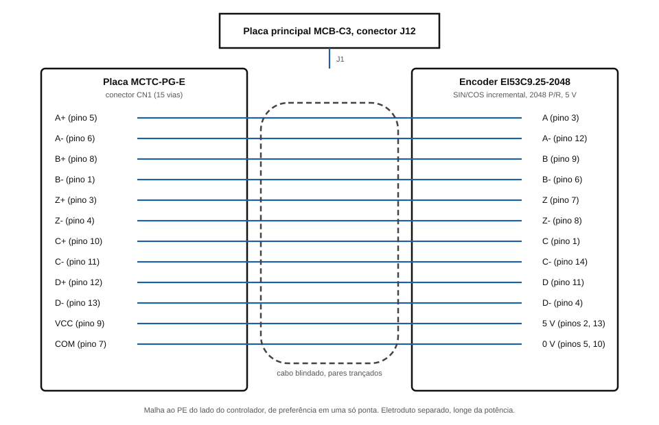
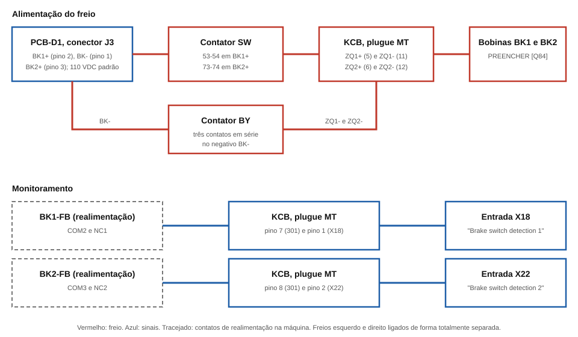

# Capítulo 7. Motor, freio e encoder

> RASCUNHO v0.1 de 14/11/2026. Aguarda aprovação do Gelson e assinatura da Qualidade. Selos abertos: `PREENCHER [Q84]`, `PREENCHER [Q95]` e `PREENCHER [Q96]`. Não há, na base de conhecimento, manual nem folha de dados da máquina de tração: os dados dela vêm do esquema e do que o controlador exige.

**Parte III. Instalação em campo**

## 7.1 O que você vai aprender

Ao terminar este capítulo você será capaz de:

1. Dizer como o inversor se liga à máquina de tração e o que protege o motor.
2. Ligar o encoder à placa PG, sinal a sinal, e aplicar as regras de cabo e de aterramento do fabricante.
3. Dizer como o freio é alimentado, comandado e monitorado.
4. Saber de onde vêm os dados do motor e do freio de que o comissionamento precisa.

O elevador de referência tem máquina de tração síncrona de ímã permanente de 7,5 kW, sem casa de máquinas, com encoder SIN/COS.

> **PERIGO.** Antes de ligar ou mexer nos cabos do motor, do freio ou do encoder, desligue toda a alimentação e espere no mínimo 10 minutos. Nunca ligue a rede aos bornes U, V e W. Fonte: manual NICE3000new, págs. PDF 20 e 21.

## 7.2 A máquina de tração

**Ligação de potência.** O inversor entrega U, V e W ao contator de marcha SW. Do SW os três fios seguem pela régua de bornes TA e depois pelos bornes XA U, V e W até os terminais U1, V1 e W1 do motor. O motor tem terminal de terra (PE). Entre o SW e o motor, o contator FX liga as fases entre si quando está desenergizado. Fonte: esquema Vitinho 19061867-ZL, folha /9 (pág. PDF 11).

**Contator FX.** O esquema marca o FX como "Add when synchronous": ele só existe para motor síncrono, e é o caso do elevador de referência. O contator liga as três fases do motor entre si, o que o capítulo 3 explica. Fonte: esquema Vitinho, folhas /9 e /17.

**Proteção térmica.** O esquema mostra, na máquina, um contato de proteção térmica do motor ("Motor overheating detection", PT1). Ele fecha o circuito entre os bornes XA COM1 e PT1 e leva o sinal à entrada X20 da KCB, pelo plugue MT (pino 9 em 301 e pino 3 em X20). A tabela de entradas do esquema chama o X20 de "Motor overheating protection" (proteção de superaquecimento do motor). Fonte: esquema Vitinho, folhas /9 e /21 (págs. PDF 11 e 23).

**Resistor de frenagem.** Fica numa caixa à parte (DBR-B), ligada aos bornes (+) e PB do inversor. O manual recomenda de 65 a 85 ohm e 2500 W para o NICE-L-C-4007, com cabo de menos de 5 m. Fonte: manual NICE3000new, Tab. 3-12, pág. PDF 100; esquema, folha /9.

**Dados da máquina.** Modelo, tensão, corrente, frequência, rotação nominal, número de polos e torque da máquina de tração do elevador de referência: `PREENCHER [Q95]`. Esses dados vão em F1-01 a F1-05 no autoajuste (capítulo 12).

> **ATENÇÃO.** A sequência de fases do motor precisa ser a correta. Uma sequência errada faz o motor girar ao contrário e pode gerar falha. O manual manda trocar a sequência UVW do motor quando a falha de sobrecorrente na aceleração (Err02) tem essa causa. Fonte: manual NICE3000new, pág. PDF 20 e tabela de falhas, pág. PDF 268.

## 7.3 O encoder

**O que é o encoder do elevador de referência.** O modelo previsto é o EI53C9.25-2048-SA5N2TH, da Weton, um encoder óptico **incremental**, de 2048 pulsos por rotação, com saída senoidal diferencial (SIN/COS). Na etiqueta dele aparece o modelo SC53H. Que o motor do elevador de referência use esse encoder: `PREENCHER [Q96]`.

| Dado | Valor |
|---|---|
| Alimentação | 5 V, tolerância de 5% |
| Corrente consumida | até 200 mA |
| Resolução | 2048 pulsos por rotação |
| Sinal de saída | seno e cosseno diferencial, amplitude de 1 V pico a pico (±0,2 V) |
| Sinal de índice Z | amplitude de 200 mV ou mais |
| Frequência de resposta | até 50 kHz |
| Rotação máxima | 2000 rpm |
| Distância máxima de transmissão | 15 m |
| Ambiente | de -20 a +100 °C, grau de proteção IP40 |

Fonte: manual do encoder `Manual_Encoder_Seno_Cosseno_EI53C9.25-2048.pdf`, págs. PDF 1 e 2.

**Pinagem do encoder** (conector retangular, ligação por trás), conforme a etiqueta do manual do encoder:

| Sinal | Pino | Sinal | Pino |
|---|---|---|---|
| A | 3 | C | 1 |
| A- | 12 | C- | 14 |
| B | 9 | D | 11 |
| B- | 6 | D- | 4 |
| Z | 7 | 5 V | 2 e 13 |
| Z- | 8 | 0 V | 5 e 10 |

A malha do cabo (SHIELD) tem terminal próprio. Fonte: manual do encoder, pág. PDF 1, Figura 1-1.

**A placa PG.** Para esse tipo de encoder, o manual do controlador indica a placa **MCTC-PG-E**, que se adapta ao encoder SIN/COS ERN1387 e ao Weton SC53. A placa PG liga a placa principal pelo terminal J1 (lado da PG) ao J12 da MCB, e o encoder, pelo conector CN1 de 15 vias. O esquema mostra o mesmo (PG-E, J1 e J12). A nota 1 do esquema escreve "J2" no lugar de "J12": o manual e o desenho trazem J12. Existe também a placa MCTC-PG-A2 para motor assíncrono, e a PG-D, para encoder UVW ou ABZ. Fonte: manual NICE3000new, págs. PDF 113, 131 e 132; esquema Vitinho, folha /9.

**Ligação da PG-E ao encoder.** A tabela mostra o sinal de cada pino do CN1 da PG-E (manual, Figura 3-29) e o pino do encoder que leva o mesmo nome de sinal (manual do encoder). A correspondência é por nome de sinal. Confira a etiqueta do encoder e a do cabo antes de ligar.

| Sinal | Pino da PG-E (CN1) | Pino do encoder |
|---|---|---|
| A+ | 5 | 3 (A) |
| A- | 6 | 12 (A-) |
| B+ | 8 | 9 (B) |
| B- | 1 | 6 (B-) |
| Z+ | 3 | 7 (Z) |
| Z- | 4 | 8 (Z-) |
| C+ | 10 | 1 (C) |
| C- | 11 | 14 (C-) |
| D+ | 12 | 11 (D) |
| D- | 13 | 4 (D-) |
| VCC (5 V) | 9 | 2 e 13 |
| COM (0 V) | 7 | 5 e 10 |

Fonte: manual NICE3000new, pág. PDF 132 (Figura 3-29, pinos do CN1) e esquema Vitinho, folha /9 (pinos CN1:1 a CN1:13); manual do encoder, pág. PDF 1.

> **ATENÇÃO.** O manual do controlador dá três regras para o cabo entre a placa PG e o encoder: (1) ele deve ficar separado dos cabos de controle e de potência, e é proibido passá-lo em paralelo e próximo a eles; (2) deve ser blindado, com a malha ligada ao PE do lado do controlador, e para reduzir interferência recomenda-se aterrar uma só ponta; (3) deve passar por um eletroduto separado, com a carcaça metálica bem aterrada. Fonte: manual NICE3000new, pág. PDF 133.

**Figura 7.1.** Ligação da placa PG-E ao encoder SIN/COS.
Fonte: manual NICE3000new, págs. PDF 132 e 133; esquema Vitinho, folha /9; manual do encoder, pág. PDF 1.

## 7.4 Parâmetros do encoder e do motor

Os parâmetros que dizem ao controlador qual é o motor e o encoder são ajustados no comissionamento: F1-00 (tipo de encoder, com 0 para SIN/COS), F1-01 a F1-05 (dados do motor), F1-12 (pulsos por rotação do encoder) e F1-25 (tipo de motor, com 1 para síncrono). O procedimento está no capítulo 12.

## 7.5 O freio

A máquina do esquema tem **duas bobinas de freio** (BK1 e BK2), com um contato de realimentação cada (BK1-FB e BK2-FB). O esquema manda ligar os freios esquerdo e direito do lado da máquina de forma totalmente separada. Fonte: esquema Vitinho, folha /13 (pág. PDF 15).

**Alimentação e comando.**

1. A placa PCB-D1 gera a tensão do freio: ajustável de 48 a 207 VDC, padrão 110 VDC. A corrente de impacto máxima é de 6 A e a de manutenção máxima, de 4 A.
2. Os parâmetros B0-00 (tensão de impacto), B0-01 (tensão de manutenção) e B0-02 (tempo de corte da manutenção, de 0 a 5 s, padrão 3 s) definem o comportamento. A tensão de manutenção não pode ser maior que a de impacto.
3. O positivo de cada bobina passa por um contato auxiliar do contator de marcha SW (53-54 para BK1+ e 73-74 para BK2+). O negativo (BK-) passa por três contatos do contator de freio BY, em série.
4. Os sinais chegam à máquina pelo plugue MT da KCB: pinos 5 e 11 para a bobina BK1 (ZQ1+ e ZQ1-) e pinos 6 e 12 para a BK2 (ZQ2+ e ZQ2-).
5. Na KCB o desenho mostra diodos (D9 e D26) e resistores (R22, R220, R21 e R23) ligados aos nós ZQA1 e ZQA2. O desenho não descreve a função deles.

**Monitoramento.** O contato de realimentação do freio 1 (BK1-FB, terminais COM2 e NC1) liga o pino 7 (301) ao pino 1 (X18) do plugue MT. O do freio 2 (BK2-FB, COM3 e NC2) liga o pino 8 (301) ao pino 2 (X22). X18 e X22 são as entradas "Brake switch detection 1" e "Brake switch detection 2" da KCB. Fonte: esquema Vitinho, folhas /13 e /21 (págs. PDF 15 e 23).

Tensão de freio ajustada, tensão e corrente da bobina do freio da máquina de referência: `PREENCHER [Q84]`.

> **ATENÇÃO.** O resgate elétrico (ERB-A1) só libera freios com tensão de partida de até 110 VDC e de manutenção de até 80 VDC, e corrente de excitação de até 4 A. Confirme os dados do freio da máquina de referência antes de depender do resgate elétrico. Fonte: manual do resgate elétrico, pág. PDF 1; esquema, folha /23.

**Figura 7.2.** Caminho do freio: alimentação, contatos, plugue MT, bobinas e realimentação.
Fonte: esquema Vitinho, folha /13 (pág. PDF 15).

## 7.6 Se o seu elevador tiver outra configuração

| Se o seu elevador tiver | O que muda neste capítulo |
|---|---|
| Motor assíncrono | Sem o contator FX; placa PG-A2 (encoder incremental de coletor aberto ou push-pull) ou outra; F1-25 diferente |
| Encoder UVW ou ABZ | Placa MCTC-PG-D; F1-00 diferente |
| Encoder absoluto Endat | Placa MCTC-PG-F1; F1-00 igual a 3; o autoajuste estático também está disponível |
| Um só freio | O esquema trata duas bobinas; confirme o número de bobinas da sua máquina |
| Casa de máquinas (MR) | O esquema tem folha própria de potência (folha /7); a ligação do motor é a mesma |

Fonte: manual NICE3000new, págs. PDF 113, 131 e 150 a 153; esquema Vitinho, folhas /7 e /9.

## 7.7 Teste o que você aprendeu

1. Que placa PG se usa com encoder SIN/COS? *(Seção 7.3: a MCTC-PG-E.)*
2. Em qual conector da MCB a placa PG se liga? *(Seção 7.3: J12.)*
3. Como se aterra a malha do cabo do encoder? *(Seção 7.3: ao PE do lado do controlador, de preferência em uma só ponta.)*
4. Por quais contatos passa o positivo e o negativo de cada bobina do freio? *(Seção 7.5: SW 53-54 e 73-74 no positivo; três contatos do BY em série no negativo.)*
5. O que acontece com a tensão do freio se B0-01 for maior que B0-00? *(O manual proíbe: a tensão de manutenção não pode ser maior que a de impacto.)*

## Fontes do capítulo

- Esquema Vitinho 19061867-ZL (2023-07-18), folhas /7, /9, /13, /17, /21 e /23.
- Manual NICE3000new, `Manual_Usuario_Controlador_NICE3000new_Completo.pdf` (368 páginas, edição 20181130), págs. PDF 20, 21, 100, 113, 131 a 133, 150 a 153, 268.
- Manual do encoder `Manual_Encoder_Seno_Cosseno_EI53C9.25-2048.pdf`, págs. PDF 1 e 2.
- Manual do resgate elétrico `Manual_Dispositivo_Resgate_Eletrico_ERB-A1_EN.pdf`, pág. PDF 1.
