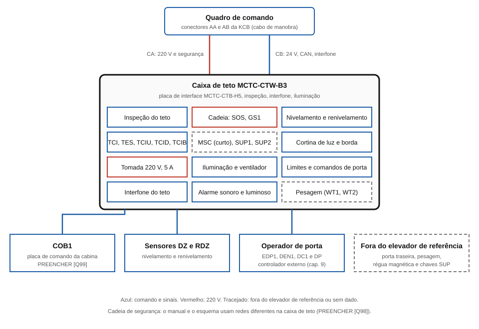

# Capítulo 8. Caixa de teto e cabina

> RASCUNHO v0.1 de 14/11/2026. Aguarda aprovação do Gelson e assinatura da Qualidade. Sem selos (Q98 resolvido e Q99 virou conferência de obra em 15/11/2026). A fonte principal é o manual da caixa de teto MCTC-CTW-B3 (edição A02, julho de 2022), que tem só duas páginas densas.

**Parte III. Instalação em campo**

## 8.1 O que você vai aprender

Ao terminar este capítulo você será capaz de:

1. Dizer o que a caixa de teto integra e o que cada componente dela faz.
2. Identificar os bornes da caixa de teto e o que se liga em cada um.
3. Seguir a cadeia de segurança e a inspeção do topo da cabina.
4. Saber o que usar e o que deixar de fora no elevador de referência (1 porta, sem pesagem).
5. Cuidar da caixa de teto na instalação, no armazenamento e na manutenção.

## 8.2 A caixa de teto MCTC-CTW-B3

A caixa de teto é um produto integrado para o topo da cabina e a própria cabina. Ela reúne a placa de interface do teto, a placa de controle do teto (CTB), a inspeção do teto, o interfone e a iluminação. É um equipamento de corrente fraca para o comando da cabina. Fonte: manual da caixa de teto MCTC-CTW-B3, introdução.

**Componentes.**

| Componente | Função |
|---|---|
| Botões de inspeção | Cinco botões: Inspect (inspeção), Stop (parada), Up (subir), Down (descer) e Run (marcha), para comissionar o elevador pelo topo da cabina |
| Iluminação do topo da cabina | Complementa a iluminação do poço. Ligue pela chave de iluminação durante o comissionamento, se a luz do poço não bastar, e desligue ao terminar |
| Interfone do topo da cabina | Parte do interfone de 5 vias, para a manutenção e o resgate |
| Tomada de 220 VAC | Fornece 220 V temporários para o trabalho no topo da cabina, com corrente máxima de saída de 5 A |
| Indicadores LED | Mostram o estado das entradas e saídas digitais e da comunicação |
| Porta USB de gravação | Serve à gravação de software da CTB |

> **CUIDADO.** A tomada de 220 V da caixa de teto fornece no máximo 5 A. Não use ferramentas de alta potência, como furadeira de impacto.

**Modelo.** MCTC é a série específica para elevadores, CTW é a caixa de teto (car top junction box) e B3 é a configuração sem controlador do operador de porta, para porta dupla. O controlador do operador de porta é então um equipamento separado (capítulo 9). Fonte: manual CTW-B3, Figura 2.

**Indicadores.** As entradas e saídas aparecem em LEDs, entre elas: limites de porta aberta e fechada 1 e 2 (X3 a X6), comandos de abrir e fechar a porta 1 e 2 (Y2 a Y7), cortinas de luz 1 e 2 (X1 e X2), bordas de segurança 1 e 2 (X15 e X16), plena carga e sobrecarga (X7 e X8), normal e inspeção (X12), inspeção de subida e de descida (X13 e X14), nivelamento de subida e de descida (X9 e X10), superaquecimento do motor (X11), iluminação (Y1), ventilador (Y11) e alarme sonoro e luminoso (Y10). Dois LEDs têm leitura própria:

| LED | Estado | Significado |
|---|---|---|
| D28 | piscando a cada 250 ms | a comunicação CAN está normal |
| D28 | apagado | comunicação anormal |
| D30 | piscando a cada 500 ms | o programa roda normalmente na placa de interface do teto |
| D30 | aceso fixo | há alimentação, mas o programa não roda |
| D30 | apagado | sem alimentação, ou sem programa gravado |

Fonte: manual CTW-B3, Tabela 2.

## 8.3 Especificações e instalação

| Item | Valor |
|---|---|
| Entrada 507/508 do terminal CA | 1 fase, 220 VAC, 7 A |
| Entrada 207/208 do terminal CA | 1 fase, 220 VAC, 4 A |
| Entrada 301/302 do terminal CB | 24 VDC, 5 A |
| Saídas DC1 e DC2 | 1 fase, 220 VAC, 4 A cada |
| Saídas FAN 509/508 e 510/508 | 1 fase, 220 VAC, 1 A cada |
| Saídas EDP1 e EDP2, 207/208 | 1 fase, 220 VAC, 1 A cada |
| Saídas EDP1 e EDP2, 301/302 | 24 VDC, 2 A cada |
| Saída SL (alarme sonoro e luminoso) | 24 VDC, 1 A |
| Saída Y3 | 1 fase, 220 VAC, 5 A |
| Saídas COB1 e COB2: 301/302, T01/302 e Z01/302 | 24 VDC, 3 A; 12 VDC, 0,62 A; 12 VDC, 0,48 A |
| Temperatura de operação | de -10 a +50 °C |
| Umidade | abaixo de 95%, sem condensação |
| Vibração | abaixo de 5,9 m/s² (0,6 g) |
| Armazenamento | de -20 a +60 °C |
| Resfriamento e proteção | natural; IP21 na instalação vertical |

Fonte: manual CTW-B3, Tabela 3.

**Instalação.** A caixa é instalada na balaustrada acima da cabina, presa à parede com quatro parafusos M6, na vertical e com a tampa sempre fechada. A Figura 3 do manual traz as cotas (254, 340, 275, 376, 80 e 135 mm) e furos de 8 mm. Fonte: manual CTW-B3, seção de instalação, Figuras 3 e 4.

> **ATENÇÃO.** Instale a caixa de inspeção na vertical e mantenha a tampa sempre fechada, para impedir a entrada de objetos estranhos. Fonte: manual CTW-B3, nota da seção de instalação.

**Figura 8.1.** A caixa de teto e o que se liga a ela.
Fonte: manual CTW-B3, Tabela 4 e diagramas; esquema Vitinho 19061867-ZL, folhas /34, /35 e /39 (págs. PDF 36, 37 e 41).

## 8.4 Bornes da caixa de teto

A placa de interface do teto é a MCTC-CTB-H5. Os bornes dela, com o que cada um recebe, estão abaixo. O elevador de referência usa um só operador de porta e não tem pesagem; por isso a coluna "Elevador de referência" indica o que se aplica.

| Borne | Sinais | Função | Elevador de referência |
|---|---|---|---|
| CA | 507, 508, 207, 208, PE, 134, 123, 125, 132, 131A, 130 | Terminais de corrente forte do cabo de manobra: alimentação de 220 V da iluminação (507 e 508) e do operador e da cortina de luz (207 e 208), terra, e os pontos da cadeia de segurança e das fechaduras | usa |
| CB | DZI, R, L, DC12, FL1, FL2, 301, 302, CAN+, CAN-, SGC1, SGC2, 102 | Terminais de corrente fraca do cabo de manobra: zona de porta, interfone, renivelamento, 24 V, CAN, trinco auxiliar e ponto comum da cadeia | usa |
| FAN | 510, 508, 509, PE | Alimentação da iluminação (510 L, 508 N) e do ventilador (509 L), por relé (contato de 240 V, 3 A) | usa |
| EDP1 e EDP2 | 301, 302, X1 e X2, X15 e X16, 207, 208, PE | Entradas da cortina de luz e da borda de segurança da porta 1 e 2; a cortina é alimentada por 24 V ou 220 VAC, conforme a instalação | EDP1 |
| DEN1 e DEN2 | X3 e X4, X5 e X6, B1 e C1, B2 e C2, B3 e C3, BM e CM, 301 | Entradas e saídas do operador de porta 1 e 2: limite de abertura, limite de fechamento, comando de abrir, de fechar e de fechamento forçado; saída por relé de 28 V, 5 A | DEN1 |
| DC1 e DC2 | 207, 208, PE | Alimentação do controlador do operador de porta | DC1 |
| DP | X11, 301 | Entrada da proteção de superaquecimento do operador de porta (10 a 30 V); trabalha com dois operadores | usa |
| WT1 | X7, X8, 301, 302 | Sinais de plena carga e de sobrecarga (10 a 30 V) | não usa (sem pesagem) |
| WT2 | AI, 301, 302 | Entrada analógica de célula de carga, de 0 a 10 V | não usa (sem pesagem) |
| DZ | X9, X10, 301, 302 | Sinais de nivelamento de subida e de descida (10 a 30 V) | usa |
| RDZ | FL1, FL2, 301 ou T01, 302 | Sinais de renivelamento de subida e de descida, levados à MCB pelo cabo de manobra; alimentação normal de 24 V e de emergência de 12 V | usa (o elevador tem renivelamento) |
| SL | 302, 303 | Alimentação do alarme sonoro e luminoso, por relé; 24 V (contato de 28 V, 5 A) | usa |
| SGC | SGC1, SGC2 | Sinais do trinco auxiliar da porta de cabina | só com porta traseira |
| MSC | CAN+, CAN-, 301, 302, DC12, DZI, 130, 102, 127, 128 e outros | Terminais da caixa de segurança. Se a régua magnética MSC não existe, ligue os terminais 127 e 128 em curto | MSC fora; curto 127 e 128 |
| GS1 | 130, 131A | Sinais do trinco da porta de cabina da frente | usa |
| GS2 | 133, 134 | Sinais do trinco da porta traseira | só com porta traseira |
| SUP1 e SUP2 | 129 e 130; 128 e 129 | Chaves de segurança de reserva | fora do elevador de referência |
| SOS | 123, 124 | Chave da cunha de segurança | usa |
| Y4 | 301, X12, X13, X14, 125, 124, 127 | Botoeira de comando do pendente. Ligada na fábrica; não é para uso do cliente | ligada de fábrica |
| COB1 e COB2 | 301, 302, MOD+, MOD-, DC12, Z01, L, R | Placa de comando da cabina (botoeira de cabina) | COB1 |

> **NOTA.** Garanta que os bornes 301 e 302 recebam 24 V, e não tensão mais alta, para proteger a placa. Fonte: manual CTW-B3, nota da Tabela 4.

Fonte: manual CTW-B3, Tabela 4. A polaridade de 301 e 302 em alguns blocos (por exemplo no WT2) aparece de forma inconsistente no manual; confira no seu equipamento.

## 8.5 Inspeção do topo da cabina

O manual descreve cinco botões de inspeção: a chave de inspeção (TCI), o botão de parada (TES) e os botões de subir (TCIU), de descer (TCID) e de marcha ou comum (TCIB). No esquema eles formam a "Car top INSP. handle KKB4-34-01", ligada à placa de controle do teto pelo conector EY4. A placa lê três sinais: o de inspeção (HX12), o de subir (HX13) e o de descer (HX14). Eles correspondem às entradas X12, X13 e X14 do controlador.

| Pino EY4 | Rede ou sinal | Função |
|---|---|---|
| 4 | 301 | 24 V |
| 3 | HX12 | sinal de inspeção |
| 2 | HX13 | sinal de subir |
| 1 | HX14 | sinal de descer |
| 15 | 122A | cadeia de segurança |
| 13 | 123 | início da cadeia no teto |
| 14 | 125 | saída de operação de emergência do teto |
| 12 | 124 | início do contato de inspeção do teto |
| 11 | 127 | fim do contato de inspeção do teto |
| 10 e 20 | 507 e 508 | 220 V da iluminação |
| 17 | PE | terra |
| 6 e 7 | EB1 e EB2 | sinais do botão de alarme |

Fonte: esquema Vitinho 19061867-ZL, folha /35 (pág. PDF 37). O manual da caixa de teto traz as mesmas redes no terminal Y4.

Os parâmetros do controlador que mostram esses sinais: FA-33 (bit 12: sinal de inspeção; bit 13: subir; bit 14: descer) e FA-63 (estado da inspeção do teto: bit 0, inspeção da cabina ativa; bit 1, inspeção do poço ativa; bit 2, bypass ativo; bit 3, inspeção sem autoajuste do poço). A nota do esquema pede separar a velocidade de inspeção da velocidade de operação de emergência. Fonte: esquema Vitinho, folha /35.

> **ATENÇÃO.** A chave de inspeção do teto e o botão de parada do teto (TES) fazem parte da cadeia de segurança (capítulo 1). Com a inspeção do teto ativa, a cabina anda só pelos botões do teto.

## 8.6 A cadeia de segurança na caixa de teto

O capítulo 1 descreve a cadeia de segurança inteira. Na caixa de teto ficam: a chave da cunha de segurança (SOS), a chave de inspeção (TCI), o botão de parada (TES), o trinco da porta de cabina (GS1) e, quando existem, as chaves de reserva (SUP1 e SUP2) e a caixa de segurança da régua magnética (MSC).

**Os dois documentos descrevem a cadeia de formas diferentes.** O manual da caixa de teto e o esquema Vitinho (folha /34) usam números de rede diferentes para a mesma região:

| Dispositivo | Segundo o manual CTW-B3 | Segundo o esquema Vitinho, folha /34 |
|---|---|---|
| SOS | entre 123 e 124 | entre 123 e 123A |
| MSC (curto se não houver régua) | entre 127 e 128 | entre 123A e 124 (desenhado com jumper 10-12) |
| SUP2 | entre 128 e 129 | entre 127 e 129 |
| SUP1 | entre 129 e 130 | entre 129 e 130 |
| GS1 | entre 130 e 131A | entre 130 e 131A |

O esquema chama a placa de "AD2SO22M1/2/3 car top control board" (caixa de teto "D1/D2/D3-G"), e o manual descreve a placa MCTC-CTB-H5 da CTW-B3. A caixa de teto instalada é a CTW-B3: o responsável técnico confirmou na revisão 8 do livro anterior (Rev. 11, pendência P36). Vale, portanto, o manual da CTW-B3: o curto do MSC fica entre 127 e 128. O desenho do esquema serve só para a topologia em série.

> **PERIGO.** Não ponteie nem curto-circuite contatos da cadeia de segurança, exceto o curto que o fabricante manda fazer no lugar do MSC quando a régua magnética não existe. Fonte: manual CTW-B3, Tabela 4; capítulo 1.

Fonte: manual CTW-B3, Tabela 4; esquema Vitinho, folha /34 (pág. PDF 36).

## 8.7 Nivelamento, renivelamento e pesagem

**Nivelamento.** Os sensores de nivelamento de subida e de descida entram em X9 e X10 (terminal DZ). A figura de sinais do manual mostra, na ordem, nivelamento de subida, zona de porta de subida, zona de porta de descida e nivelamento de descida.

**Renivelamento.** Os sinais de renivelamento de subida e de descida (FL1 e FL2, terminal RDZ) são levados à placa principal pelo cabo de manobra. A alimentação normal desses sensores é de 24 V, e a de emergência, de 12 V. Quando a função de abertura antecipada da porta ou de renivelamento está configurada, é preciso habilitar a comunicação de nivelamento de subida e de descida do teto, ajustando o bit 6 de F6-52 na placa principal em 1. Fonte: manual CTW-B3, Tabela 4 e nota 1 do diagrama.

**Pesagem.** O terminal WT1 recebe os sinais de plena carga e sobrecarga e o WT2, a célula de carga analógica (0 a 10 V). O elevador de referência não tem pesagem. Para o caso de ter, a célula analógica entra por WT2 e o capítulo 12 traz o parâmetro F8-01. Fonte: manual CTW-B3, Tabela 4.

## 8.8 Iluminação, ventilador, alarme e interfone

- **Iluminação e ventilador da cabina:** controlados por relé, com a alimentação de 220 V pelo terminal FAN (510 e 508 para a luz, 509 e 508 para o ventilador). O contato do relé aguenta 240 V e 3 A. O manual avisa que uma potência maior pode danificar o relé e é proibida, e que a iluminação e o ventilador devem ser ligados corretamente (o cabo com termistor serve de amortecedor de partida no circuito da iluminação).
- **Alarme sonoro e luminoso:** saída SL, por relé, em 24 V (contato de 28 V e 5 A).
- **Iluminação de emergência da cabina:** alimentada em 12 V pelo terminal Z01 da placa de comando da cabina.
- **Interfone:** a caixa de teto tem o botão de fala do interfone do topo da cabina e a alimentação de 12 V (DC12). O sinal do interfone vai em L e R. O interfone é parte do interfone de 5 vias.

Fonte: manual CTW-B3, Tabelas 1 e 4; esquema Vitinho, folha /39 (pág. PDF 41).

## 8.9 Placa de comando da cabina

A placa de comando da cabina (COB) recebe os botões de andar e de porta e acende os indicadores. O manual traz a MCTC-COB-A1 (com anunciador de voz e gongo de chegada) e a MCTC-COB-A2 (sem esses recursos). Cada uma tem 24 entradas de botão, 20 saídas de indicador, um terminal de interfone e dois terminais de comunicação 485.

| Terminal | Função |
|---|---|
| JP1 a JP16 | botão e indicador dos andares 1 a 16 (pinos 2 e 3: entrada do botão; pinos 1 e 4: saída do indicador) |
| JP17, JP18 e JP19 | abrir a porta, fechar a porta e retardo da abertura |
| JP20 a JP24 | viagem direta, atendente, mudança de sentido, operação independente e emergência de incêndio (só entradas) |
| JP25 e JP26 | alimentação de 24 V e comunicação 485 (MOD+ e MOD-) para dispositivos externos, como a placa de chamada dos pavimentos e o leitor de cartão |
| JP27 | +24 V, COM, controle da iluminação (LIGHT), controle do ventilador (FAN) e iluminação de emergência (Z01) |
| JP28 | alimentação do interfone (DC12 e GND) e saída do interfone (C01 e C02) |
| S5 | chave DIP do endereço da COB (andares 1 a 16 ou 17 a 32, e porta traseira de cabina passante) |

Em um elevador com mais de 16 andares, a placa de chamada da cabina MCTC-CCB-F1 liga em cascata com a COB e acrescenta 8 andares por placa. O elevador de referência tem 3 paradas e não usa a CCB-F1.

O modelo da placa de comando da cabina depende do pedido: a A1 tem anunciador de voz e gongo de chegada, e a A2 não. Confira na etiqueta da placa do seu elevador.

Fonte: manual CTW-B3, Tabelas 5 a 10, Figuras 6, 8 e 9.

## 8.10 Armazenamento e manutenção

**Armazenamento.** Guarde a caixa de teto na embalagem original. Ela tem alimentação de emergência com bateria: se ficar parada por mais de seis meses, carregue a bateria com 220 VAC (pelos bornes 507 e 508 do terminal CA) por um dia. O armazenamento longo degrada o capacitor eletrolítico: ligue a caixa por pelo menos cinco horas a cada dois anos, subindo a tensão devagar até o valor nominal com um regulador.

**Manutenção diária.** Confira se o ambiente de instalação mudou e se a caixa continua na vertical com a tampa sempre fechada. Limpe a poeira da superfície, principalmente a de metal, para que não entre na caixa.

**Manutenção periódica.** Confira se há parafusos soltos, corrosão e marcas de arco nos bornes.

Fonte: manual CTW-B3, seção 5.

## 8.11 Se o seu elevador tiver outra configuração

| Se o seu elevador tiver | O que muda |
|---|---|
| Porta traseira | Entram EDP2, DEN2, DC2, COB2, GS2 e SGC, e o jumper da porta única deixa de valer (capítulo 1) |
| Pesagem | Entram WT1 (sinais) ou WT2 (analógica) e o parâmetro F8-01 (capítulo 12) |
| Mais de 16 andares | Entra a placa MCTC-CCB-F1 em cascata com a COB |
| Régua magnética (MSC) | O curto 127 e 128 deixa de ser feito; entram os terminais de CAN e de zona de porta da régua |
| Chaves de segurança de reserva | Entram SUP1 e SUP2 na cadeia |
| Operador de porta com controlador próprio (B3 não o inclui) | O controlador do operador de porta é externo à caixa (capítulo 9) |

Fonte: manual CTW-B3, Tabelas 3 e 4; esquema Vitinho, folhas /34 e /39.

## 8.12 Teste o que você aprendeu

1. O que a caixa de teto integra? *(Seção 8.2: a placa de interface do teto, a CTB, a inspeção, o interfone e a iluminação.)*
2. Quais são os cinco botões de inspeção e a que entradas do controlador correspondem? *(Seção 8.5: Inspect, Stop, Up, Down e Run; X12, X13 e X14.)*
3. Qual a corrente máxima da tomada de 220 V? *(Seção 8.2: 5 A.)*
4. O que se faz com os terminais 127 e 128 se a régua magnética não existe? *(Seção 8.4: ligam-se em curto.)*
5. Quanto tempo se deve carregar a bateria da caixa de teto depois de seis meses parada? *(Seção 8.10: um dia, com 220 VAC em 507 e 508 do terminal CA.)*

## Fontes do capítulo

- Manual da caixa de teto `Manual_Caixa_de_Teto_MCTC-CTW-B3_EN.pdf` (edição A02, julho de 2022), págs. PDF 1 e 2.
- Esquema Vitinho 19061867-ZL (2023-07-18), folhas /34, /35 e /39 (págs. PDF 36, 37 e 41).
- Manual NICE3000new, `Manual_Usuario_Controlador_NICE3000new_Completo.pdf`, para as remissões a F6-52 e a FA-33 (capítulo 12).
