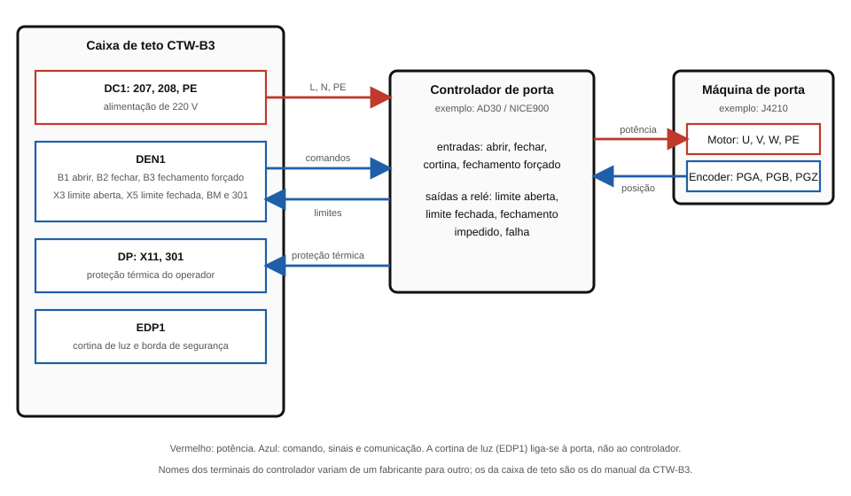
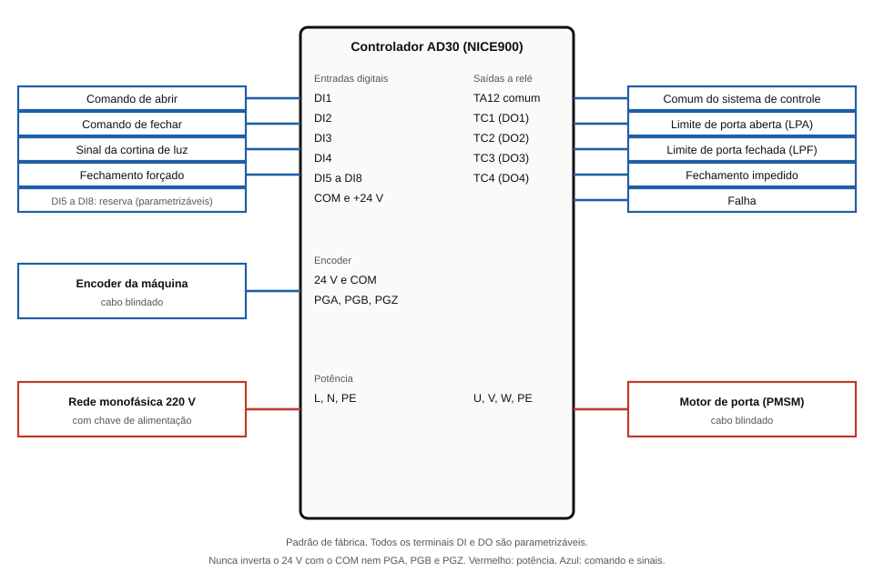

# Capítulo 9. Operador de porta

> RASCUNHO v0.1 de 15/11/2026. Aguarda aprovação do Gelson e assinatura da Qualidade. Selos abertos: `PREENCHER [Q106]`, `PREENCHER [Q107]`, `PREENCHER [Q108]`, `PREENCHER [Q109]`, `PREENCHER [Q110]` e `PREENCHER [Q111]`. Fontes: boletim "Parametrização de Controlador de Porta NICE900", manual de comissionamento do NICE900 (versão 1.0, fevereiro de 2026) e manual de instalação da máquina de porta J4210 (22/03/2024).

**Parte III. Instalação em campo**

## 9.1 O que você vai aprender

Ao terminar este capítulo você será capaz de:

1. Dizer o que o quadro de comando espera de qualquer operador de porta e o que muda de um fabricante para outro.
2. Ligar o controlador de porta AD30/NICE900: potência, encoder, entradas e saídas.
3. Conferir a mecânica da máquina de porta J4210 antes de parametrizar.
4. Configurar o motor e o encoder e fazer os dois autoajustes: o do motor e o da largura da porta.
5. Reconhecer os problemas mecânicos mais comuns da porta e como o fabricante manda resolvê-los.

> **PERIGO.** Antes de mexer nos cabos do motor, no encoder ou nos bornes do controlador de porta, desligue a alimentação e espere a descarga dos capacitores. O manual do NICE900 manda esperar **5 minutos**; o capítulo 1 manda esperar 10 minutos para o quadro. Confirmação do tempo para o controlador de porta: `PREENCHER [Q110]`.

> **ATENÇÃO.** O autoajuste move a porta por completo. Deixe a área livre e não toque no motor, na porta nem nas peças em movimento durante o processo.

## 9.2 O que é o operador de porta

O operador de porta abre e fecha a porta de cabina e, pela faca da porta de cabina, também as portas de pavimento. Ele tem duas partes:

1. **A máquina de porta:** motor síncrono de ímã permanente com encoder, polia motriz, correia dentada ou cabo de aço e as folhas da porta. No exemplo deste capítulo, a máquina é a J4210.
2. **O controlador de porta:** recebe os comandos do quadro e comanda o motor. No exemplo deste capítulo, o controlador é o AD30, que o boletim do fabricante também chama de NICE900.

**O quadro de comando conversa com muitos operadores de porta.** O elevador de referência tem um só, e qual é: `PREENCHER [Q107]`. Por isso o capítulo tem duas camadas: a seção 9.3 vale para qualquer operador, e as seções 9.4 em diante são o **exemplo trabalhado** com o AD30 e a J4210, que são os que o livro tem documentados. Para outro operador, siga o manual do fabricante e use a seção 9.3 como lista de conferência.

Fonte: manual da caixa de teto MCTC-CTW-B3 (a B3 não inclui o controlador do operador; capítulo 8); manual J4210, seção 4.1.

## 9.3 O que o quadro espera de qualquer operador

Qualquer operador de porta, de qualquer fabricante, precisa dar e receber os mesmos sinais da caixa de teto:

| Sinal | Sentido | Para que serve |
|---|---|---|
| Alimentação monofásica de 220 V | caixa de teto para o operador | Alimenta o controlador (terminais DC1 da caixa de teto: 207, 208 e PE) |
| Comando de abrir | caixa de teto para o operador | Manda a porta abrir |
| Comando de fechar | caixa de teto para o operador | Manda a porta fechar |
| Fechamento forçado | caixa de teto para o operador | Sinal de fechamento forçado do quadro (a função exata é definida pelo fabricante do operador) |
| Limite de porta aberta | operador para a caixa de teto | Diz que a porta chegou ao fim da abertura |
| Limite de porta fechada | operador para a caixa de teto | Diz que a porta chegou ao fim do fechamento |
| Proteção térmica | operador para a caixa de teto | Avisa superaquecimento (terminais DP da caixa de teto) |
| Cortina de luz ou borda de segurança | porta para a caixa de teto | Sinal da cortina de luz ou da borda de segurança da porta (terminais EDP) |

Os bornes da caixa de teto que carregam esses sinais são o DEN1 (comandos e limites), o DC1 (alimentação), o DP (proteção térmica) e o EDP1 (cortina). Estão descritos no capítulo 8, seção 8.4.

**O que muda de um operador para outro:** a numeração dos parâmetros, o jeito de fazer o autoajuste, as teclas do painel e o nome dos bornes. Os documentos de outros operadores que o livro consultou (controladores BST BG101 e BG201, brochura J5801) confirmam essa mesma lista de sinais; eles não são fonte deste capítulo, porque não são o operador do elevador de referência.

Fonte: manual CTW-B3, bornes DEN1, DC1, DP e EDP; boletim AD30, pág. 1 e 2.

**Figura 9.1.** O que o quadro e a caixa de teto trocam com o operador de porta.
Fonte: manual CTW-B3 (bornes DEN1, DC1, DP, EDP1) e boletim AD30 (Figura 1).

## 9.4 O controlador AD30/NICE900

O AD30 tem três blocos de ligação:

1. **Alimentação do controlador:** terminais L, N e PE. Aceita 220 V monofásico ou bifásico.
2. **Motor:** terminais U, V, W e PE.
3. **Encoder:** terminais 24 V e COM (alimentam o encoder) e PGA, PGB e PGZ (sinais de posição).

> **CUIDADO.** No encoder, nunca inverta o 24 V com o COM nem os sinais PGA, PGB e PGZ. Siga o boletim.

**Entradas digitais.** Os terminais DI1 a DI8 são parametrizáveis. O padrão de fábrica define:

| Terminal | Função de fábrica |
|---|---|
| DI1 | Comando de abrir a porta |
| DI2 | Comando de fechar a porta |
| DI3 | Sinal da cortina de luz |
| DI4 | Sinal de fechamento forçado |
| DI5 a DI8 | Reserva |

**Saídas a relé.** Os terminais TA12 a TC4 são parametrizáveis. O padrão de fábrica define:

| Terminal | Função de fábrica |
|---|---|
| TA12 | Comum da alimentação (entrada comum do sistema de controle) |
| TC1 (DO1) | Retorno do limite de porta aberta (LPA) |
| TC2 (DO2) | Retorno do limite de porta fechada (LPF) |
| TC3 (DO3) | Saída de fechamento impedido |
| TC4 (DO4) | Saída de falha |

Os terminais COM e +24 V do controlador são saídas de alimentação para o retorno de sinal.

**Figura 9.2.** Ligação elétrica do AD30: potência, encoder, entradas e saídas.
Fonte: boletim AD30, Figura 1 (pág. 2).

Fonte: boletim "Parametrização de Controlador de Porta NICE900", págs. 1 e 2.

## 9.5 Ligação do AD30 com a caixa de teto

A caixa de teto liga o controlador de porta assim:

| Caixa de teto (CTW-B3) | Controlador AD30 | Base |
|---|---|---|
| DC1: 207 e 208 | L e N (alimentação) | manual CTW-B3, figura de ligação |
| DC1: PE | PE | manual CTW-B3, figura de ligação |
| DEN1: B1 | DI1 (abrir) | manual CTW-B3, figura de ligação |
| DEN1: B2 | DI2 (fechar) | manual CTW-B3, figura de ligação |
| DEN1: BM | COM | manual CTW-B3, figura de ligação |
| DEN1: B3 | DI4 (fechamento forçado) | correspondência de função |
| DEN1: X3 | TC1 (limite de porta aberta) | correspondência de função |
| DEN1: X5 | TC2 (limite de porta fechada) | correspondência de função |
| DEN1: 301 | TA12 (comum) | correspondência de função |

> **NOTA.** As cinco primeiras linhas aparecem na figura de ligação do manual da CTW-B3, que desenha um controlador de porta genérico. As quatro últimas são **correspondência de função** entre o nome do sinal na caixa de teto e o nome do terminal no AD30. Nenhum documento do livro mostra a ligação CTW-B3 com o AD30 fio a fio: `PREENCHER [Q108]`. Confira com o multímetro e com o manual do operador antes de energizar.

Fonte: manual CTW-B3, bornes e figura de ligação; boletim AD30, pág. 2.

## 9.6 A mecânica da máquina de porta J4210

O manual da máquina J4210 traz estes pontos de instalação. Confira todos antes de parametrizar o controlador.

| O que conferir | Valor | Seção do manual J4210 |
|---|---|---|
| Distância entre a placa traseira do operador e a borda da cabina | 32 mm, mantida em qualquer método de fixação | 4.3 |
| Abertura lateral: distância da folha ao batente de borracha, com a porta aberta | X = PL + 20 (0, +2) mm | 4.4 |
| Folga entre a roldana superior e a guia | de 0,2 a 0,5 mm; se a roldana excêntrica apertar demais, a porta não anda | 4.6 |
| Folga do gancho de partida da faca da porta | de 0,3 a 1 mm, com o operador desligado | 4.7 |
| Folga entre o braço da faca e o rolete (dianteiro e traseiro) | 10 ± 1 mm | 5.1 e 5.3 |
| Folga entre a folha da porta e a soleira | de 3 a 5 mm | 5.2 |
| Curso da correia para a faca recolher | 7 mm | 5.3 |

**Como a faca da porta funciona.** A faca da porta de cabina abre a porta de pavimento: com a porta de cabina fechada, a faca fica recolhida e não toca a porta de pavimento. Ao abrir, a faca primeiro solta a fechadura e só depois puxa a porta de pavimento. Ao fechar, ela empurra a porta de pavimento no sentido do fechamento e a fechadura trava. Fonte: J4210, seção 4.7.

> **ATENÇÃO.** Só pessoas treinadas e que conheçam as normas de segurança de elevadores podem abrir à mão a porta de pavimento ou a de cabina (J4210, seção 1.2).

> **CUIDADO.** Não lubrifique a guia da máquina de porta. O lubrificante junta poeira e sujeira, aumenta o atrito e o ruído e desgasta o rolete e a guia (J4210, seção 5.4).

Fonte: manual de instalação e comissionamento da máquina J4210, seções 1.2, 4 e 5.

## 9.7 Antes de parametrizar

Siga esta ordem. Ela vale para a primeira parametrização de um controlador de porta.

1. Verifique a mecânica da porta: ela deve correr livre, sem trilho obstruído e sem objeto no caminho. Faça um teste manual de movimento suave e confira os sensores de limite.
2. Anote os valores atuais dos parâmetros do motor e do encoder, porque o reset os apaga.
3. Restaure o padrão de fábrica pelo parâmetro FP-01 (ou FP01, ver seção 9.8), com valor 1, e confirme com ENTER. Espere o controlador reiniciar.
4. Feche a porta de cabina por completo.

**O painel de operação.** O NICE900 tem um display LED de 4 dígitos, quatro LEDs de estado (D1 a D4) e as teclas PRG, UP, DOWN, ENTER, STOP/RES, OPEN, CLOSE e SHIFT. Durante os autoajustes use principalmente ENTER, OPEN e CLOSE. A tecla STOP/RES interrompe o processo e só deve ser usada em emergência ou para cancelar.

Fonte: boletim AD30, pág. 3; manual de comissionamento NICE900, págs. 3, 7, 9 e 10.

## 9.8 Parâmetros do motor e do encoder

Os dados do motor estão na placa de identificação, normalmente uma etiqueta na lateral esquerda do motor. Os do encoder, na placa do encoder. Os valores do elevador de referência: `PREENCHER [Q109]`.

Os dois documentos do fabricante usam notações diferentes para os mesmos parâmetros:

| O que é | Boletim AD30 | Manual de comissionamento NICE900 |
|---|---|---|
| Tipo de motor (1 = PMSM) | F1-00 | F100 |
| Potência nominal | F1-01 | F101 |
| Tensão nominal | F1-02 | F102 |
| Corrente nominal | F1-03 | F103 |
| Frequência nominal | F1-04 | F104 |
| Velocidade nominal (rpm) | F1-05 | F105 |
| Tipo de encoder (0 = ABZ, 1 = SPI, 2 = ABPWM) | F1-06 | não consta |
| Pulsos do encoder | F1-07 | F214 |
| Restaurar o padrão de fábrica (valor 1) | FP-01 | FP01 |

> **NOTA.** Qual das duas notações vale no controlador entregue não está nos documentos: `PREENCHER [Q106]`. Veja no display do controlador qual escrita aparece (F1-01 ou F101) e use a coluna correspondente.

Fonte: boletim AD30, pág. 3; manual de comissionamento NICE900, págs. 3, 4 e 11.

## 9.9 Os autoajustes

Há dois autoajustes essenciais: o do **motor síncrono** e o da **largura da porta**. Antes de começar, confira que o motor e o encoder estão ligados e que a porta está totalmente fechada.

> **ATENÇÃO.** Durante o autoajuste, não aperte nenhum botão, não desligue a alimentação e não toque no motor nem na carga mecânica. O processo leva de 2 a 5 minutos, conforme o manual de comissionamento.

Os dois documentos do fabricante descrevem métodos diferentes. O livro mostra os dois, cada um com a sua notação. Use o que corresponde ao seu controlador.

**Método do boletim AD30.**

1. Com os dados do motor e do encoder já configurados e a porta totalmente fechada, aperte ao mesmo tempo as teclas PRG e seta para a direita até aparecer TUNE1 no display.
2. Em TUNE1 o motor faz um ruído. É o controlador injetando tensão no rotor para reconhecer os polos norte e sul, o que deixa a abertura e o fechamento mais precisos.
3. Depois do reconhecimento dos polos, TUNE1 some e aparece TUNE2 sozinho.
4. Em TUNE2 o controlador abre e fecha a porta até 3 vezes para reconhecer a largura.
5. Quando TUNE2 sumir e nenhum erro aparecer, o autoajuste terminou com sucesso.

**Método do manual de comissionamento NICE900.**

1. Configure F002 = 0 (controle pelo painel, só para o autoajuste do motor) e F100 = 1 (PMSM).
2. Digite os dados do motor (F101 a F105) e do encoder (F214 e F215).
3. Escolha o modo: F116 = 3 (sem carga, motor desacoplado) ou F116 = 4 (com carga, porta instalada). Para instalação nova, o manual recomenda começar sem carga.
4. Aperte ENTER, espere TUNE aparecer no display e aperte OPEN para iniciar. Espere o fim.
5. Teste: F004 = 5,00 Hz e F002 = 2 (controle manual da máquina de porta); aperte OPEN ou CLOSE e observe o motor em baixa velocidade. O motor deve girar suave, com corrente normal e sem ruído ou vibração. Se não, verifique a mecânica e os sinais do encoder.
6. Finalize com F002 = 1 (controle por terminal, modo normal). Se o autoajuste foi sem carga, acople a carga agora e faça um teste completo.

Há uma terceira forma no manual de comissionamento: apertar OPEN e CLOSE ao mesmo tempo por cerca de 5 segundos. Nesse caso o NICE900 faz o autoajuste completo, já com o da largura da porta, e a etapa seguinte pode ser pulada.

**Autoajuste da largura da porta, método do manual de comissionamento.**

1. Verifique trilho livre, sem objeto no caminho, e teste manual de movimento.
2. Configure F002 = 2.
3. Só se não há sensores de fim de curso ou se for preciso limitar o curso: defina os limites.
4. Configure F601 com a frequência de fechamento (Hz) e F600 = 1 para habilitar. Aperte OPEN ou CLOSE para iniciar.
5. O controlador fecha a porta até o limite de fechamento e registra a posição; abre a porta por completo e registra o limite de abertura; fecha de novo.
6. Os dados ficam em F602 e F603. A largura é F602 + F603 × 10000. Exemplo do manual: F602 = 2500 e F603 = 3 dão 32.500 unidades.

> **NOTA.** Não altere F602 e F603 à mão. O controlador preenche os dois sozinho.

> **NOTA.** O manual de comissionamento numera as etapas do autoajuste do motor de 1 a 4 e depois de 6; não há uma Etapa 5. O livro descreve só o que o manual traz.

Fonte: boletim AD30, págs. 4 e 5; manual de comissionamento NICE900, págs. 4 a 8, 11 e 12.

## 9.10 Se a porta abre ou fecha ao contrário

Se, depois do comissionamento, o sentido de abertura e fechamento estiver invertido, o manual de comissionamento descreve esta correção, com o controlador desligado e depois de esperar:

1. Desligue o controlador e espere pelo menos 5 minutos para a descarga dos capacitores.
2. Localize os cabos U e V do motor no controlador e troque as posições (U por V e V por U). Confira que as conexões estão firmes.
3. Religue e acesse F215 (direção de rotação). Se o valor era 1, mude para 0; se era 0, mude para 1. Confirme com ENTER.
4. Configure F002 = 2, aperte OPEN ou CLOSE e confira se a porta anda no sentido certo.

> **ATENÇÃO.** O manual apresenta os dois métodos (trocar U e V, mudar F215) como um só procedimento, sem dizer se é preciso fazer os dois. Fazer os dois ao mesmo tempo pode desfazer a correção. Antes de mudar o F215, confirme com o fabricante qual dos métodos vale para o seu controlador: `PREENCHER [Q111]`.

Fonte: manual de comissionamento NICE900, pág. 12.

## 9.11 Problemas comuns e como o fabricante manda resolvê-los

| Sintoma | Causa que o manual cita | O que o manual manda fazer |
|---|---|---|
| Batida forte ao fechar em um andar | Folga excessiva entre o rolete e o braço da faca, e a porta de pavimento fecha antes da de cabina | Ajustar a folga entre o braço da faca e a bola da porta, e a inferior, para 10 ± 1 mm |
| Porta não chega ao limite de abertura | Roldana excêntrica aperta a guia, atrito entre a folha e a soleira, mola de fechamento forçado muito forte, correia ou cabo de aço apertados demais | Folga da roldana de 0,2 a 0,5 mm; limpar e corrigir a folha; folga folha e soleira de 3 a 5 mm; mover o gancho da mola; ajustar a tensão. Se nada resolver, procurar ajuda profissional |
| Batida na abertura, sem desaceleração no fim | Faca não solta por completo; a correia anda menos de 7 mm | Verificar a resistência do mecanismo da faca e acertar a folga de 10 mm com o rolete |
| Ruído por sujeira na guia | Lubrificante na guia atrai poeira | Limpar a guia e o rolete; não lubrificar |
| Porta rebate de 1 a 2 mm depois de fechada | Folga do gancho de partida da faca maior que 1 mm, ou borracha do limite de fechamento mole demais | Ajustar o gancho para de 0,3 a 1 mm com o operador desligado; trocar a borracha e refazer o autoajuste |
| Aceleração e impacto no fim do fechamento | O abridor da faca encosta cedo no gancho e a faca abre antes da hora | Ajustar a folga do gancho para de 0,3 a 1 mm |

Fonte: manual J4210, seção 5.

## 9.12 Manutenção

A cada visita de manutenção, o manual J4210 manda:

1. Limpar a guia da porta e verificar o desgaste do rolete. Trocar se a profundidade do desgaste passar de 1,5 mm.
2. Verificar a tensão do cabo de aço e da correia sincronizadora.
3. Verificar o aperto dos parafusos e das peças padrão.
4. Lubrificar as partes móveis do operador, **exceto a guia** (ver seção 9.6).
5. Verificar com regularidade a posição das chaves de limite do operador.

> **NOTA.** O sinal de abrir e fechar do controlador deve ter blindagem, para evitar interferência de sistemas de alta tensão (J4210, seção 6.2). Mantenha o controlador protegido contra entrada de objetos, principalmente metal e cavacos (seção 6.3).

Fonte: manual J4210, seção 6.

## 9.13 O que é igual e o que muda entre operadores

| Item | Igual em todos | Muda de um para outro |
|---|---|---|
| Interface com o quadro | Alimentação de 220 V, abrir, fechar, limites de abertura e de fechamento, fechamento forçado, falha | Nome dos terminais |
| Autoajuste | Duas partes: motor e largura da porta | Teclas, parâmetros e modo |
| Segurança | Desligar e esperar antes de mexer nos cabos | Tempo de espera |
| Parâmetros | Dados do motor, do encoder e restauração do padrão de fábrica | Numeração (F1-01 ou F101, P01.00 etc.) |

**Se o seu elevador tiver outra configuração:**

| Se o seu elevador tiver | O que muda |
|---|---|
| Duas portas (frente e fundo) | A caixa de teto traz DEN2, DC2 e EDP2 para o segundo operador |
| Operador de outro fabricante | Use a seção 9.3 como lista de conferência e siga o manual dele |

Fonte: manual CTW-B3, bornes DEN1 e DEN2, DC1 e DC2, EDP1 e EDP2.

## 9.14 Teste o que você aprendeu

1. Quais são os padrões de fábrica de DI1, DI2, TC1 e TC2? *(Seção 9.4: abrir, fechar, limite de porta aberta e limite de porta fechada.)*
2. O que o controlador faz em TUNE1 e em TUNE2? *(Seção 9.9: reconhece os polos do rotor; depois abre e fecha a porta até 3 vezes para reconhecer a largura.)*
3. Como se calcula a largura da porta a partir de F602 e F603? *(Seção 9.9: F602 + F603 × 10000.)*
4. Que folga leva o gancho de partida da faca da porta? *(Seção 9.6: de 0,3 a 1 mm.)*
5. Qual o primeiro passo antes de parametrizar o controlador pela primeira vez? *(Seção 9.7: conferir a mecânica da porta e restaurar o padrão de fábrica, depois de anotar os valores.)*

## Fontes do capítulo

- Boletim "Parametrização de Controlador de Porta NICE900" (`Parametrização do AD30 (Motor Síncrono).pdf`, 5 págs.).
- Manual de comissionamento do controlador NICE900 (`Manual_Comissionamento_NICE900_VerticalParts.pdf`, versão 1.0, fevereiro de 2026).
- Manual de instalação e comissionamento do operador de porta J4210 (`Manual_Instrucoes_Operador_de_Porta_J4210-T2.pdf`, 22/03/2024).
- Manual da caixa de teto MCTC-CTW-B3, edição A02 (bornes DEN1, DC1, DP e EDP1), conforme capítulo 8.
