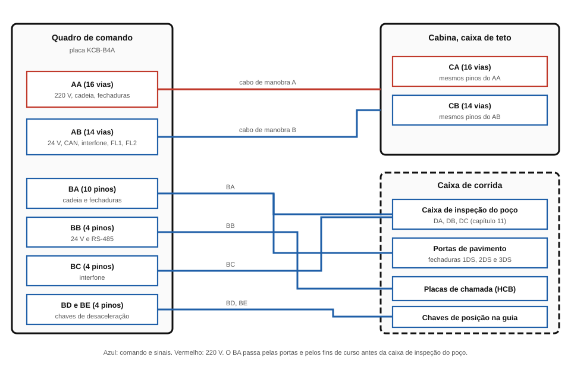
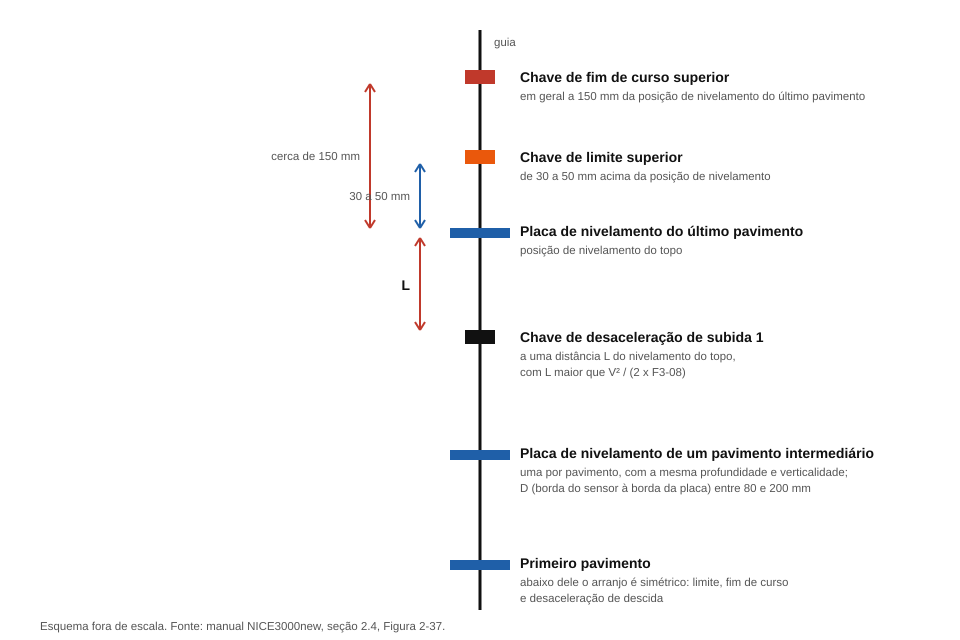

# Capítulo 10. Caixa de corrida e cabos de manobra

> RASCUNHO v0.1 de 14/11/2026. Aguarda aprovação do Gelson e assinatura da Qualidade. Sem selos (Q101 e Q102 viraram conferência de obra em 15/11/2026).

**Parte III. Instalação em campo**

## 10.1 O que você vai aprender

Ao terminar este capítulo você será capaz de:

1. Dizer o que liga o quadro de comando à cabina e à caixa de corrida, e por quais cabos.
2. Ler a pinagem do cabo de manobra, pino a pino.
3. Dizer o que cada cabo de poço (BA, BB e BC) leva.
4. Posicionar as chaves de posição (nivelamento, desaceleração, limites e fins de curso) e calcular a distância de desaceleração.
5. Saber como ficam as fechaduras das portas de pavimento, as chamadas dos pavimentos e a iluminação da caixa de corrida.

## 10.2 O que sai do quadro de comando

Do quadro de comando saem dois cabos de manobra para a caixa de teto (um em cada conector, AA e AB) e três cabos de poço (BA, BB e BC), mais o cabo de iluminação. Os conectores ficam na placa de interface KCB-B4A.

**Figura 10.1.** Cabos entre o quadro de comando, a cabina e a caixa de corrida.
Fonte: esquema Vitinho 19061867-ZL, folhas /11, /19, /34, /43, /44, /45 e /48 (págs. PDF 13, 21, 36, 45, 46, 47 e 50).

Os cabos, o comprimento e a bitola dependem da obra. Os cabos de manobra e de poço são feitos pela VerticalParts: a lista de materiais da fiação traz cabos PP de 0,75 mm² (2 vias de 750 V, 3 e 4 vias de 500 V), com conectores Mini-Fit de passo 4,2 mm do lado do quadro e da cabina e conectores Hylok do lado do poço (`Lista de materiais QDC e fiação(FIAÇÃO).csv`). Nenhum esquema lido indica bitola. O comprimento de cada cabo depende da obra: meça no seu elevador (percurso, altura do poço e posição do quadro).

## 10.3 O cabo de manobra

O cabo de manobra liga o quadro de comando à caixa de teto, em dois cabos separados, pino a pino: o cabo A liga o conector AA da KCB (16 vias) ao CA da caixa de teto, e o cabo B liga o AB (14 vias) ao CB. Os pinos de AA e CA são iguais, e os de AB e CB também. São 12 sinais em cada cabo, ou 24 condutores com sinal.

**Numeração dos pinos.**

- No lado do quadro (KCB), o pino 1 fica no canto superior esquerdo, como no desenho da folha /21. A linha de cima vai da esquerda para a direita e depois vem a de baixo.
- No lado da caixa de teto, o pino 1 é o quadrado do canto inferior direito. A linha de baixo vai da direita para a esquerda, de 1 até a metade, e a de cima continua a numeração.
- O livro anterior diz que a KCB está montada girada 180 graus no quadro real, mas isso não foi confirmado. Confira o pino 1 impresso na placa.

> **ATENÇÃO.** A correspondência pino a pino vale para o esquema Vitinho. A caixa de teto CTW-B3 do manual tem diferenças de rótulo e de numeração em alguns conectores (por exemplo, o CB do manual traz 102 onde o esquema traz 122A). A caixa instalada é a CTW-B3 (capítulo 8, seção 8.6): onde os dois divergem, vale o manual da CTW-B3.

**Cabo A: AA (quadro) para CA (caixa de teto).**

| Pino | Sinal | O que leva |
|---|---|---|
| 1 | 207 | 220 V de comando da cabina, fase (operador de porta e cortina de luz) |
| 3 | PE | terra |
| 4 | 130 | fim da cadeia de segurança |
| 5 | 131A | fim do trinco da porta de cabina |
| 6 | 133 | trinco da porta traseira |
| 8 | 507 | 220 V da iluminação, fase |
| 9 | 208 | 220 V de comando da cabina, neutro |
| 11 | 132 | início do trinco da porta traseira |
| 12 | 125 | saída de operação de emergência do teto |
| 13 | 123 | início da cadeia de segurança no teto |
| 14 | 134 | fim do trinco da porta traseira |
| 16 | 508 | 220 V da iluminação, neutro |

Pinos sem uso: 2, 7, 10 e 15.

**Cabo B: AB (quadro) para CB (caixa de teto).**

| Pino | Sinal | O que leva |
|---|---|---|
| 1 | 102 | ponto comum da cadeia de segurança e das fechaduras |
| 3 | 301 | 24 V |
| 4 | 302 | 24 V, comum |
| 5 | CAN+ | comunicação CAN |
| 6 | CAN- | comunicação CAN |
| 7 | FL1 | sinal de renivelamento de subida |
| 8 | 122A | cadeia de segurança |
| 10 | FL2 | sinal de renivelamento de descida |
| 11 | DC12 | 12 V do interfone |
| 12 | L | sinal do interfone |
| 13 | R | sinal do interfone |
| 14 | DZI | sinal de zona de porta da régua magnética |

Pinos sem uso: 2 e 9.

Fonte: esquema Vitinho 19061867-ZL, folhas /11, /19, /21, /24, /34 e /38 (págs. PDF 13, 21, 23, 26, 36 e 40); manual da caixa de teto CTW-B3 (manual de A02, figura de fiação). As funções de 123, 125, 130, 131A, 132, 133, 134 e 102 estão no manual da caixa de teto, Tabela 4.

> **PERIGO.** Os jumpers que a lista de fios traz nos conectores AA e HW (fios 62 a 66) existem só para a bancada, segundo o responsável técnico, e curto-circuitam a cadeia de segurança e as fechaduras se ficarem no quadro de campo. Remova-os antes de ligar o cabo de manobra. No elevador de porta única, só o jumper entre AA 6 e AA 14 (133 e 134) vale, porque o desenho o prevê. Fonte: esquema Vitinho, folha /19; capítulo 1; Apêndice A.

## 10.4 Os cabos de poço

O quadro de comando liga três cabos de poço, cada um com um conector na KCB e outro na caixa de inspeção do poço (capítulo 11):

| Cabo | Conector na KCB | Conector na caixa de inspeção do poço | O que leva |
|---|---|---|---|
| BA | BA, 10 pinos | DA, 6 pinos | cadeia de segurança e fechaduras das portas de pavimento (PE, 118, 121, 131, 122A, 111, 132, 133 e 123) |
| BB | BB, 4 pinos | DB, 4 pinos | 24 V e RS-485 para as placas de chamada dos pavimentos: 301, 302, MOD+ e MOD- |
| BC | BC, 4 pinos | DC, 4 pinos | interfone: R, L e DC12 |

Conteúdo do conector DA, na caixa de inspeção do poço: 1 = 119, 2 = 118, 3 = 122A, 4 = PE, 5 = 123 e 6 = 111. O DB e o DC têm, respectivamente, 301, 302, MOD+ e MOD-, e R, L e DC12 (o pino 3 do DC fica sem uso).

> **ATENÇÃO.** O BA não liga pino a pino ao DA. A cadeia de segurança passa pelos fins de curso fixos na guia e pelas portas de pavimento antes de chegar à caixa de inspeção do poço. A ordem na cadeia é 119, FLSD, 120, FLSU, 121. Fonte: esquema Vitinho, folha /19.

Fonte: esquema Vitinho, folhas /19 e /48 (págs. PDF 21 e 50); ficha da KCB (`sources/cap03_fichas_controle.md`).

## 10.5 As fechaduras das portas de pavimento

O circuito de fechaduras passa por um contato de fechadura em cada pavimento: 1DS, 2DS e nDS (uma por parada; o elevador de referência tem 3). Eles ficam em série, entre as redes 131 e 132, no cabo BA. Cada contato tem uma ligação de terra (PE). O contato de fechadura da porta de cabina (GS1) fica na caixa de teto.

| Posição | Rede | Observação |
|---|---|---|
| BA 4 | 131 | início da série dos contatos de pavimento |
| BA 7 e BA 8 | 132 | fim da série dos contatos de pavimento |
| BA 9 | 133 | trinco traseiro |

No elevador de uma porta, o desenho manda ligar BA 8 a BA 9 ("single door, connect BA-P08 and BA-P09"), o que fecha o ramo da porta traseira. Com porta traseira, entram as fechaduras traseiras (1RDS a nRDS) entre 132 e 133, e esse jumper deixa de existir.

Fonte: esquema Vitinho 19061867-ZL, folhas /19 e /43 (págs. PDF 21 e 45).

## 10.6 As chaves de posição

O controlador identifica a posição da cabina por sinais da caixa de corrida: os sensores de nivelamento, as chaves de desaceleração, as chaves de limite e as chaves de fim de curso. Esses sinais chegam à placa principal pelos cabos de poço.

**Figura 10.2.** Arranjo das chaves de posição na caixa de corrida (no pavimento extremo superior; no inferior é simétrico).
Fonte: manual NICE3000new, seção 2.4, Figura 2-37, pág. PDF 74.

**Nivelamento.** Os sensores de nivelamento ficam, em geral, no topo da cabina, e a placa de nivelamento fica na guia, uma por pavimento, todas com a mesma profundidade e verticalidade. O sistema aceita até 4 sensores de nivelamento. Fonte: manual NICE3000new, seção 2.4.1, pág. PDF 75.

**Desaceleração.** A chave de desaceleração protege contra a cabina passar do extremo na velocidade máxima, quando a posição fica anormal. O sistema aceita até três pares (1, 2 e 3), instalados das pontas do poço para o meio. Em elevador lento basta um par; em elevador rápido, dois ou três. A distância de desaceleração L, da chave à placa de nivelamento do pavimento extremo, é calculada por:

> L > V² / (2 × F3-08)

Nessa fórmula, V é a velocidade nominal do elevador (parâmetro F0-04) e F3-08 é a taxa especial de desaceleração, cujo padrão é 0,9 m/s². Os valores recomendados pelo fabricante estão na tabela abaixo.

| Velocidade nominal (m/s) | 0,25 a 0,63 | 0,75 | 1 | 1,5 | 1,6 | 1,75 | 2 | 2,5 | 3 | 3,5 | 4 |
|---|---|---|---|---|---|---|---|---|---|---|---|
| Chave 1 (m) | 0,4 | 0,4 | 0,7 | 1,5 | 1,7 | 2,0 | 2,0 | 2,0 | 2,0 | 2,0 | 2,0 |
| Chave 2 (m) | nenhuma | nenhuma | nenhuma | nenhuma | nenhuma | nenhuma | 2,5 | 4,0 | 4,0 | 4,0 | 4,0 |
| Chave 3 (m) | nenhuma | nenhuma | nenhuma | nenhuma | nenhuma | nenhuma | nenhuma | nenhuma | 6 | 8 | 11 |

**Exemplo resolvido.** Para um elevador de 1 m/s: L > 1² / (2 × 0,9) = 1 / 1,8 = 0,56 m. O valor recomendado da tabela é 0,7 m, e vale o da tabela. Para 1,5 m/s: L > 1,5² / 1,8 = 2,25 / 1,8 = 1,25 m, e a tabela recomenda 1,5 m. Para 0,75 m/s: L > 0,5625 / 1,8 = 0,31 m, e a tabela recomenda 0,4 m. Os números de velocidade são exemplos. Use a velocidade do seu elevador. Exemplo: o pedido QC-2026-0014, modernização do elevador EL21, usado só como exemplo tem 1,0 m/s, o que dá a distância de 0,56 m pela fórmula e 0,7 m pela tabela.

**Tolerância de instalação.**

- Abaixo de 1 m/s: instale perto dos valores da tabela.
- De 1 a 2 m/s: erro de até 0,1 m sobre a tabela.
- Acima de 2 e até 4 m/s: erro de até 0,3 m sobre a tabela.

> **ATENÇÃO.** Os valores da tabela são calculados com a taxa especial padrão de 0,9 m/s². Diminuir as taxas de aceleração e desaceleração e aumentar a taxa especial não afeta a segurança. Diminuir a taxa especial pode criar risco. Se a mudar, recalcule a distância pela fórmula. Fonte: manual NICE3000new, nota da seção 2.4.2.

**Chaves de limite.** A chave de limite de subida fica de 30 a 50 mm acima da posição de nivelamento do último pavimento, e a de descida, de 30 a 50 mm abaixo da posição de nivelamento do primeiro. Elas protegem contra a cabina passar do pavimento extremo sem parar no nivelamento.

**Chaves de fim de curso.** A chave de fim de curso superior fica acima da de limite, em geral a 150 mm da posição de nivelamento do último pavimento, e a inferior fica abaixo da de limite, em geral a 150 mm da posição do primeiro. Elas protegem quando a cabina passa pela chave de limite sem parar por completo. Fonte: manual NICE3000new, seções 2.4.3 e 2.4.4, pág. PDF 77.

O esquema traz uma nota sobre essas chaves: os limites de subida e de descida são realizados pela função de limite por software, e por isso as chaves físicas de limite não seriam necessárias. As chaves de fim de curso FLSU e FLSD, porém, fazem parte da cadeia de segurança (capítulo 1). Fonte: esquema Vitinho, folha /5, nota 2.

**Ligação das chaves de desaceleração.** Há duas opções no esquema. Com os sensores no poço, os conectores BD (301, 302, ULS1 em X14 e ULS2 em X16) e BE (301, 302, DLS1 em X15 e DLS2 em X17) da KCB levam os sinais. Com os sensores na cabina, a KCB recebe ULS1 em X14 e DLS1 em X15 por BD 3 e BE 3, vindos da placa da cabina.

> **PERIGO.** Não ligue o BD 3 ao BD 1 nem o BD 3 ao BE 3 com jumper: o sinal de desaceleração ficaria sempre acionado. Os jumpers 62 e 63 da lista de fios fazem isso e existem só para a bancada. Fonte: esquema Vitinho, folha /44 (pág. PDF 46); Apêndice A.

Fonte: esquema Vitinho, folha /44 (pág. PDF 46).

## 10.7 Chamadas externas

As placas de chamada dos pavimentos (HCB) ligam-se ao cabo BB: 24 V (301 e 302), 485+ (MOD+) e 485- (MOD-). Em cada pavimento, a placa recebe os botões de subida e de descida e acende os indicadores. Cada placa tem endereço único, e as regras do RS-485 estão no capítulo 2. A instalação e o endereço das placas estão no capítulo 12. Fonte: esquema Vitinho, folha /45 (pág. PDF 47).

## 10.8 Iluminação da caixa de corrida

A iluminação da caixa de corrida é alimentada pelo QFB4, que passa pela chave LIHS1 e leva as redes 807, 809 e 802 à iluminação (capítulo 3). No poço, o conector LIH (6 pinos) leva 802, 805, 803 e 804 e o PE à lâmpada do poço (PL1) e ao interruptor de iluminação do poço ("Shaft lighting switch 2"). A caixa de inspeção do poço também tem duas tomadas de 220 VAC (PUR1 e PUR2). Fonte: esquema Vitinho, folha /48 (pág. PDF 50).

## 10.9 Se o seu elevador tiver outra configuração

| Se o seu elevador tiver | O que muda |
|---|---|
| Porta traseira | Entram as fechaduras traseiras (1RDS a nRDS), o jumper BA 8 a BA 9 e o AA 6 a AA 14 deixam de valer |
| Mais de 3 paradas | A série das fechaduras ganha um contato por pavimento e entram mais placas de chamada (até 40) |
| Maior velocidade | A distância e o número de chaves de desaceleração mudam (tabela da seção 10.6) |
| Sensores de desaceleração na cabina | Usam-se BD 3 e BE 3 com a placa da cabina (seção 10.6) |
| Régua magnética | Entram os sinais CAN e DZI da régua; ver o capítulo 8 |

Fonte: esquema Vitinho, folhas /19, /43 e /44; manual NICE3000new, seção 2.4.

## 10.10 Teste o que você aprendeu

1. Quantos cabos de manobra e quantos cabos de poço saem do quadro de comando? *(Seção 10.2: dois e três.)*
2. Em quais pinos do AB estão o CAN+ e o CAN-? *(Seção 10.3: 5 e 6.)*
3. Calcule a distância mínima de desaceleração para 1 m/s com F3-08 igual a 0,9 m/s². *(Seção 10.6: 0,56 m; a tabela recomenda 0,7 m.)*
4. A que distância do nivelamento ficam as chaves de limite e as de fim de curso? *(Seção 10.6: de 30 a 50 mm e 150 mm.)*
5. Que jumper vale em um elevador de uma só porta? *(Seção 10.5: BA 8 a BA 9, e AA 6 a AA 14.)*

## Fontes do capítulo

- Esquema Vitinho 19061867-ZL (2023-07-18), folhas /5, /11, /19, /21, /24, /34, /38, /43, /44, /45 e /48.
- Manual NICE3000new, `Manual_Usuario_Controlador_NICE3000new_Completo.pdf` (368 páginas, edição 20181130), seção 2.4, págs. PDF 74 a 77.
- Manual da caixa de teto `Manual_Caixa_de_Teto_MCTC-CTW-B3_EN.pdf` (edição A02), Tabela 4.
- Auditoria do livro anterior (`AUDITORIA_REV11.md`, lote 7b), para a pinagem do cabo de manobra.
