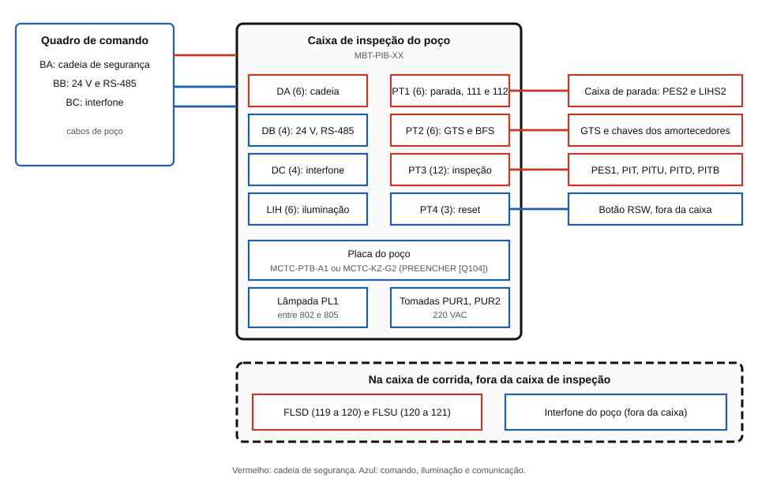

# Capítulo 11. Poço

> RASCUNHO v0.1 de 15/11/2026. Aguarda aprovação do Gelson e assinatura da Qualidade. Selos abertos: `PREENCHER [Q47]`, `PREENCHER [Q59]`, `PREENCHER [Q101]` e `PREENCHER [Q104]`. Fontes: folhas /19, /41, /42, /46 e /48 do esquema Vitinho 19061867-ZL.

**Parte III. Instalação em campo**

## 11.1 O que você vai aprender

Ao terminar este capítulo você será capaz de:

1. Dizer o que há no poço e o que cada dispositivo faz na cadeia de segurança.
2. Identificar os plugues da caixa de inspeção do poço e o que se liga em cada um.
3. Explicar como funcionam a parada e a inspeção do poço.
4. Ligar a iluminação, as tomadas e o interfone do poço.

> **PERIGO.** O poço é o lugar de maior risco para quem trabalha no elevador. Antes de entrar, desligue e bloqueie o elevador, acione o botão de parada do poço e confirme que a cabina não se move. Não ponteie nenhum contato da cadeia de segurança. Este livro traz o que os documentos do fabricante dizem; as exigências das normas sobre acesso ao poço e posição do botão de parada ainda não foram incorporadas: `PREENCHER [Q47]`.

## 11.2 O que há no poço

No poço do elevador de referência ficam:

| Componente | O que é | Fonte |
|---|---|---|
| Caixa de inspeção do poço (MBT-PIB-XX) | Reúne os plugues DA, DB, DC, PT1 a PT4 e LIH, a placa do poço, a lâmpada do poço (PL1) e as tomadas de 220 V (PUR1 e PUR2) | esquema /48 (pág. PDF 50) |
| Caixa de parada do poço (MBT-PIB-A12) | Reúne o botão de parada do poço (PES2) e o interruptor de iluminação do poço (LIHS2) | esquema /46 e /48 |
| Botoeira de inspeção do poço | Botão de parada (PES1) e as chaves PIT, PITU, PITD e PITB | esquema /42 |
| Botão de reset fora da caixa de corrida | Botão RSW, ligado ao plugue PT4 | esquema /42 |
| Chave elétrica da polia tensora (GTS) | contato da cadeia de segurança | esquema /41 |
| Chaves dos amortecedores 1 e 2 (BFS1 e BFS2) | contatos da cadeia de segurança | esquema /41 |
| Fins de curso FLSD e FLSU | contatos da cadeia de segurança | esquema /41 e /19 |
| Interfone do poço | alimentado pelo plugue DC | esquema /48 |

No elevador de referência, o responsável técnico informa que a caixa do poço é fixa, na altura do piso do primeiro pavimento (e não no fundo do poço), o mais perto possível da porta e ao alcance da mão do técnico, porque nela fica o botão de parada do poço. A posição e a altura exigidas pelas normas: `PREENCHER [Q47]`. O comprimento de cada cabo: `PREENCHER [Q101]` (capítulo 10).

**Figura 11.1.** Caixa de inspeção do poço, plugues e dispositivos do poço.
Fonte: esquema Vitinho 19061867-ZL, folhas /41, /42, /46 e /48 (págs. PDF 43, 44, 48 e 50).

## 11.3 Os plugues da caixa de inspeção do poço

| Plugue | Vias | Pino a pino | O que liga |
|---|---|---|---|
| DA | 6 | 1 = 119, 2 = 118, 3 = 122A, 4 = PE, 5 = 123, 6 = 111 | cabo de poço BA (cadeia de segurança) |
| DB | 4 | 1 = 301, 2 = 302, 3 = MOD+, 4 = MOD- | cabo de poço BB (24 V e RS-485) |
| DC | 4 | 1 = R, 2 = L, 3 = sem uso, 4 = DC12 | cabo de poço BC (interfone) |
| PT1 | 6 | 1 = 802, 2 = 805, 3 = PE, 4 = sem uso, 5 = 111, 6 = 112 | caixa de parada do poço (PES2 e iluminação) |
| PT2 | 6 | 1 = sem uso, 2 = 118B, 3 = PE, 4 = 119, 5 = 112, 6 = 113 | GTS e as chaves dos amortecedores |
| PT3 | 12 | 1 = 113, 2 = 118, 3 = 118B, 4 = 122A, 5 = 123, 6 = sem uso, 7 = 301, 8 = PX1, 9 = PX2, 10 = PX3, 11 = EB1, 12 = EB2 | botoeira de inspeção do poço e a placa do poço |
| PT4 | 3 | 1 = 301, 2 = PX4, 3 = sem uso | botão de reset fora da caixa de corrida |
| LIH | 6 | 1 = 802, 2 = 805, 3 = 803, 4 = 804, 5 = sem uso, 6 = PE | iluminação do poço (caixa de parada) |

Fonte: esquema Vitinho 19061867-ZL, folha /48 (pág. PDF 50).

> **NOTA.** O PT3 tem 12 vias, o PT4 tem 3 e os demais, 4 ou 6. Confira, antes de comprar os conectores, se o modelo escolhido tem vias suficientes para o PT3 e o PT4.

## 11.4 A cadeia de segurança no poço

A cadeia de segurança atravessa o poço por esta ordem, na parte que o esquema desenha: botão de parada do poço PES2 (entre 111 e 112, plugue PT1), chave da polia tensora GTS (entre 112 e 113, plugue PT2), botão de parada PES1 e chaves da inspeção do poço (a partir de 113, plugue PT3), chaves dos amortecedores BFS1 e BFS2 (entre 118B e 119, plugue PT2) e os fins de curso FLSD (entre 119 e 120) e FLSU (entre 120 e 121). No desenho, os fins de curso e o conjunto da polia tensora e dos amortecedores têm ligação ao terra.

O esquema chama o BFS1 e o BFS2 apenas de "Buffer switch 1" e "Buffer switch 2". O esquema VerticalParts diz que o BFS1 é o do amortecedor do carro e o BFS2, o do contrapeso. Enquanto você não confirmar, o livro os chama de chave do amortecedor 1 e chave do amortecedor 2.

A função de cada chave (o que ela detecta e por que existe): `PREENCHER [Q59]` (capítulo 1).

Fonte: esquema Vitinho, folhas /19 e /41 (págs. PDF 21 e 43).

## 11.5 A inspeção do poço

A botoeira de inspeção do poço é a "Pit inspection handle" do esquema. Reúne o botão de parada PES1 ("Handle stop button") e as chaves PIT (inspeção do poço), PITU (subir), PITD (descer) e PITB (comum). Ela se liga à placa do poço pelo plugue PT3. O parâmetro FA-63, bit 1, mostra que a inspeção do poço está ativa (capítulo 8).

**A placa do poço.** O esquema desenha a placa em duas folhas com nomes diferentes: "MCTC-PTB-A1, Pit inspection board" na folha /42 e "Pit extension board MCTC-KZ-G2" na folha /48. Qual é a placa instalada no elevador de referência: `PREENCHER [Q104]`.

A folha /42 mostra os terminais da placa em J9: 6 = M24V (301), 5 = X1 (PX1), 4 = X2 (PX2), 3 = X3 (PX3) e 2 = X4 (PX4). PX1 a PX3 são três sinais da botoeira de inspeção, mas a correspondência botão a sinal não ficou legível no desenho. PX4 é o sinal do botão de reset fora da caixa de corrida. A placa tem também um jumper J15 de três posições (M24V, OP e COM). Os sinais EB1 e EB2 (PT3 11 e 12) vão ao circuito do alarme do interfone.

> **ATENÇÃO.** Com a inspeção do poço ativa, a cabina anda só pelos botões do poço. O botão de parada PES1 e o PES2 fazem parte da cadeia de segurança e não podem ser anulados.

Fonte: esquema Vitinho 19061867-ZL, folhas /42 e /48 (págs. PDF 44 e 50); manual NICE3000new, parâmetros FA-33 e FA-63 (capítulo 12).

## 11.6 Iluminação, tomadas e interfone

**Iluminação do poço.** Várias lâmpadas (LIH1, LIH2, LIH3 até LIHn) ficam em paralelo entre as redes 805 e 802. A rede 802 vem do QFB4 e a 805, do interruptor. O esquema mostra dois interruptores de duas posições, o LIHS1 no quadro de comando e o LIHS2 na caixa de parada do poço, ligados pelas redes 807 e 809 do lado do quadro e 803 e 804 do lado do poço. O desenho não descreve a função dos dois interruptores. Uma leitura natural é a de um comando de dois pontos, em que se liga e se desliga a iluminação do quadro ou do poço, mas o desenho não diz isso.

**Lâmpada e tomadas do poço.** Dentro da caixa de inspeção do poço ficam a lâmpada PL1 (entre 802 e 805, plugue PT1) e a tomada PUR1 de 220 VAC. A folha /48 mostra duas tomadas (PUR1 e PUR2). Corrente máxima da tomada: o esquema não informa.

**Interfone.** O plugue DC leva R, L e DC12 (12 V) ao interfone do poço. A nota da folha /48 manda ligar o interfone do poço e instalar o interfone fora da caixa de inspeção do poço (soquete AMP, pino macho). A sigla do esquema para o plugue de iluminação é LIH.

Fonte: esquema Vitinho, folhas /46 e /48 (págs. PDF 48 e 50).

## 11.7 Se o seu elevador tiver outra configuração

| Se o seu elevador tiver | O que muda |
|---|---|
| Caixa de inspeção no fundo do poço | O cabo BA, o BB e o BC descem até o fundo, e o comprimento muda (capítulo 10) |
| Mais de uma caixa de parada | Cada caixa de parada acrescenta um PES na cadeia, entre 111 e 112 |
| Sem botão de reset fora da caixa de corrida | O plugue PT4 não é usado |
| Casa de máquinas | Outras folhas de alimentação; o poço é o mesmo (capítulo 1) |

Fonte: esquema Vitinho, folhas /19, /41 e /48.

## 11.8 Teste o que você aprendeu

1. Quais plugues levam a cadeia de segurança do poço? *(Seção 11.3: DA, PT1, PT2 e PT3.)*
2. Entre quais redes ficam o PES2, o GTS e os fins de curso? *(Seção 11.4: 111 e 112; 112 e 113; 119, 120 e 121.)*
3. O que é a botoeira de inspeção do poço? *(Seção 11.5: PES1, PIT, PITU, PITD e PITB, ligados pelo plugue PT3.)*
4. Quais redes alimentam a lâmpada do poço? *(Seção 11.6: 802 e 805.)*
5. O que o esquema manda fazer com o interfone do poço? *(Seção 11.6: ligar e instalar o interfone fora da caixa de inspeção do poço.)*

## Fontes do capítulo

- Esquema Vitinho 19061867-ZL (2023-07-18), folhas /19, /41, /42, /46 e /48 (págs. PDF 21, 43, 44, 48 e 50).
- Esquema VerticalParts 19060918-ZL (página 30 e legenda da página 12), para BFS1 e BFS2.
- Manual NICE3000new, `Manual_Usuario_Controlador_NICE3000new_Completo.pdf`, para FA-33 e FA-63.
