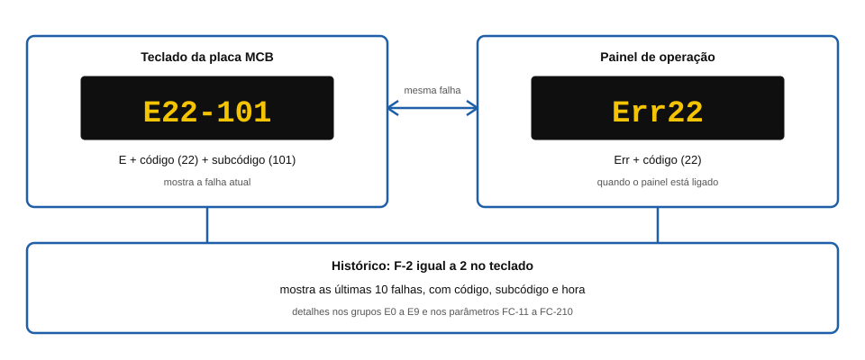
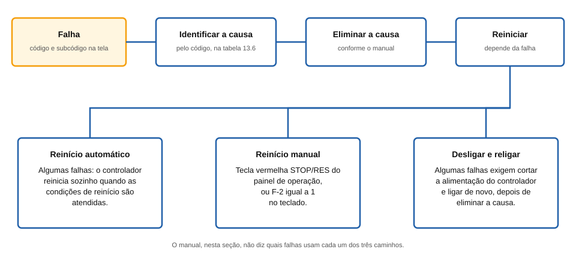
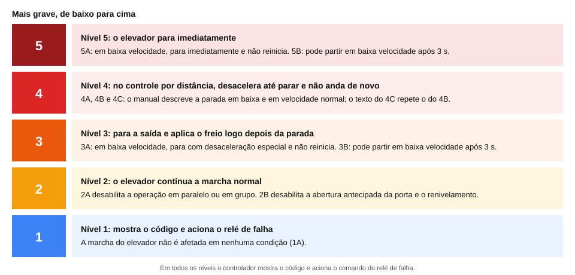

# Capítulo 13. Diagnóstico de falhas

> RASCUNHO v0.1 de 14/11/2026. Texto revisado pelo Gelson em 14/11/2026; aguarda a assinatura da Qualidade. A tabela de falhas é tradução fiel do capítulo 7 do manual do controlador; a revisão técnica final é do responsável técnico e da Qualidade. Este arquivo é montado por `build/monta_cap13.py`; edite os arquivos de origem.

**Parte IV. Comissionamento**

## 13.1 O que você vai aprender

Ao terminar este capítulo você será capaz de:

1. Ler um código de falha no teclado da placa MCB e no painel de operação.
2. Dizer o que cada nível de falha faz com o elevador.
3. Reiniciar o controlador depois de uma falha do jeito que a falha exige.
4. Encontrar, para um código, a causa possível e o que o manual manda verificar.

> **PERIGO.** Antes de abrir o quadro de comando ou tocar em qualquer borne para diagnosticar uma falha, desligue toda a alimentação e espere no mínimo 10 minutos. Nunca ponteie a cadeia de segurança nem as fechaduras para testar uma falha: isso anula a proteção (capítulo 1). Fonte: manual NICE3000new, págs. PDF 20 e 21.

## 13.2 Como a falha aparece

Quando o controlador detecta uma falha, ele avisa e registra as informações dela.

- **No teclado da placa MCB** aparecem o código e o subcódigo da falha atual, por exemplo **E22-101**.
- **No painel de operação**, quando ele está ligado, aparece o código da falha atual, por exemplo **Err22**.
- Com o parâmetro **F-2 igual a 2** no teclado, ele mostra as últimas 10 falhas, com código, subcódigo e hora.
- O controlador grava informação detalhada das últimas 10 falhas e informação simples de 50 grupos de falhas. Os detalhes estão nos grupos de parâmetros E0 a E9 e nos parâmetros FC-11 a FC-210.

O código aparece então em dois formatos para a mesma falha: "E22-101" no teclado e "Err22" no painel. Neste livro, a tabela usa o formato "Err" e o texto cita o subcódigo quando ele existe.

Fonte: manual NICE3000new, seção 7.1, pág. PDF 265 (impressa 264), figuras 7-1 e 7-2.

**Figura 13.1.** A mesma falha aparece como E22-101 no teclado da placa MCB e como Err22 no painel de operação. O código 22 é o do exemplo do manual.
Fonte: manual NICE3000new, seção 7.1, pág. PDF 265.

## 13.3 Como reiniciar depois da falha

| Etapa | O que fazer |
|---|---|
| Quando a falha ocorre | Com F-2 igual a 2 no teclado, veja as últimas 10 falhas (código, subcódigo e hora). |
| Antes de reiniciar | Identifique a causa pelo código no painel de operação e elimine-a conforme a seção 13.5. |
| Reinício automático | Em algumas falhas, depois de eliminada a causa, o controlador reinicia sozinho quando as condições de reinício são atendidas. |
| Reinício manual | Algumas falhas exigem reinício manual: pressione a tecla vermelha STOP/RES do painel de operação ou ajuste F-2 para 1 no teclado. |
| Reinício desligando | Algumas falhas exigem desligar a alimentação do controlador e ligar de novo depois de eliminar a causa. |

Fonte: manual NICE3000new, seção 7.2, pág. PDF 266 (impressa 265).

**Figura 13.2.** Reinício depois da falha: automático, manual ou desligando e religando o controlador.
Fonte: manual NICE3000new, seção 7.2, pág. PDF 266.

## 13.4 Os cinco níveis de falha

O NICE3000new tem quase 70 informações de alarme e funções de proteção. Elas são classificadas em cinco níveis, de acordo com a gravidade. O que o controlador faz depende do nível.

| Nível | O que o controlador faz | Subníveis |
|---|---|---|
| 1 | Mostra o código da falha e aciona o comando do relé de falha | 1A: a marcha do elevador não é afetada em nenhuma condição |
| 2 | Mostra o código, aciona o relé de falha e o elevador continua a marcha normal | 2A: a função de operação em paralelo ou em grupo é desabilitada. 2B: a função de abertura antecipada da porta e de renivelamento é desabilitada |
| 3 | Mostra o código, aciona o relé de falha, para a saída e aplica o freio logo depois da parada | 3A: em baixa velocidade, o elevador para com taxa especial de desaceleração e não pode reiniciar. 3B: em baixa velocidade o elevador não para; em velocidade normal ele para e depois pode partir em baixa velocidade, após 3 s |
| 4 | Mostra o código e aciona o relé de falha; no controle por distância o elevador desacelera até parar e não pode andar de novo | 4A: em baixa velocidade, para com taxa especial de desaceleração e não pode reiniciar. 4B: em baixa velocidade não para; em velocidade normal para e depois pode partir em baixa velocidade, após 3 s. 4C: o manual dá para o 4C o mesmo texto do 4B |
| 5 | Mostra o código, aciona o relé de falha e o elevador para imediatamente | 5A: em baixa velocidade, para imediatamente e não pode reiniciar. 5B: em baixa velocidade não para; em velocidade normal para e depois pode partir em baixa velocidade, após 3 s |

Fonte: manual NICE3000new, seção 7.3, Tabela 7-1, pág. PDF 267 (impressa 266).

**Figura 13.3.** Os cinco níveis de falha, do menos grave (1) ao mais grave (5).
Fonte: manual NICE3000new, seção 7.3, Tabela 7-1, pág. PDF 267.

## 13.5 Como usar a tabela de falhas

Para cada código a tabela traz o nome da falha em português e o original em inglês, o nível, o subcódigo (quando existe) e as causas possíveis, cada uma com o que verificar ou fazer. O livro traduz o que o manual diz e não acrescenta causa nem solução. Onde o texto do manual ficou ambíguo, a tabela mantém o original entre aspas e manda ver a página.

Os códigos Err01, Err63 e Err68 não constam na tabela do manual. Alguns códigos são "Reserved" (reservados) e o manual manda contatar o agente ou a Inovance. As notas do manual depois da tabela aparecem junto do código a que se referem.

Fonte: manual NICE3000new, seção 7.4, págs. PDF 268 a 289 (impressas 267 a 288).

## 13.6 Tabela de falhas

### Err02. Sobrecorrente durante a aceleração (Overcurrent during acceleration)
- Nível: 5A. Páginas do manual: 268.
- Subcódigos: nenhum.

| Causa possível | O que verificar ou fazer |
|---|---|
| A saída do circuito principal está aterrada ou em curto-circuito | Verificar se os cabos do motor e de aterramento estão ligados corretamente; verificar se o contator de curto do estator do motor síncrono causa curto-circuito no lado de saída do controlador; verificar se os cabos do motor têm a capa danificada |
| A autossintonia do motor foi feita de forma inadequada | Verificar se os parâmetros do motor estão de acordo com a placa de identificação; fazer a autossintonia do motor novamente |
| O sinal do encoder está incorreto | Verificar se o número de pulsos por revolução (PPR) do encoder está ajustado corretamente; verificar se o sinal do encoder sofre interferência, se o cabo do encoder passa independente no eletroduto, se o cabo é longo demais e se a malha (shield) está aterrada em uma só extremidade; verificar se o encoder está instalado de forma firme e se o eixo rotativo está ligado ao eixo do motor de forma firme, observando se o encoder está estável durante a marcha em velocidade normal; verificar se a ligação dos fios do encoder está correta. Para o motor assíncrono, executar SVC e comparar a corrente para julgar se o encoder funciona corretamente |
| A sequência de fases do motor está incorreta | Trocar a sequência de fases UVW do motor |
| O tempo de aceleração é muito curto | Reduzir a taxa de aceleração |

- Notas do manual: nenhuma.

### Err03. Sobrecorrente durante a desaceleração (Overcurrent during deceleration)
- Nível: 5A. Páginas do manual: 269.
- Subcódigos: nenhum.

| Causa possível | O que verificar ou fazer |
|---|---|
| A saída do circuito principal está aterrada ou em curto-circuito | Verificar se os cabos do motor e de aterramento estão ligados corretamente; verificar se o contator de curto do estator do motor síncrono causa curto-circuito no lado de saída do controlador; verificar se os cabos do motor têm a capa danificada |
| A autossintonia do motor foi feita de forma inadequada | Verificar se os parâmetros do motor estão de acordo com a placa de identificação; fazer a autossintonia do motor novamente |
| O sinal do encoder está incorreto | Verificar se o número de pulsos por revolução (PPR) do encoder está ajustado corretamente; verificar se o sinal do encoder sofre interferência, se o cabo do encoder passa independente no eletroduto, se o cabo é longo demais e se a malha (shield) está aterrada em uma só extremidade; verificar se o encoder está instalado de forma firme e se o eixo rotativo está ligado ao eixo do motor de forma firme, observando se o encoder está estável durante a marcha em velocidade normal; verificar se a ligação dos fios do encoder está correta. Para o motor assíncrono, executar SVC e comparar a corrente para julgar se o encoder funciona corretamente |
| A taxa de desaceleração é muito curta (texto original: "The deceleration rate is too short") | Reduzir a taxa de desaceleração |

- Notas do manual: nenhuma.

### Err04. Sobrecorrente em velocidade constante (Overcurrent at constant speed)
- Nível: 5A. Páginas do manual: 269.
- Subcódigos: nenhum.

| Causa possível | O que verificar ou fazer |
|---|---|
| A saída do circuito principal está aterrada ou em curto-circuito | Verificar se os cabos do motor e de aterramento estão ligados corretamente; verificar se o contator de curto do estator do motor síncrono causa curto-circuito no lado de saída do controlador; verificar se os cabos do motor têm a capa danificada |
| A autossintonia do motor foi feita de forma inadequada | Verificar se os parâmetros do motor estão de acordo com a placa de identificação; fazer a autossintonia do motor novamente |
| O sinal do encoder está incorreto | Verificar se o número de pulsos por revolução (PPR) do encoder está ajustado corretamente; verificar se o sinal do encoder sofre interferência, se o cabo do encoder passa independente no eletroduto, se o cabo é longo demais e se a malha (shield) está aterrada em uma só extremidade; verificar se o encoder está instalado de forma firme e se o eixo rotativo está ligado ao eixo do motor de forma firme, observando se o encoder está estável durante a marcha em velocidade normal; verificar se a ligação dos fios do encoder está correta. Para o motor assíncrono, executar SVC e comparar a corrente para julgar se o encoder funciona corretamente |

- Notas do manual: nenhuma.

### Err05. Sobretensão durante a aceleração (Overvoltage during acceleration)
- Nível: 5A. Páginas do manual: 270.
- Subcódigos: nenhum.

| Causa possível | O que verificar ou fazer |
|---|---|
| A tensão de entrada é muito alta | Verificar se a tensão de entrada é muito alta; observar se a tensão do barramento é muito alta (normal: 540 a 580 V para entrada de 380 V) |
| A resistência regenerativa é muito grande, ou a unidade de frenagem falha (texto original: "The regen. resistance is too large, or the braking unit fails") | Verificar o coeficiente de balanceamento; verificar se a tensão do barramento sobe rápido demais durante a marcha. Se sim, o resistor de frenagem não funciona ou seu modelo é inadequado: verificar se o cabo que liga o resistor de frenagem está danificado, se o fio de cobre toca o terra e se a ligação é firme; verificar se a resistência é adequada com base na recomendação do capítulo 4 e selecionar um resistor de frenagem adequado; se uma unidade de frenagem for usada, verificar se ela funciona corretamente e se o modelo é adequado. Se a resistência do resistor de frenagem for adequada e a sobretensão ocorrer toda vez que o elevador atinge a velocidade alvo, diminuir os valores de F2-01 ou F2-04 para reduzir o erro de seguimento da curva e evitar sobretensão por ultrapassagem (overshoot) do sistema |
| A taxa de aceleração é muito curta | Reduzir a taxa de aceleração |

- Notas do manual: nenhuma.

### Err06. Sobretensão durante a desaceleração (Overvoltage during deceleration)
- Nível: 5A. Páginas do manual: 270.
- Subcódigos: nenhum.

| Causa possível | O que verificar ou fazer |
|---|---|
| A tensão de entrada é muito alta | Verificar se a tensão de entrada é muito alta; observar se a tensão do barramento é muito alta (normal: 540 a 580 V para entrada de 380 V) |
| A resistência regenerativa é muito grande, ou a unidade de frenagem falha (texto original: "The regen resistance is too large, or the braking unit fails") | Verificar o coeficiente de balanceamento; verificar se a tensão do barramento sobe rápido demais durante a marcha. Se sim, o resistor de frenagem não funciona ou seu modelo é inadequado: verificar se o cabo que liga o resistor de frenagem está danificado, se o fio de cobre toca o terra e se a ligação é firme; verificar se a resistência é adequada com base na recomendação do capítulo 4 e selecionar um resistor de frenagem adequado; se uma unidade de frenagem for usada, verificar se ela funciona corretamente e se o modelo é adequado. Se a resistência do resistor de frenagem for adequada e a sobretensão ocorrer toda vez que o elevador atinge a velocidade alvo, diminuir os valores de F2-01 ou F2-04 para reduzir o erro de seguimento da curva e evitar sobretensão por ultrapassagem (overshoot) do sistema |
| A taxa de desaceleração é muito curta | Reduzir a taxa de desaceleração |

- Notas do manual: nenhuma.

### Err07. Sobretensão em velocidade constante (Overvoltage at constant speed)
- Nível: 5A. Páginas do manual: 271.
- Subcódigos: nenhum.

| Causa possível | O que verificar ou fazer |
|---|---|
| A tensão de entrada é muito alta | Verificar se a tensão de entrada é muito alta; observar se a tensão do barramento é muito alta (normal: 540 a 580 V para entrada de 380 V) |
| A resistência regenerativa é muito grande, ou a unidade de frenagem falha | Verificar o coeficiente de balanceamento; verificar se a tensão do barramento sobe rápido demais durante a marcha. Se sim, o resistor de frenagem não funciona ou seu modelo é inadequado: verificar se o cabo que liga o resistor de frenagem está danificado, se o fio de cobre toca o terra e se a ligação é firme; verificar se a resistência é adequada com base na recomendação do capítulo 4 e selecionar um resistor de frenagem adequado; se uma unidade de frenagem for usada, verificar se ela funciona corretamente e se o modelo é adequado. Se a resistência do resistor de frenagem for adequada e a sobretensão ocorrer toda vez que o elevador atinge a velocidade alvo, diminuir os valores de F2-01 ou F2-04 para reduzir o erro de seguimento da curva e evitar sobretensão por ultrapassagem (overshoot) do sistema |

- Notas do manual: nenhuma.

### Err08. Período de aviso de manutenção atingido (Maintenance notification period reached)
- Nível: 5A. Páginas do manual: 271.
- Subcódigos: nenhum.

| Causa possível | O que verificar ou fazer |
|---|---|
| O elevador não foi mantido dentro do período de aviso | Desligar a alimentação e fazer a manutenção do elevador; desativar a função de aviso de manutenção ajustando F9-13 para 0; contatar o agente ou o fabricante |

- Notas do manual: nenhuma.

### Err09. Subtensão (Undervoltage)
- Nível: 5A. Páginas do manual: 271.
- Subcódigos: nenhum.

| Causa possível | O que verificar ou fazer |
|---|---|
| Ocorre falta de energia instantânea na alimentação de entrada | Verificar se a energia falha durante a marcha; verificar se a ligação de todos os cabos de entrada de alimentação está firme |
| A tensão de entrada é muito baixa | Verificar se a tensão da alimentação externa é muito baixa |
| A placa de controle do inversor falha | Contatar o agente ou o fabricante |

- Notas do manual: nenhuma.

### Err10. Sobrecarga do controlador (Controller overload)
- Nível: 5A. Páginas do manual: 272.
- Subcódigos: nenhum.

| Causa possível | O que verificar ou fazer |
|---|---|
| A resistência mecânica é muito grande | Verificar se o freio está liberado e se a alimentação do freio está normal; verificar se as sapatas de guia estão apertadas demais |
| O coeficiente de balanceamento está inadequado | Verificar se o coeficiente de balanceamento está correto |
| O sinal de realimentação do encoder está anormal | Verificar se o sinal de realimentação do encoder e o ajuste de parâmetros estão corretos, e se o ângulo inicial do encoder para o PMSM está correto |
| A autossintonia do motor não foi feita corretamente (neste caso, a corrente de marcha do elevador é maior que a normal) | Verificar o ajuste dos parâmetros do motor e fazer a autossintonia do motor novamente; se esta falha for reportada quando o experimento de escorregamento (slip) é realizado, fazer o experimento de escorregamento usando a função ajustada em F3-24 |
| A sequência de fases do motor está incorreta | Verificar se a sequência de fases UVW do motor está correta |
| O modelo do inversor (AC drive) é de classe de potência baixa demais | Verificar se a corrente excedeu a corrente nominal do inversor durante a marcha em velocidade estável do elevador com a cabina vazia |

- Notas do manual: nenhuma.

### Err11. Sobrecarga do motor (Motor overload)
- Nível: 5A. Páginas do manual: 272.
- Subcódigos: nenhum.

| Causa possível | O que verificar ou fazer |
|---|---|
| A resistência mecânica é muito grande | Verificar se o freio está liberado e se a alimentação do freio está normal; verificar se as sapatas de guia estão apertadas demais |
| O coeficiente de balanceamento está inadequado | Verificar se o coeficiente de balanceamento está correto |
| A autossintonia do motor não foi feita corretamente (neste caso, a corrente de marcha do elevador é maior que a normal) | Verificar o ajuste dos parâmetros do motor e fazer a autossintonia do motor novamente; se esta falha for reportada quando o experimento de escorregamento (slip) é realizado, fazer o experimento de escorregamento usando a função ajustada em F3-24 |
| A sequência de fases do motor está incorreta | Verificar se a sequência de fases UVW do motor está correta |
| O modelo do motor é de classe de potência baixa demais | Verificar se a corrente excedeu a corrente nominal do motor durante a marcha em velocidade estável do elevador com a cabina vazia |

- Notas do manual: nenhuma.

### Err12. Falta de fase na alimentação (Power supply phase loss)
- Nível: 5A. Páginas do manual: 272.
- Subcódigos: nenhum.

| Causa possível | O que verificar ou fazer |
|---|---|
| As fases da entrada de alimentação não são simétricas | Verificar se alguma das três fases da alimentação foi perdida; verificar se as três fases da alimentação estão equilibradas; verificar se a tensão da alimentação está normal e, se não estiver, ajustar a alimentação |
| A placa de controle do inversor falha | Contatar o agente ou o fabricante |

- Notas do manual: nenhuma.

### Err13. Falta de fase na saída (Power output phase loss)
- Nível: 5A. Páginas do manual: 272.
- Subcódigos: nenhum.

| Causa possível | O que verificar ou fazer |
|---|---|
| A ligação de saída do circuito principal está solta | Verificar se a ligação do motor está firme; verificar se o contator RUN do lado da saída está normal |
| O motor está danificado | Verificar se o motor está anormal internamente |

- Notas do manual: nenhuma.

### Err14. Superaquecimento do módulo (Module overheat)
- Nível: 5A. Páginas do manual: 273.
- Subcódigos: nenhum.

| Causa possível | O que verificar ou fazer |
|---|---|
| A temperatura ambiente é muito alta | Reduzir a temperatura ambiente |
| O ventilador está danificado | Trocar o ventilador |
| O filtro de ar está bloqueado | Limpar o filtro de ar; verificar se a folga de instalação do controlador atende ao requisito |

- Notas do manual: nenhuma.

### Err15. Saída anormal (Output abnormal)
- Nível: 5A. Páginas do manual: 273.
- Subcódigos: 1: o resistor regenerativo está em curto-circuito; 2: o IGBT de frenagem está em curto-circuito.

| Causa possível | O que verificar ou fazer |
|---|---|
| Subcódigo 1: o resistor regenerativo está em curto-circuito | Verificar se a ligação do resistor regenerativo e da unidade de frenagem está correta, sem curto-circuito; verificar se o contator principal funciona corretamente e se há problema de arco ou de travamento (texto original: "arch or stuck problem") |
| Subcódigo 2: o IGBT de frenagem está em curto-circuito | Contatar o agente ou a Inovance |

- Notas do manual: nenhuma.

### Err16. Falha de controle de corrente (Current control fault)
- Nível: 5A. Páginas do manual: 273.
- Subcódigos: 1: o desvio da corrente de excitação é grande demais; 2: o desvio da corrente de torque é grande demais; 3: o desvio de velocidade é grande demais.

| Causa possível | O que verificar ou fazer |
|---|---|
| Subcódigo 1: o desvio da corrente de excitação é grande demais; Subcódigo 2: o desvio da corrente de torque é grande demais (as duas causas dividem o mesmo bloco de soluções, conforme o PDF) | Verificar se a tensão de entrada está baixa (frequente em alimentação provisória); verificar se a ligação do cabo entre o controlador e o motor está firme; verificar se o contator RUN funciona corretamente |
| Subcódigo 3: o desvio de velocidade é grande demais | Verificar o circuito do encoder; verificar se o número de pulsos por revolução (PPR) do encoder está ajustado corretamente; verificar se o sinal do encoder sofre interferência; verificar se o cabo do encoder passa independente no eletroduto, se o cabo é longo demais ou se a malha (shield) está aterrada em uma só extremidade; verificar se o encoder está instalado de forma firme, se o eixo rotativo está ligado ao eixo do motor de forma firme ou se o encoder está estável durante a marcha em velocidade normal; verificar se os parâmetros do motor estão corretos e fazer a autossintonia do motor novamente; aumentar o limite superior de torque em F2-08 |

- Notas do manual: nenhuma.

### Err17. Interferência no encoder durante a autossintonia do motor (Encoder interference during motor auto-tuning)
- Nível: 5A. Páginas do manual: 273.
- Subcódigos: 1: reservado; 2: o sinal do encoder SIN/COS está anormal; 3: o sinal do encoder UVW está anormal.

| Causa possível | O que verificar ou fazer |
|---|---|
| Subcódigo 1: reservado | Reservado |
| Subcódigo 2: o sinal do encoder SIN/COS está anormal | Existe interferência séria nos sinais C, D e Z do encoder SIN/COS; verificar se o cabo do encoder está passado separado dos cabos de potência e se o aterramento do sistema é confiável; verificar se a placa PG está ligada corretamente |
| Subcódigo 3: o sinal do encoder UVW está anormal | Existe interferência séria nos sinais U, V e W do encoder UVW; verificar se o cabo do encoder está passado separado dos cabos de potência e se o aterramento do sistema é confiável; verificar se a placa PG está ligada corretamente |

- Notas do manual: nenhuma.

### Err18. Falha de detecção de corrente (Current detection fault)
- Nível: 5A. Páginas do manual: 274.
- Subcódigos: nenhum.

| Causa possível | O que verificar ou fazer |
|---|---|
| A placa de controle do inversor falha | Contatar o agente ou o fabricante |

- Notas do manual: nenhuma.

### Err19. Falha de autossintonia do motor (Motor auto-tuning fault)
- Nível: 5A. Páginas do manual: 274.
- Subcódigos: 1: a autossintonia da resistência do estator falha; 5: a autossintonia da posição do polo magnético falha; 8: a autossintonia estática do motor síncrono foi selecionada, mas o tipo de encoder não é SIN/COS; 9: a flutuação do sinal CD é grande demais na autossintonia estática do motor síncrono; 12: o ângulo inicial do encoder não foi aprendido durante a autossintonia sem ângulo (angle-free) do motor síncrono, e por isso é emitido um alarme.

| Causa possível | O que verificar ou fazer |
|---|---|
| Subcódigo 1: a autossintonia da resistência do estator falha; Subcódigo 5: a autossintonia da posição do polo magnético falha | Verificar a ligação do motor |
| Subcódigo 8: a autossintonia estática do motor síncrono foi selecionada, mas o tipo de encoder não é SIN/COS | Selecionar outros modos de autossintonia ou mudar o tipo de encoder para encoder SIN/COS |
| Subcódigo 9: a flutuação do sinal CD é grande demais na autossintonia estática do motor síncrono | Existe interferência de hardware nos sinais CD do encoder SIN/COS; verificar se o aterramento está normal |
| Subcódigo 12: o ângulo inicial do encoder não foi aprendido durante a autossintonia sem ângulo do motor síncrono, e por isso é emitido um alarme | Na autossintonia sem ângulo semiautomática, o elevador só pode rodar em velocidade normal depois que o ângulo inicial do encoder for obtido no modo de inspeção |

- Notas do manual: nenhuma.

### Err20. Realimentação de velocidade incorreta (Speed feedback incorrect)
- Nível: 5A. Páginas do manual: 275.
- Subcódigos: 1: o sinal do encoder não é detectado durante a autossintonia sem carga do motor síncrono; 2 e 8: reservado; 3 e 15: ver as duas linhas abaixo (o manual traz duas linhas para "3, 15"); 4: o sinal Z não pode ser detectado durante a autossintonia do motor síncrono; 5: os cabos do encoder SIN/COS estão rompidos; 7: os cabos do encoder UVW estão rompidos; 9: o desvio de velocidade é grande demais; 12: os sinais AB do encoder são perdidos na partida; 13: os sinais AB do encoder são perdidos durante a marcha; 14: o sinal Z é perdido durante a marcha normal; 19: os sinais do encoder SIN/COS sofrem interferência séria durante a marcha; 55: os sinais do encoder SIN/COS sofrem interferência séria ou os sinais CD estão incorretos durante a autossintonia do motor.

| Causa possível | O que verificar ou fazer |
|---|---|
| Subcódigo 1: o sinal do encoder não é detectado durante a autossintonia sem carga do motor síncrono | Verificar se o circuito do sinal do encoder está normal; verificar se a placa PG está normal; verificar se o freio foi liberado |
| Subcódigos 4, 5, 7 e 14 (sinal Z não detectado na autossintonia do motor síncrono; cabos do encoder SIN/COS rompidos; cabos do encoder UVW rompidos; sinal Z perdido durante a marcha normal; as quatro causas dividem o mesmo bloco de soluções, conforme o PDF) | Verificar se o circuito do sinal do encoder está normal; verificar se a placa PG está normal |
| Subcódigos 2, 8: reservado | Reservado |
| Subcódigos 3, 15: a sequência dos cabos do motor está incorreta, o freio do motor não foi acionado, ou a qualidade do sinal do encoder é ruim (texto original: "the motor brake is not started") | Trocar a sequência dos cabos de quaisquer duas das fases U, V e W do motor; verificar se o freio é acionado durante a autossintonia com carga do motor síncrono (texto original: "Check whether the brake is started during synchronous motor with-load auto-tuning"); verificar o circuito do sinal do encoder |
| Subcódigos 3, 15: a sequência de fases do motor está incorreta (segunda linha para os mesmos subcódigos, como no manual) | Trocar quaisquer duas fases dos cabos UVW do motor; verificar se o freio é liberado durante a autossintonia com carga do motor síncrono |
| Subcódigo 9: o desvio de velocidade é grande demais | O ângulo do motor síncrono está anormal; fazer a autossintonia do motor novamente; reduzir o KP do laço de velocidade de travamento de posição (texto original: "position lock speed loop KP"); o ganho proporcional do laço de velocidade é excessivo ou o tempo integral é insuficiente: diminuir o ganho proporcional ou aumentar adequadamente o tempo integral; verificar a sequência de fases do motor |
| Subcódigo 12: os sinais AB do encoder são perdidos na partida | Verificar se o freio foi liberado; verificar se os cabos de sinal AB do encoder estão rompidos; se o motor não puder ser partido no experimento de escorregamento (slip), fazer o experimento de escorregamento usando a função ajustada em F3-24 |
| Subcódigo 13: os sinais AB do encoder são perdidos durante a marcha | Os sinais AB do encoder são perdidos de repente; verificar se a ligação do encoder está correta, se existe interferência forte ou se o motor ficou travado por falta repentina de alimentação do freio durante a marcha |
| Subcódigo 19: os sinais do encoder SIN/COS sofrem interferência séria durante a marcha | Os sinais analógicos do encoder sofrem interferência séria durante a marcha do motor, ou os sinais do encoder estão com mau contato; é preciso verificar o circuito do encoder |
| Subcódigo 55: os sinais do encoder SIN/COS sofrem interferência séria ou os sinais CD estão incorretos durante a autossintonia do motor | Os sinais analógicos do encoder sofrem interferência séria durante a autossintonia do motor, ou os sinais CD do encoder estão em sequência errada |

Trecho com duas linhas para "3, 15": o PDF mostra mesmo duas linhas com os subcódigos 3 e 15 (pág. 275), com causas e soluções diferentes; mantidas como no manual.

- Notas do manual: nenhuma.

### Err21. Parâmetros ajustados incorretamente (Parameters are incorrectly set)
- Nível: 5A. Páginas do manual: 276.
- Subcódigos: 2: o valor ajustado da frequência máxima é menor que a frequência nominal do motor; 3: o tipo de encoder está ajustado incorretamente.

| Causa possível | O que verificar ou fazer |
|---|---|
| Subcódigo 2: o valor ajustado da frequência máxima é menor que a frequência nominal do motor | Aumentar o valor de F0-06 para que seja maior que a frequência nominal do motor |
| Subcódigo 3: o tipo de encoder está ajustado incorretamente | O encoder SIN/COS, absoluto ou ABZ está ajustado incorretamente como encoder UVW; testar se o valor ajustado de F1-00 corresponde ao encoder |

- Notas do manual: nenhuma.

### Err22. Sinal de nivelamento anormal (Leveling signal abnormal)
- Nível: 1A. Páginas do manual: 276.
- Subcódigos: 101: o sinal de nivelamento está travado (stuck); 102: o sinal de nivelamento está perdido; 103: o desvio da posição de nivelamento é grande demais no estado de marcha automática do elevador.

| Causa possível | O que verificar ou fazer |
|---|---|
| Subcódigo 101: o sinal de nivelamento está travado; Subcódigo 102: o sinal de nivelamento está perdido (as duas causas dividem o mesmo bloco de soluções, conforme o PDF) | Verificar se os interruptores de nivelamento e de zona de porta funcionam corretamente; verificar a verticalidade e a profundidade de instalação das placas de nivelamento; verificar os pontos de entrada do sinal de nivelamento da MCB |
| Subcódigo 103: o desvio da posição de nivelamento é grande demais no estado de marcha automática do elevador | Verificar se o cabo de aço (steel rope) escorrega |

- Notas do manual: nenhuma.

### Err23. Curto-circuito (Short circuit)
- Nível: 5A. Páginas do manual: 276.
- Subcódigos: 1, 2, 3: existe curto-circuito para o terra; 4: existe curto-circuito entre fases.

| Causa possível | O que verificar ou fazer |
|---|---|
| Subcódigos 1, 2, 3: existe curto-circuito para o terra | Verificar se a saída trifásica do inversor (AC drive) está em curto-circuito para o terra |
| Subcódigo 4: existe curto-circuito entre fases | Verificar se a saída trifásica do inversor (AC drive) está em curto-circuito entre fases ou para o terra |

- Notas do manual: nenhuma.

### Err24. Falha do relógio RTC (RTC clock fault)
- Nível: 3B. Páginas do manual: 276.
- Subcódigos: 101: a informação do relógio RTC da MCB está anormal.

| Causa possível | O que verificar ou fazer |
|---|---|
| Subcódigo 101: a informação do relógio RTC da MCB está anormal | Trocar a bateria do relógio; trocar a MCB |

- Notas do manual: nenhuma.

### Err25. Dados armazenados anormais (Storage data abnormal)
- Nível: 4A. Páginas do manual: 276.
- Subcódigos: 101, 102, 103: os dados armazenados da MCB estão anormais.

| Causa possível | O que verificar ou fazer |
|---|---|
| Subcódigos 101, 102, 103: os dados armazenados da MCB estão anormais | Contatar o agente ou o fabricante |

- Notas do manual: nenhuma.

### Err26. Sinal de terremoto (Earthquake signal)
- Nível: 3B. Páginas do manual: 276.
- Subcódigos: 101: o sinal de terremoto está ativo e a duração excede 2 s.

| Causa possível | O que verificar ou fazer |
|---|---|
| Subcódigo 101: o sinal de terremoto está ativo e a duração excede 2 s | Subcódigo 101: verificar se o sinal de terremoto é coerente com o ajuste de parâmetro (NC, NO) da MCB |

- Notas do manual: nenhuma.

### Err27. Falha do controlador especial (Fault of special controller)
- Nível: "-" (sem nível na tabela). Páginas do manual: 276.
- Subcódigos: nenhum.

| Causa possível | O que verificar ou fazer |
|---|---|
| Reservado | Contatar o agente ou a Inovance |

- Notas do manual: nenhuma.

### Err28. Falha de manutenção (Maintenance fault)
- Nível: "-" (sem nível na tabela). Páginas do manual: 276.
- Subcódigos: nenhum.

| Causa possível | O que verificar ou fazer |
|---|---|
| Reservado | Contatar o agente ou a Inovance |

- Notas do manual: nenhuma.

### Err29. Realimentação anormal do contator de curto do estator do motor síncrono (Shorting motor stator contactor feedback abnormal)
- Nível: 5A. Páginas do manual: 276.
- Subcódigos: 101: a realimentação do contator de curto do estator do motor da MCB está anormal; 102: a realimentação do contator de curto do estator do motor síncrono da placa de expansão de E/S (IO expansion board) está anormal.

| Causa possível | O que verificar ou fazer |
|---|---|
| Subcódigo 101: a realimentação do contator de curto do estator do motor da MCB está anormal; Subcódigo 102: a realimentação do contator de curto do estator do motor síncrono da placa de expansão de E/S está anormal (as duas causas dividem o mesmo bloco de soluções, conforme o PDF) | Verificar se a característica do sinal (NO, NC) do contato de realimentação do contator está correta; verificar se o contator e o contato de realimentação correspondente atuam corretamente; verificar o circuito da bobina do contator de curto do estator do motor |

- Notas do manual: nenhuma.

### Err30. Posição do elevador anormal (Elevator position abnormal)
- Nível: 4A. Páginas do manual: 276.
- Subcódigos: 101, 102: no modo de marcha em velocidade normal ou de remarcha de renivelamento (re-leveling), o tempo de marcha é maior que o valor de F9-02, mas o sinal de nivelamento não tem mudança.

| Causa possível | O que verificar ou fazer |
|---|---|
| Subcódigos 101, 102: no modo de marcha em velocidade normal ou de renivelamento, o tempo de marcha é maior que o valor de F9-02, mas o sinal de nivelamento não tem mudança | Verificar se os cabos do sinal de nivelamento estão ligados de forma firme e se os fios de cobre do sinal podem tocar o terra ou entrar em curto-circuito com outros cabos de sinal; verificar se a distância entre dois andares é grande demais ou se o tempo de renivelamento ajustado em F3-21 é curto demais, causando tempo de marcha de renivelamento longo demais |

- Notas do manual: nenhuma.

### Err31. Reservado (Reserved)
- Nível: "-" (sem nível na tabela). Páginas do manual: 276.
- Subcódigos: nenhum.

| Causa possível | O que verificar ou fazer |
|---|---|
| Reservado | Reservado |

- Notas do manual: nenhuma.

### Err32. Reservado (Reserved)
- Nível: "-" (sem nível na tabela). Páginas do manual: 277.
- Subcódigos: nenhum.

| Causa possível | O que verificar ou fazer |
|---|---|
| Reservado | Reservado |

- Notas do manual: nenhuma.

### Err33. Velocidade do elevador anormal (Elevator speed abnormal)
- Nível: 5A. Páginas do manual: 277.
- Subcódigos: 101: a velocidade de marcha detectada na marcha em velocidade normal excede o limite; 102: a velocidade excede o limite durante a inspeção ou a autossintonia do poço (texto original: "shaft autotuning"); 103: a velocidade excede o limite no modo de frenagem por curto do estator (texto original: "shorting stator braking mode"); 104, 105: a velocidade excede o limite durante a marcha de emergência; 106: o desvio de medição de velocidade da MCB é grande demais.

| Causa possível | O que verificar ou fazer |
|---|---|
| Subcódigo 101: a velocidade de marcha detectada na marcha em velocidade normal excede o limite | Verificar se o ajuste de parâmetros e a ligação do encoder estão corretos; verificar o ajuste dos parâmetros de placa do motor e fazer a autossintonia do motor novamente |
| Subcódigo 102: a velocidade excede o limite durante a inspeção ou a autossintonia do poço | Tentar diminuir a velocidade de inspeção ou fazer a autossintonia do motor novamente |
| Subcódigo 103: a velocidade excede o limite no modo de frenagem por curto do estator | Verificar se a função de curto do estator do motor está habilitada; verificar se a sequência de fases UVW do motor está correta |
| Subcódigos 104, 105: a velocidade excede o limite durante a marcha de emergência | Verificar se a capacidade da alimentação de emergência atende aos requisitos; verificar se a velocidade de marcha de emergência está ajustada de forma adequada |
| Subcódigo 106: o desvio de medição de velocidade da MCB é grande demais | Verificar a ligação do encoder; verificar se a qualidade da comunicação SPI entre a MCB e o inversor (AC drive) é excelente |

- Notas do manual: nenhuma.

### Err34. Falha de lógica (Logic fault)
- Nível: 5A. Páginas do manual: 277.
- Subcódigos: nenhum.

| Causa possível | O que verificar ou fazer |
|---|---|
| A lógica da MCB está anormal | Contatar o agente ou a Inovance para trocar a MCB |

- Notas do manual: nenhuma.

### Err35. Dados de autoaprendizado do poço anormais (Shaft auto-tuning data abnormal)
- Nível: 4C. Páginas do manual: 278.
- Subcódigos: 101: ao iniciar o autoaprendizado do poço, o elevador não está no andar inferior ou a chave de redução de velocidade de descida é inválida; 102: o sistema não está no estado de inspeção (chave de inspeção não ligada); 103: na energização, julga-se que o autoaprendizado do poço não foi feito; 104, 113, 114: no modo de controle por distância, na partida da corrida, julga-se que o autoaprendizado do poço não foi feito; 105: o sentido de corrida do elevador e a variação dos pulsos são inconsistentes; 106, 107, 109: o comprimento de pulso da placa detectado no nivelamento de subida/descida é anormal; 108, 110: nenhum sinal de nivelamento é recebido em 45 s de corrida contínua; 111, 115: a altura de andar armazenada é menor que 50 cm; 112: o andar em que o autoaprendizado termina não é o andar superior; 116: os sinais de nivelamento de subida e de descida estão em sequência errada.

| Causa possível | O que verificar ou fazer |
|---|---|
| Subcódigo 101: ao iniciar o autoaprendizado do poço, o elevador não está no andar inferior ou a chave de redução de velocidade de descida é inválida. | Verificar se a chave de redução de velocidade de descida é válida e se F4-01 (Current floor, andar atual) está ajustado para o número do andar inferior. |
| Subcódigo 102: o sistema não está no estado de inspeção (chave de inspeção não ligada). | O manual traz apenas o texto "when shaft auto-tuning is performed." (ambíguo, ver o original na pág. 278: a frase está truncada e parece continuar a causa; não traz ação). |
| Subcódigo 103: julga-se na energização que o autoaprendizado do poço não foi feito. | Fazer o autoaprendizado do poço novamente. |
| Subcódigos 104, 113, 114: no modo de controle por distância, julga-se na partida da corrida que o autoaprendizado do poço não foi feito. | Fazer o autoaprendizado do poço novamente. |
| Subcódigo 105: o sentido de corrida do elevador e a variação dos pulsos são inconsistentes. | Verificar se o sentido de corrida do elevador é consistente com a variação dos pulsos em F4-03: F4-03 aumenta no sentido de subida e diminui no sentido de descida. |
| Subcódigos 106, 107, 109: o comprimento de pulso da placa detectado no nivelamento de subida/descida é anormal. | Verificar se o estado NO/NC da chave de nivelamento está ajustado corretamente; verificar se as placas de nivelamento estão inseridas corretamente e se há forte interferência de potência caso o sinal da chave de nivelamento pisque. |
| Subcódigos 108, 110: nenhum sinal de nivelamento é recebido em 45 s de corrida contínua. | Verificar se a fiação da chave de nivelamento está correta; verificar se a distância entre andares é grande demais, causando estouro de tempo de corrida. Aumentar a velocidade ajustada em F3-11 e refazer o autoaprendizado do poço, para garantir que o aprendizado dos andares possa ser concluído em 45 s. |
| Subcódigos 111, 115: a altura de andar armazenada é menor que 50 cm. | Habilitar a função de andar super curto se a distância entre andares for menor que 50 cm. Se a distância entre andares for normal, verificar a instalação da placa de nivelamento desse andar e verificar a chave e sua fiação. |
| Subcódigo 112: o andar em que o autoaprendizado termina não é o andar superior. | F6-00 (Top floor of the elevator, andar superior do elevador) está ajustado incorretamente ou falta a placa de nivelamento. |
| Subcódigo 116: os sinais de nivelamento de subida e de descida estão em sequência errada. | Verificar se a fiação de nivelamento de subida e de descida está correta; verificar se os intervalos (gaps) de nivelamento de subida e de descida são adequados. |

- Notas do manual: nenhuma.

### Err36. Realimentação do contator de marcha anormal (RUN contactor feedback abnormal)
- Nível: 5A. Páginas do manual: 279.
- Subcódigos: 101: a realimentação do contator de marcha (RUN) está ativa, mas o contator não tem saída; 102: o controlador emite o sinal RUN mas não recebe realimentação de RUN; 103: a corrente do motor assíncrono do trecho de aceleração ao trecho de velocidade constante é muito pequena (≤ 0,1 A); 104: com as duas realimentações do contator de marcha habilitadas, seus estados são inconsistentes; 105: a realimentação do contator de marcha está ativa antes de o renivelamento ser habilitado.

| Causa possível | O que verificar ou fazer |
|---|---|
| Subcódigo 101: a realimentação do contator de marcha está ativa, mas o contator não tem saída. | Verificar se o contato de realimentação do contator atua corretamente; verificar a característica do sinal (NO, NC) do contato de realimentação. |
| Subcódigo 102: o controlador emite o sinal RUN mas não recebe realimentação de RUN. | Mesma ação do subcódigo 101 (o manual agrupa 101, 102, 104 e 105 sob as mesmas ações). |
| Subcódigo 104: com as duas realimentações do contator de marcha habilitadas, seus estados são inconsistentes. | Mesma ação do subcódigo 101. |
| Subcódigo 105: a realimentação do contator de marcha está ativa antes de o renivelamento ser habilitado. | Mesma ação do subcódigo 101. |
| Subcódigo 103: a corrente do motor assíncrono do trecho de aceleração ao trecho de velocidade constante é muito pequena (≤ 0,1 A). | Verificar se os cabos de saída UVW do controlador estão conectados corretamente; verificar se o circuito de comando da bobina do contator de marcha (RUN) está normal. |

- Notas do manual: nenhuma.

### Err37. Realimentação do contator de freio anormal (Brake contactor feedback abnormal)
- Nível: 5A. Páginas do manual: 280.
- Subcódigos: 101: a saída do contator de freio é inconsistente com a realimentação; 102: com as duas realimentações do contator de freio habilitadas, seus estados são inconsistentes; 103: a saída do contator de freio é inconsistente com a realimentação da chave de curso do freio 1; 104: com as duas realimentações da chave de curso do freio 1 habilitadas, seus estados são inconsistentes; 105: a realimentação do contator de freio é válida antes de o contator de freio abrir; 106: a saída do contator de freio é inconsistente com a realimentação da chave de curso do freio 2; 107: com as duas realimentações da chave de curso do freio 2 habilitadas, seus estados são inconsistentes; 108: a saída do contator de freio é inconsistente com a realimentação da chave de curso do freio 1 na placa de expansão de E/S (IO expansion board); 109: idem, com a chave de curso do freio 2 na placa de expansão de E/S.

| Causa possível | O que verificar ou fazer |
|---|---|
| Subcódigo 101: a saída do contator de freio é inconsistente com a realimentação. | Verificar se o contator de freio abre e fecha corretamente; verificar se a característica do sinal (NO, NC) do contato de realimentação do contator de freio está ajustada corretamente; verificar se o circuito de realimentação do contator de freio está normal. |
| Subcódigo 102: com as duas realimentações do contator de freio habilitadas, seus estados são inconsistentes. | Verificar a característica do sinal (NO, NC) do contato de realimentação do contator de freio, se está ajustada corretamente; verificar se os estados dos contatos de realimentação de múltiplas vias são consistentes (o manual marca este segundo item com "b."). |
| Subcódigos 103 e 106: a saída do contator de freio é inconsistente com a realimentação da chave de curso do freio 1 (103) ou 2 (106). | Verificar se a característica do sinal (NO, NC) da realimentação da chave de curso do freio 1/2 está ajustada corretamente; verificar se o circuito da realimentação da chave de curso do freio 1/2 está normal (marcado "b." no manual). |
| Subcódigo 105: a realimentação do contator de freio é válida antes de o contator de freio abrir. | Verificar se o contato de realimentação do contator de freio apresenta mau funcionamento ("mal-functions"). |
| Subcódigos 104 e 107: com as duas realimentações da chave de curso do freio 1 (104) ou 2 (107) habilitadas, seus estados são inconsistentes. | Verificar se a característica do sinal (NO, NC) da realimentação da chave de curso do freio 1/2 está ajustada corretamente; verificar se os estados dos contatos de realimentação de múltiplas vias são consistentes (marcado "b." no manual). Observação: o texto do subcódigo 104 diz "brake travel switch 1" e o do 107 diz "brake travel switch 2", ambos com "feedback signal" no singular, como no original. |
| Subcódigos 108 e 109: a saída do contator de freio é inconsistente com a realimentação da chave de curso do freio 1 (108) ou 2 (109) na placa de expansão de E/S. | Verificar se a característica do sinal (NO, NC) da realimentação da chave de curso do freio 1/2 na placa de expansão de E/S está ajustada corretamente; verificar se o circuito da realimentação da chave de curso do freio 1/2 está normal (marcado "b." no manual). |

- Notas do manual: nenhuma. O manual numera alguns itens de solução com "b." sem existir um item "a.".

### Err38. Sinal do encoder anormal (Encoder signal abnormal)
- Nível: 5A. Páginas do manual: 281.
- Subcódigos: 101: os pulsos em F4-03 não mudam dentro do limite de tempo em F1-13; 102: F4-03 aumenta no sentido de descida; 103: F4-03 diminui no sentido de subida; 104: o SVC é usado no modo de controle por distância; 105: a chave limite de descida atua no sentido de subida enquanto a chave de redução de velocidade de descida 1 está ativa; 106: a chave limite de subida atua no sentido de descida enquanto a chave de redução de velocidade de subida 1 está ativa.

| Causa possível | O que verificar ou fazer |
|---|---|
| Subcódigo 101: os pulsos em F4-03 não mudam dentro do limite de tempo em F1-13. | Verificar se o encoder é usado corretamente; verificar se o freio funciona corretamente. |
| Subcódigo 102: F4-03 aumenta no sentido de descida. | Verificar se o ajuste de parâmetros e a fiação do encoder estão corretos; verificar se o aterramento do sistema e o aterramento de sinal estão firmes; verificar a sequência de fases do motor. |
| Subcódigo 103: F4-03 diminui no sentido de subida. | Mesmas ações do subcódigo 102. |
| Subcódigo 104: o SVC é usado no modo de controle por distância. | Ajustar F0-00 (Control mode) para 1 (Closed-loop vector control) no modo de controle por distância. |
| Subcódigos 105 e 106: a chave limite de descida atua no sentido de subida com a redução de velocidade de descida 1 ativa (105); a chave limite de subida atua no sentido de descida com a redução de velocidade de subida 1 ativa (106). | Verificar se a fiação das chaves limite de subida e de descida está normal. |

- Notas do manual: nenhuma.

### Err39. Superaquecimento do motor (Motor overheat)
- Nível: 3A. Páginas do manual: 281.
- Subcódigos: 101: a entrada do relé de superaquecimento do motor permanece válida por um certo tempo.

| Causa possível | O que verificar ou fazer |
|---|---|
| Subcódigo 101: a entrada do relé de superaquecimento do motor permanece válida por um certo tempo. | Verificar se o ajuste de parâmetro (NO, NC) está correto; verificar se a base (socket) do relé de proteção térmica está normal; verificar se o motor é usado corretamente e se está danificado; melhorar as condições de resfriamento do motor. |

- Notas do manual: nenhuma na tabela. Em outro capítulo (fora da tabela de falhas) o manual diz que, com o sinal de superaquecimento ativo por 2 s, o controlador interrompe a saída e reporta Err39, e que quando o sinal fica inativo o Err39 é reiniciado automaticamente e o sistema volta a operar (texto parcial, ver o original na linha do capítulo correspondente; não faz parte da tabela).

### Err40. Reservado (Reserved)
- Nível: 4B. Páginas do manual: 281.
- Subcódigos: nenhum.

| Causa possível | O que verificar ou fazer |
|---|---|
| Reservado (Reserved) | Contatar o agente ou a Inovance. |

- Notas do manual: nenhuma.

### Err41. Circuito de segurança desligado (Safety circuit disconnected)
- Nível: 5A. Páginas do manual: 281.
- Subcódigos: 101: o sinal do circuito de segurança passa a OFF.

| Causa possível | O que verificar ou fazer |
|---|---|
| Subcódigo 101: o sinal do circuito de segurança passa a OFF. | Verificar as chaves do circuito de segurança e seus estados; verificar se a alimentação externa está normal; verificar se o contator do circuito de segurança atua corretamente; confirmar a característica do sinal (NO, NC) do contato de realimentação do contator do circuito de segurança. |

- Notas do manual: "Fault Err41 is not recorded in the elevator stop state." (A falha Err41 não é registrada no estado de parada do elevador.)

### Err42. Fechadura de porta desligada durante a corrida (Door lock disconnected during running)
- Nível: 5A. Páginas do manual: 281.
- Subcódigos: 101, 102: a realimentação do circuito de fechaduras de porta é inválida durante a corrida do elevador.

| Causa possível | O que verificar ou fazer |
|---|---|
| Subcódigos 101, 102: a realimentação do circuito de fechaduras de porta é inválida durante a corrida do elevador. | Verificar se a fechadura da porta de pavimento e a fechadura da porta de cabina estão em bom contato; verificar se o contator de fechaduras de porta atua corretamente; verificar a característica do sinal (NO, NC) do contato de realimentação do contator de fechaduras de porta; verificar se a alimentação externa está normal. |

- Notas do manual: "Fault Err42 is reset automatically when the door lock circuit is shorted or 1s after the fault occurs in the door zone." (A falha Err42 é reiniciada automaticamente quando o circuito de fechaduras de porta é curto-circuitado ("shorted") ou 1 s depois de a falha ocorrer na zona de porta.)

### Err43. Sinal do limite de subida anormal (Up limit signal abnormal)
- Nível: 4A. Páginas do manual: 282.
- Subcódigos: 101: a chave limite de subida atua quando o elevador corre no sentido de subida.

| Causa possível | O que verificar ou fazer |
|---|---|
| Subcódigo 101: a chave limite de subida atua quando o elevador corre no sentido de subida. | Verificar a característica do sinal (NO, NC) da chave limite de subida; verificar se a chave limite de subida está em bom contato; verificar se a chave limite está instalada em posição relativamente baixa e atua mesmo quando o elevador chega normalmente ao andar terminal. |

- Notas do manual: nenhuma.

### Err44. Sinal do limite de descida anormal (Down limit signal abnormal)
- Nível: 4A. Páginas do manual: 282.
- Subcódigos: 101: a chave limite de descida atua quando o elevador corre no sentido de descida.

| Causa possível | O que verificar ou fazer |
|---|---|
| Subcódigo 101: a chave limite de descida atua quando o elevador corre no sentido de descida. | Verificar a característica do sinal (NO, NC) da chave limite de descida; verificar se a chave limite de descida está em bom contato; verificar se a chave limite está instalada em posição relativamente alta e, por isso, atua mesmo quando o elevador chega normalmente ao andar terminal. |

- Notas do manual: nenhuma.

### Err45. Chave de redução de velocidade anormal (Slow-down switch abnormal)
- Nível: 4B. Páginas do manual: 282.
- Subcódigos: 101: a distância de redução de velocidade de descida é insuficiente durante o autoaprendizado do poço; 102: a distância de redução de velocidade de subida é insuficiente durante o autoaprendizado do poço; 103: a chave de redução de velocidade está presa ou anormal durante a corrida normal; 106: as chaves de redução de velocidade 2 de subida e de descida atuam de forma inadequada durante o autoaprendizado do poço; 107: as chaves de redução de velocidade 3 de subida e de descida atuam de forma inadequada durante o autoaprendizado do poço.

| Causa possível | O que verificar ou fazer |
|---|---|
| Subcódigos 101, 102, 103: distância de redução de velocidade de descida (101) ou de subida (102) insuficiente no autoaprendizado do poço; chave de redução de velocidade presa ou anormal na corrida normal (103). | Verificar se as chaves de redução de velocidade de subida e de descida estão em bom contato; verificar a característica do sinal (NO, NC) das chaves de redução de velocidade de subida e de descida; garantir que a distância de redução de velocidade obtida satisfaça a exigência de redução de velocidade para a velocidade do elevador. |
| Subcódigo 106: as chaves de redução de velocidade 2 de subida e de descida atuam de forma inadequada durante o autoaprendizado do poço. | Verificar se o sinal das chaves de redução de velocidade 2 de subida e de descida está em sequência errada; verificar a característica do sinal (NO, NC) dessas chaves. |
| Subcódigo 107: as chaves de redução de velocidade 3 de subida e de descida atuam de forma inadequada durante o autoaprendizado do poço. | Verificar se o sinal das chaves de redução de velocidade 3 de subida e de descida está em sequência errada; verificar a característica do sinal (NO, NC) dessas chaves. |

- Notas do manual: nenhuma.

### Err46. Renivelamento anormal (Re-leveling abnormal)
- Nível: 2B. Páginas do manual: 282.
- Subcódigos: 101: o sinal de nivelamento está inativo durante o renivelamento; 102: a velocidade de corrida do renivelamento excede 0,1 m/s.

| Causa possível | O que verificar ou fazer |
|---|---|
| Subcódigo 101: o sinal de nivelamento está inativo durante o renivelamento. | Verificar se o sinal de nivelamento está normal. |
| Subcódigo 102: a velocidade de corrida do renivelamento excede 0,1 m/s. | Verificar se o encoder é usado corretamente. |

- Notas do manual: nenhuma.

### Err47. Contator de curto do circuito de fechaduras de porta anormal (Shorting door lock circuit contactor abnormal)
- Nível: 2B. Páginas do manual: 283.
- Subcódigos: 101: o contator de curto do circuito de fechaduras de porta tem saída por 2 s contínuos, mas a realimentação é inválida e a fechadura de porta está desconectada; 102: o contator não tem saída, mas a realimentação é válida por 2 s contínuos; 103: durante o renivelamento ou a corrida de pré-abertura, o tempo de saída do contator é maior que 15 s; 106: a realimentação da fechadura de porta é detectada como válida antes do renivelamento.

| Causa possível | O que verificar ou fazer |
|---|---|
| Subcódigo 101: o contator de curto do circuito de fechaduras de porta tem saída por 2 s contínuos, mas a realimentação é inválida e a fechadura de porta está desconectada. | Verificar a característica do sinal (NO, NC) do contato de realimentação do contator de curto do circuito de fechaduras de porta; verificar se esse contator atua corretamente. |
| Subcódigo 102: o contator não tem saída, mas a realimentação é válida por 2 s contínuos. | Mesmas ações do subcódigo 101. |
| Subcódigo 106: a realimentação da fechadura de porta é detectada como válida antes do renivelamento. | Mesmas ações do subcódigo 101. |
| Subcódigo 103: durante o renivelamento ou a corrida de pré-abertura (pre-open running), o tempo de saída do contator de curto do circuito de fechaduras de porta é maior que 15 s. | Verificar se os sinais de nivelamento e de renivelamento estão normais; verificar se a velocidade de renivelamento está ajustada baixa demais. |

- Notas do manual: nenhuma.

### Err48. Falha de abertura de porta (Door open fault)
- Nível: 5A. Páginas do manual: 283.
- Subcódigos: 101: o número de vezes consecutivas em que a porta não abre até o limite atinge o valor ajustado em Fb-09.

| Causa possível | O que verificar ou fazer |
|---|---|
| Subcódigo 101: o número de vezes consecutivas em que a porta não abre até o limite atinge o valor ajustado em Fb-09. | Verificar se o sistema do operador de porta funciona corretamente; verificar se a saída da CTB está normal; verificar se o sinal de limite de abertura de porta e o sinal de fechadura de porta estão normais. |

- Notas do manual: nenhuma.

### Err49. Falha de fechamento de porta (Door close fault)
- Nível: 5A. Páginas do manual: 283.
- Subcódigos: 101: o número de vezes consecutivas em que a porta não fecha até o limite atinge o valor ajustado em Fb-09.

| Causa possível | O que verificar ou fazer |
|---|---|
| Subcódigo 101: o número de vezes consecutivas em que a porta não fecha até o limite atinge o valor ajustado em Fb-09. | Verificar se o sistema do operador de porta funciona corretamente; verificar se a saída da CTB está normal; verificar se o sinal de limite de fechamento de porta e o sinal de fechadura de porta estão normais. |

- Notas do manual: nenhuma.

### Err50. Perda consecutiva do sinal de nivelamento (Consecutive loss of leveling signal)
- Nível: 5A. Páginas do manual: 283.
- Subcódigos: 101: sinal de nivelamento travado (stuck) detectado três vezes consecutivas; 102: perda do sinal de nivelamento detectada três vezes consecutivas.

| Causa possível | O que verificar ou fazer |
|---|---|
| Subcódigo 101: sinal de nivelamento travado detectado três vezes consecutivas. | Verificar se as chaves de nivelamento e de zona de porta funcionam corretamente; verificar a verticalidade e a profundidade de instalação das placas de nivelamento; verificar os pontos de entrada do sinal de nivelamento da MCB; verificar se o cabo de aço (steel rope) escorrega. |
| Subcódigo 102: perda do sinal de nivelamento detectada três vezes consecutivas. | Mesmas ações do subcódigo 101. |

- Notas do manual: nenhuma.

### Err51. Falha de comunicação CAN (CAN communication fault)
- Nível: 1A. Páginas do manual: 283.
- Subcódigos: 101: os dados de realimentação da comunicação CANbus com a CTB permanecem incorretos.

| Causa possível | O que verificar ou fazer |
|---|---|
| Subcódigo 101: os dados de realimentação da comunicação CANbus com a CTB permanecem incorretos. | O primeiro item de solução está em branco no manual: aparece apenas um marcador seguido de um ponto, "◆ ." (ambíguo, ver o original na pág. 283); verificar a alimentação da CTB; verificar se a alimentação de 24 V do controlador está normal; verificar se há interferência de forte potência na comunicação. |

- Notas do manual: "If faults Err51, Err52, and E57 persist, they are recorded once every one hour." (Se as falhas Err51, Err52 e E57 persistirem, elas são registradas uma vez a cada hora.) Ver também a nota em Err52 e Err57.

### Err52. Comunicação com a HCB anormal (HCB communication abnormal)
- Nível: 1A. Páginas do manual: 283.
- Subcódigos: 101: os dados de realimentação da comunicação Modbus com a HCB permanecem incorretos.

| Causa possível | O que verificar ou fazer |
|---|---|
| Subcódigo 101: os dados de realimentação da comunicação Modbus com a HCB permanecem incorretos. | Verificar a conexão do cabo de comunicação; verificar se a alimentação de 24 V do controlador está normal; verificar se os endereços das HCB estão repetidos; verificar se há interferência de forte potência na comunicação. |

- Notas do manual: "If faults Err51, Err52, and E57 persist, they are recorded once every one hour." (mesma nota do Err51.)

### Err53. Falha de fechadura de porta (Door lock fault)
- Nível: 5A. Páginas do manual: 284.
- Subcódigos: 101: o sinal de realimentação da fechadura de porta permanece ativo 3 s após a saída de abertura de porta, com o curto do circuito de fechaduras de porta desabilitado; 102: os estados dos contatos de realimentação de múltiplas vias da fechadura de porta são inconsistentes 3 s após a saída de abertura de porta; 104: os sinais de fechadura de porta de tensão mais alta e de tensão baixa são inconsistentes; 105: o sinal de curto da fechadura de porta 1 permanece ativo 3 s após a saída de abertura de porta, com o curto do circuito de fechaduras de porta habilitado; 106: idem, para o sinal de curto da fechadura de porta 2; 107: o parâmetro de entrada de curto das fechaduras de porta está selecionado, mas o sinal de realimentação está continuamente desconectado ou não está conectado.

| Causa possível | O que verificar ou fazer |
|---|---|
| Subcódigo 101: o sinal de realimentação da fechadura de porta permanece ativo 3 s após a saída de abertura de porta, com o curto do circuito de fechaduras de porta desabilitado. | Verificar se o circuito de fechaduras de porta está em curto-circuito; verificar se o contato de realimentação do contator de fechaduras de porta atua corretamente. |
| Subcódigo 102: os estados dos contatos de realimentação de múltiplas vias da fechadura de porta são inconsistentes 3 s após a saída de abertura de porta. | Mesmas ações do subcódigo 101. |
| Subcódigo 105: o sinal de curto da fechadura de porta 1 permanece ativo 3 s após a saída de abertura de porta, com o curto do circuito de fechaduras de porta habilitado. | Mesmas ações do subcódigo 101. |
| Subcódigo 106: o sinal de curto da fechadura de porta 2 permanece ativo 3 s após a saída de abertura de porta, com o curto do circuito de fechaduras de porta habilitado. | Mesmas ações do subcódigo 101. |
| Subcódigo 104: os sinais de fechadura de porta de tensão mais alta e de tensão baixa são inconsistentes. | Verificar se os sinais de fechadura de porta de tensão mais alta e de tensão baixa são inconsistentes. Se o tempo em que a MCB recebe os dois sinais tem desvio acima de 1,5 s, esta falha é reportada. Este subcódigo é reiniciado ao desligar e ligar novamente a energia. |
| Subcódigo 107: o parâmetro de entrada de curto das fechaduras de porta está selecionado, mas o sinal de realimentação está continuamente desconectado ou não está conectado. | Verificar se o cabo do sinal de realimentação de curto da fechadura de porta não está conectado ou está rompido. |

- Notas do manual: nenhuma na tabela.

### Err54. Sobrecorrente na partida em inspeção (Overcurrent at inspection startup)
- Nível: 5A. Páginas do manual: 284.
- Subcódigos: 102: a corrente na partida em inspeção excede 120% da corrente nominal. (O manual não lista subcódigo 101 para este código.)

| Causa possível | O que verificar ou fazer |
|---|---|
| Subcódigo 102: a corrente na partida em inspeção excede 120% da corrente nominal. | Reduzir a carga; verificar a sequência de fases do motor; mudar o Bit1 de FC-00 para 1 para cancelar a função de detecção de corrente de partida. |

- Notas do manual: nenhuma.

### Err55. Parada em outro andar (Stop at another landing floor)
- Nível: 1A. Páginas do manual: 284.
- Subcódigos: 101: durante a corrida automática do elevador, o limite de abertura de porta não é recebido dentro do limite de tempo em Fb-06.

| Causa possível | O que verificar ou fazer |
|---|---|
| Subcódigo 101: durante a corrida automática do elevador, o limite de abertura de porta não é recebido dentro do limite de tempo em Fb-06. | Verificar o sinal de limite de abertura de porta no andar atual. |

- Notas do manual: nenhuma na tabela. Em outro trecho do manual (fora da tabela) consta que o elevador corre automaticamente até o andar seguinte e o sistema reporta a falha Err55.

### Err56. Falha do sinal de abertura/fechamento de porta (Door open/close signal fault)
- Nível: 5A. Páginas do manual: 285.
- Subcódigos: 101: o sinal de limite de abertura/fechamento de porta está ativo durante a corrida; 102: o sinal de limite de fechamento de porta está inativo durante a corrida; 103: os sinais de limite de abertura e de limite de fechamento de porta são ambos válidos; 104: o sinal de limite de fechamento de porta está continuamente conectado 3 s após a porta abrir. Este subcódigo é detectado depois de o desvio (bypass) da fechadura de porta ser ajustado.

| Causa possível | O que verificar ou fazer |
|---|---|
| Subcódigo 101: o sinal de limite de abertura/fechamento de porta está ativo durante a corrida. | Verificar o ajuste NO/NC do sinal de limite de abertura/fechamento de porta em F5-25; verificar a fiação do sinal de abertura/fechamento de porta. |
| Subcódigo 102: o sinal de limite de fechamento de porta está inativo durante a corrida. | Mesmas ações do subcódigo 101. |
| Subcódigo 103: os sinais de limite de abertura e de fechamento de porta são ambos válidos. | Mesmas ações do subcódigo 101. |
| Subcódigo 104: o sinal de limite de fechamento de porta está continuamente conectado 3 s após a porta abrir. Este subcódigo é detectado depois de o desvio da fechadura de porta ser ajustado. | Verificar se o sinal de limite de fechamento de porta está sempre ativo. |

- Notas do manual: nenhuma.

### Err57. Comunicação por interface periférica serial (SPI) anormal (Serial peripheral interface (SPI) communication abnormal)
- Nível: 5A. Páginas do manual: 285.
- Subcódigos: 101, 102: a comunicação da MCB com a placa DSP da unidade de acionamento é anormal; 103: a MCB não é compatível com o inversor CA (AC drive).

| Causa possível | O que verificar ou fazer |
|---|---|
| Subcódigos 101, 102: a comunicação da MCB com a placa DSP da unidade de acionamento é anormal. | Verificar a fiação entre a placa de controle e a placa de acionamento. |
| Subcódigo 103: a MCB não é compatível com o inversor CA ("does not match"). | Contatar o agente ou a Inovance. |

- Notas do manual: "If faults Err51, Err52, and E57 persist, they are recorded once every one hour." O manual escreve aqui "E57" (não "Err57"); presume-se tratar-se do mesmo código Err57, mas o manual não o afirma.

### Err58. Chaves de posição do poço anormais (Shaft position switches abnormal)
- Nível: 4B. Páginas do manual: 285.
- Subcódigos: 101: a chave de redução de velocidade de subida e a chave de redução de velocidade de descida estão desconectadas simultaneamente; 102: a realimentação do limite de subida e a realimentação do limite de descida estão desconectadas simultaneamente.

| Causa possível | O que verificar ou fazer |
|---|---|
| Subcódigo 101: a chave de redução de velocidade de subida e a de descida estão desconectadas simultaneamente. | Verificar se a característica do sinal (NO, NC) das chaves de redução de velocidade e das chaves limite é consistente com o ajuste de parâmetro da MCB (o texto extraído quebra a frase em dois itens, "are" / "consistent with the parameter setting of the MCB", e foi aqui reunido); verificar se há mau funcionamento das chaves de redução de velocidade e das chaves limite. |
| Subcódigo 102: a realimentação do limite de subida e a do limite de descida estão desconectadas simultaneamente. | Mesmas ações do subcódigo 101. |

- Notas do manual: nenhuma na tabela.

### Err59. Reservado (Reserved)
- Nível: "-" (traço). Páginas do manual: 285.
- Subcódigos: nenhum.

| Causa possível | O que verificar ou fazer |
|---|---|
| Reservado (Reserved) | Reservado (Reserved). |

- Notas do manual: nenhuma.

### Err60. Reservado (Reserved)
- Nível: "-" (traço). Páginas do manual: 285.
- Subcódigos: nenhum.

| Causa possível | O que verificar ou fazer |
|---|---|
| Reservado (Reserved) | Reservado (Reserved). |

- Notas do manual: nenhuma.

### Err61. Reservado (Reserved)
- Nível: "-" (traço). Páginas do manual: 285.
- Subcódigos: nenhum.

| Causa possível | O que verificar ou fazer |
|---|---|
| Reservado (Reserved) | Reservado (Reserved). |

- Notas do manual: nenhuma.

### Err62. Cabo de entrada analógica rompido (Analog input cable broken)
- Nível: 3B. Páginas do manual: 285.
- Subcódigos: 101: o cabo de entrada analógica da célula de carga (load cell) está rompido.

| Causa possível | O que verificar ou fazer |
|---|---|
| Subcódigo 101: o cabo de entrada analógica da célula de carga está rompido. | Verificar se F5-36 está ajustado corretamente; verificar se o cabo de entrada analógica da CTB ou da MCB está conectado incorretamente ou rompido; ajustar a função da chave da célula de carga ("load cell switch function"). |

- Notas do manual: nenhuma.

### Err64. Falha externa (External fault)
- Nível: 5A. Páginas do manual: 285.
- Subcódigos: 101: o sinal de falha externa está continuamente ativo por 2 s.

| Causa possível | O que verificar ou fazer |
|---|---|
| Subcódigo 101: o sinal de falha externa está continuamente ativo por 2 s. | Verificar o ajuste NO/NC do terminal de falha externa; verificar o estado do sinal de entrada do terminal de falha externa. |

- Notas do manual: nenhuma.

### Err65. Teste UCMP anormal (UCMP test abnormal)
- Nível: 5A. Páginas do manual: 285.
- Subcódigos: nenhum (a coluna de causas traz duas frases sem subcódigo).

| Causa possível | O que verificar ou fazer |
|---|---|
| Esta falha é reportada quando o teste da função UCMP está habilitado. | Verificar se o freio está totalmente fechado e se a cabina não se move de forma não intencional ("unintendedly"). |
| Esta falha é reportada quando a cabina se move de forma não intencional. | Mesma ação da linha anterior (o manual traz uma única célula de solução para as duas frases). |

- Notas do manual: nenhuma.

### Err66. Teste de força de frenagem anormal (Braking force test abnormal)
- Nível: 5A. Páginas do manual: 285.
- Subcódigos: nenhum (a causa é uma frase sem subcódigo).

| Causa possível | O que verificar ou fazer |
|---|---|
| Esta falha é reportada quando o teste de força de frenagem está habilitado e é detectada força de frenagem insuficiente. | Verificar a folga do freio (brake clearance). |

- Notas do manual: nenhuma.

### Err67. Falha do AFE (AFE fault)
- Nível: 5A. Páginas do manual: 286 a 287.
- Subcódigos: 01: sobrecorrente; 02: superaquecimento do AFE; 04: subtensão do barramento; 06: sobretensão do barramento; 07: sobrecarga do AFE; 08: sobretensão da rede elétrica (Power grid overvoltage); 09: subtensão da rede ("undervoltage of the mains"); 10: sobrefrequência da rede ("overfrequency of the mains"); 11: subfrequência da rede ("underfrequency of the mains"); 12: tensão da rede assimétrica; 13: falha de travamento de fase ("phase lock") da tensão da rede; 14: corrente do AFE assimétrica; 15: falha de limite de corrente pulso a pulso; 16: falha de corrente de sequência zero; 17: falha de deslocamento de zero da corrente; 19: comunicação CAN anormal; 21: falha de comunicação RS485 em paralelo; 201/202: comunicação CAN anormal; 23: conexão do barramento em sequência errada.

| Causa possível | O que verificar ou fazer |
|---|---|
| Subcódigo 01: sobrecorrente. | Verificar se existe aterramento ou curto-circuito do AFE ou do inversor CA; verificar se os parâmetros do controlador estão ajustados de forma irracional ("unreasonably"); verificar se a rede elétrica está anormal e se existe oscilação de saída; verificar qualquer falha interna da máquina; contatar a Inovance. |
| Subcódigos 02 (superaquecimento do AFE) e 04 (subtensão do barramento). | Verificar se a temperatura ambiente está alta demais; verificar se o ventilador está com defeito e se o filtro de ar está entupido; verificar se o módulo está danificado; testar a falha do circuito e contatar a Inovance; reduzir a carga se a carga estiver pesada demais; verificar se o teste da tensão do barramento está anormal e contatar a Inovance. (O manual não separa quais itens valem para 02 e quais para 04.) |
| Subcódigo 06: sobretensão do barramento. | Instalar um resistor regenerativo ("regen. resistor") no inversor CA; verificar se a tensão e a fiação da rede elétrica estão normais; verificar a compatibilidade de modelo e as condições; contatar a Inovance e verificar se o circuito e a malha de tensão estão ajustados de forma razoável. |
| Subcódigo 07: sobrecarga do AFE. | Verificar se a combinação (matching) da potência da máquina é razoável. |
| Subcódigos 08, 09, 10, 11: sobretensão, subtensão, sobrefrequência e subfrequência da rede elétrica. | Verificar se a tensão da rede elétrica está normal; contatar a Inovance e verificar se o circuito está normal. |
| Subcódigos 12, 13: tensão da rede assimétrica; falha de travamento de fase da tensão da rede. | Verificar se as três fases da tensão da rede estão normais; verificar se a conexão do cabo de entrada está normal; contatar a Inovance e verificar se o circuito está normal. |
| Subcódigos 14, 15, 16, 17: corrente do AFE assimétrica; falha de limite de corrente pulso a pulso; falha de corrente de sequência zero; falha de deslocamento de zero da corrente. | Verificar se a entrada trifásica está normal; verificar se a carga é grande demais; verificar se o sistema está em curto-circuito para o terra; contatar a Inovance e verificar se o circuito está normal. |
| Subcódigos 19, 21, 201/202: comunicação CAN anormal (19); falha de comunicação RS485 em paralelo (21); comunicação CAN anormal (201/202). | Verificar se o software da MCB suporta AFE; verificar se F6-52 BIT2 nos parâmetros da MCB está ajustado de forma razoável; verificar se o cabo de comunicação está rompido ou em mau contato. |
| Subcódigo 23: conexão do barramento em sequência errada. | Verificar a conexão do barramento e trocar a polaridade. |

- Notas do manual: nenhuma. Os subcódigos do Err67 são escritos com dois dígitos (01, 02...), diferente dos de três dígitos de outros códigos. A tabela continua na página 287 sem repetir o código e o nome nas colunas da esquerda.

### Err69. Falha do ARD (ARD fault)
- Nível: 1A. Páginas do manual: 288.
- Subcódigos: 22 e 103: falha de comunicação do ARD; 1 a 3 e 8: falha de sobrecorrente do ARD; 10: sobrecarga do ARD; 4 a 7: falha da bateria do ARD; 11: sobretensão do barramento do ARD; 12: subtensão do barramento do ARD; 13: sobretensão da unidade de acionamento do ARD; 16: sobretensão de entrada da rede elétrica; 21 (relé travado, "Relay stuck"); 21 (alarme de nível muito baixo da bateria de lítio). O subcódigo 21 aparece duas vezes na tabela, com dois significados diferentes (ambíguo, ver o original na pág. 288).

| Causa possível | O que verificar ou fazer |
|---|---|
| Subcódigos 22 e 103: falha de comunicação do ARD. | Verificar a conexão do cabo de comunicação; verificar se a alimentação do ARD está normal; verificar se a alimentação de 24 V do controlador está normal; verificar se há interferência de forte potência na comunicação. |
| Subcódigos 1 a 3 e 8: falha de sobrecorrente do ARD; subcódigo 10: sobrecarga do ARD. | Verificar se a carga está normal; verificar se a fiação está correta; verificar se a carga é grande demais; contatar a Inovance. |
| Subcódigos 4 a 7: falha da bateria do ARD. | Verificar se o fio da bateria está conectado corretamente; verificar se o modelo da bateria está correto (48 V); "The battery life is reduced. Replace the battery." (A vida útil da bateria está reduzida. Substituir a bateria.); "The machine operates too long or the ambient temperature is too high." (A máquina opera por tempo demais ou a temperatura ambiente está alta demais.) Os dois últimos itens estão redigidos como afirmações, não como ações de verificar, e o manual não indica a que item da lista cada um se refere. |
| Subcódigos 11 (sobretensão do barramento do ARD), 12 (subtensão do barramento do ARD), 13 (sobretensão da unidade de acionamento do ARD). | Verificar se o nível da bateria está dentro de uma faixa correta; verificar se a tensão da bateria está normal; contatar a Inovance. |
| Subcódigo 16: sobretensão de entrada da rede elétrica. | Verificar se a tensão da rede está normal "and is incorrectly connected to 380 V" (ambíguo, ver o original na pág. 288: a frase diz literalmente "normal e está incorretamente conectada a 380 V"); contatar a Inovance. |
| Subcódigo 21: relé travado ("Relay stuck"). | Desligar e ligar novamente a energia do quadro de comando; se o "E69 subcode 21" reocorrer, testar a situação de travamento; testar se o relé principal K4 está travado; testar se o relé da unidade de acionamento K2 está travado; testar se o relé de liberação do freio K1 está travado. |
| Subcódigo 21: alarme de nível muito baixo da bateria de lítio. | Testar se a bateria de lítio está danificada; "The lithium battery is discharged excessively and must be charged." (A bateria de lítio está descarregada em excesso e deve ser carregada.) |

- Notas do manual: nenhuma específica ao Err69. A solução do subcódigo 21 usa a forma "E69" em vez de "Err69". O "ARD" é mantido como sigla do manual (o manual não o expande nesta tabela).

---

## Notas gerais da tabela (NOTE, pág. 288)

O manual traz, ao fim da tabela, o quadro "NOTE" com três itens. Tradução fiel:

1. "Fault Err41 is not recorded in the elevator stop state." Ligada ao Err41: a falha Err41 não é registrada no estado de parada do elevador.
2. "Fault Err42 is reset automatically when the door lock circuit is shorted or 1s after the fault occurs in the door zone." Ligada ao Err42: a falha Err42 é reiniciada automaticamente quando o circuito de fechaduras de porta é curto-circuitado ou 1 s depois de a falha ocorrer na zona de porta.
3. "If faults Err51, Err52, and E57 persist, they are recorded once every one hour." Ligada ao Err51, Err52 e Err57: se as falhas persistirem, são registradas uma vez a cada hora. Formato de código: o manual escreve "Err51" e "Err52", mas "E57" (e não "Err57") neste item.

---

## Outros conteúdos do capítulo 7

Depois da tabela e da nota (pág. 288 do PDF), o capítulo 7 ("7 Troubleshooting") não traz nenhum outro procedimento ou tabela dentro das páginas 289 a 295 lidas.

- Pág. 289 do PDF (impressa 288): página de anotações em branco, com o cabeçalho "Memo NO." e "Date" e linhas pontilhadas para escrever. Não há conteúdo técnico.

Início do capítulo 8 ("8 Inspection and Maintenance"), apenas registrado por ser o conteúdo seguinte, sem fazer parte do escopo da tabela de falhas:

- Pág. 290 do PDF (impressa 289): índice do capítulo 8: 8.1 Daily Maintenance (8.1.1 Daily Inspection Items), 8.2 Periodic Inspection (8.2.1 Periodic Inspection Items, 8.2.2 Main Circuit Insulation Test), 8.3 Replacement of Vulnerable Components (8.3.1 Lifetime of Wear Parts, 8.3.2 Cooling Fan, 8.3.3 Electrolytic Capacitor), 8.4 Storage. O índice indica as páginas impressas 291, 292, 293, 295 e 296 para essas seções.
- Pág. 291 (impressa 290): "Safety Information". Em "Danger" (para evitar choque elétrico): nunca fazer fiação com a energia ligada; cortar todas as alimentações e esperar pelo menos dez minutos para a tensão residual dos capacitores descarregar com segurança; nunca modificar a fiação, desconectar o cabo, remover a placa opcional ou trocar o ventilador de resfriamento com o controlador em funcionamento; ligar o terminal de aterramento do motor à terra; inspeção, manutenção e reparo só por pessoal elétrico qualificado. Em "Warning" (para evitar incêndio): nunca operar o controlador com a tampa de proteção removida; apertar todos os parafusos de terminal com o torque especificado; nunca ligar o circuito principal de forma errada; manter materiais inflamáveis longe do controlador. Em "Caution": trocar o ventilador da forma especificada, com a direção correta de saída de ar; nunca instalar ou remover o motor com o controlador em funcionamento; usar cabos blindados no circuito de comando, com a blindagem aterrada em uma das pontas; nunca modificar o circuito do controlador; ligar corretamente os terminais de saída do controlador aos terminais do motor; nunca operar um controlador danificado.
- Pág. 292 (impressa 291): "8.1 Daily Maintenance / 8.1.1 Daily Inspection Items". Texto introdutório sobre a influência de temperatura, umidade, poeira e vibração no envelhecimento dos componentes e sobre encurtar os ciclos de verificação em ambientes severos. Tabela de checklist diário com colunas Inspection Item, Inspection Points, Correction, Checked, com os itens: motor (oscilação ou ruído anormal), ventilador de resfriamento (controlador e motor), ambiente de instalação (armário e canaleta de cabos), carga (corrente de saída acima da nominal por certo tempo; vibração mecânica "< 0.6 g on normal condition"), tensão de entrada (alimentação principal e tensão de comando).
- Pág. 293 (impressa 292): "8.2 Periodic Inspection / 8.2.1 Periodic Inspection Items". Precauções (nunca inspecionar com a energia ligada; esperar pelo menos dez minutos) e tabela de inspeção periódica: geral (sujeira e poeira; aspirar com aspirador), cabos (descoloração, isolação envelhecida ou rachada), dispositivos periféricos como contator eletromagnético, filtro de ar e ventilação, circuito de comando.
- Pág. 294 (impressa 293): "8.2.2 Main Circuit Insulation Test" (megôhmetro de 500 VDC recomendado, desconectar os cabos do circuito principal, não testar o circuito de comando com o megôhmetro, não é necessário refazer o ensaio de alta tensão, resistência de isolação medida deve ser maior que 5 MΩ, remover o parafuso do varistor ("piezoresistor") antes de testar; Figura 8-3). "8.3.1 Lifetime of Wear Parts": ventilador de resfriamento ≥ 5 anos e capacitor eletrolítico ≥ 5 anos, com condições de base de temperatura ambiente 40ºC, taxa de carga 80% e taxa de operação 12 horas/dia. Início de "8.3.2 Cooling Fan" (causas possíveis: rolamento do ventilador desgastado, envelhecimento das pás).
- Pág. 295 (impressa 294): critérios de avaliação do ventilador (trinca na pá, ruído de vibração anormal na partida, pás funcionando normalmente) e procedimento de substituição do ventilador (estrutura plástica): pressionar os ganchos da tampa e puxar para cima; levantar o ventilador, desconectar os cabos de alimentação do ventilador e removê-lo; reinstalar em ordem inversa, observando a seta de direção para o fluxo de ar para cima.
- Pág. 296 (impressa 295): procedimento de remoção do ventilador com parafusos na tampa (soltar parafusos, levantar a tampa e o ventilador, desconectar o cabo, remover) e de reinstalação (alinhar furos, garantir o sentido do fluxo de ar). "8.3.3 Electrolytic Capacitor": causas possíveis (alimentação de má qualidade, temperatura ambiente alta, saltos frequentes de carga, envelhecimento do eletrolítico).
- Pág. 297 (impressa 296): critérios do capacitor eletrolítico (vazamento de líquido, válvula de segurança projetada, medir capacitância estática, medir resistência de isolação) e substituição: "Do not replace the electrolytic capacitor yourself. If replacement is required, contact us." "8.4 Storage": embalar com a caixa original da Inovance; não colocar em ambiente de alta umidade ou temperatura nem sob luz solar direta por muito tempo; o armazenamento de longo prazo degrada o capacitor eletrolítico, por isso o controlador deve ser energizado uma vez a cada seis meses, por pelo menos 5 horas cada vez, elevando a tensão de entrada lentamente até o valor nominal com o regulador.

(As páginas 296 e 297 vão além do intervalo pedido, 289 a 295, e foram lidas apenas para fechar o resumo da seção.)

## Fontes do capítulo

- Manual NICE3000new, `Manual_Usuario_Controlador_NICE3000new_Completo.pdf` (368 páginas, edição 20181130), capítulo 7, págs. PDF 264 a 289.
