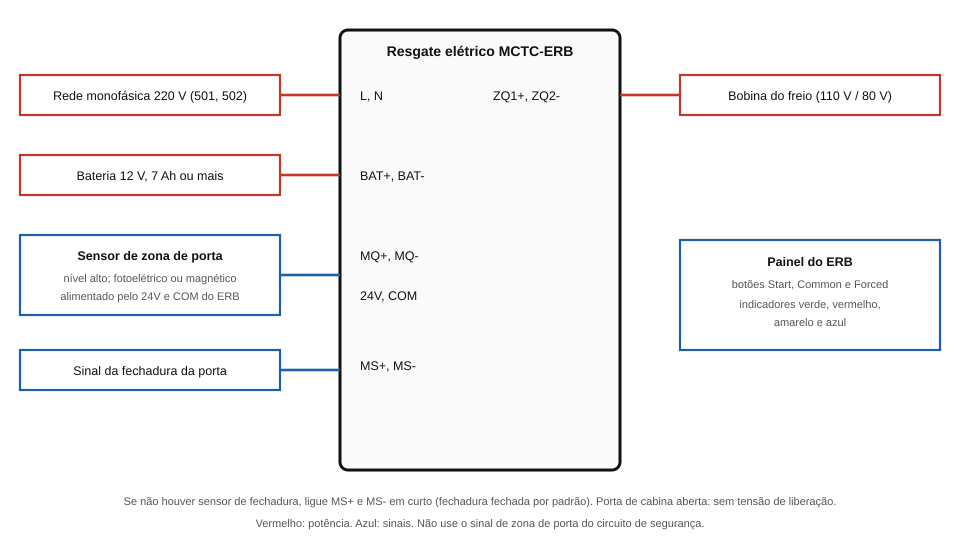
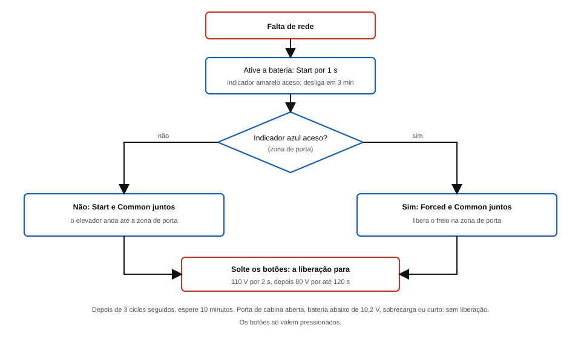

# Capítulo 14. Resgate elétrico e manutenção

> VERSÃO v0.2 de 15/11/2026. Aprovado pelo Gelson em 15/11/2026; aguarda a assinatura da Qualidade. Selos abertos: `PREENCHER [Q112]`, `PREENCHER [Q113]` e `PREENCHER [Q114]`. Fontes: manual do resgate elétrico MCTC-ERB-A (Inovance, 19010850), manual do NICE3000new (seção 9.13) e cartilha "Manual de Resgate" da VerticalParts (VP-RES-01, Rev. 02, versão para validação técnica).

**Parte IV. Comissionamento**

## 14.1 O que você vai aprender

Ao terminar este capítulo você será capaz de:

1. Distinguir resgate de passageiros, resgate elétrico, operação elétrica de emergência e resgate automático.
2. Dizer o que o resgate elétrico ERB faz, o que ele atende e quais são os terminais, os indicadores e os botões.
3. Descrever a sequência de liberação do freio e os limites do dispositivo.
4. Trocar a bateria do resgate elétrico com segurança.
5. Saber o que a cartilha de resgate da VerticalParts diz e quem faz o quê.

> **PERIGO.** O resgate de passageiros é trabalho de equipe treinada, com procedimento específico do elevador. Este capítulo descreve o **equipamento** (o dispositivo que libera o freio e as peças do quadro), não habilita ninguém a executar manobras. Abertura de portas, liberação de freio e movimentação da cabina dependem de treinamento e do procedimento do elevador.

> **PERIGO.** O resgate elétrico contém alta tensão. Antes de ligar fios ou trocar a bateria, desconecte o dispositivo da rede com um componente isolante confiável.

## 14.2 Quatro coisas que não se confundem

| Termo | O que é | Onde está neste livro |
|---|---|---|
| Resgate de passageiros | Procedimento de emergência para retirar pessoas de uma cabina parada, feito por equipe treinada | Seção 14.9 |
| Resgate elétrico | O equipamento MCTC-ERB, que libera o freio quando falta a rede, com bateria | Seções 14.3 a 14.7 |
| Operação elétrica de emergência | Modo de movimentar a cabina com a chave CIS e os botões de subir e descer; não é o resgate elétrico | Capítulos 3 e 12 |
| Resgate automático | Equipamento reserva que faz o elevador chegar sozinho a um pavimento quando falta a rede (UPS de 220 V ou ARD) | Seção 14.8 |

O elevador de referência tem o resgate elétrico ERB, conforme o esquema e as fotos do quadro (capítulo 3, seção 3.6). Se tem também UPS ou ARD: `PREENCHER [Q112]`.

Fonte: glossário do projeto; manual NICE3000new, seção 9.13; esquema Vitinho, folha /23.

## 14.3 O resgate elétrico MCTC-ERB

O MCTC-ERB é o dispositivo de liberação elétrica do freio da Inovance (série MCTC, específica para elevadores). Quando a rede falta, ele libera o freio para que a cabina pare em uma posição esperada, e com a rede normal ele carrega a bateria. A série tem duas versões: **A1**, com bateria, e **A2**, sem bateria (a bateria é por conta do usuário). O elevador de referência usa o **A1**: a etiqueta "MCTC-ERB-A1" é legível na foto do quadro de 12/11/2026 (capítulo 3, seção 3.6).

| Dado | Valor |
|---|---|
| Freios atendidos | Tensão de excitação forte até 110 V e tensão de manutenção até 80 V |
| Corrente máxima de excitação forte | 4 A |
| Entrada | Monofásica de 220 V (de -15% a +10%), 50/60 Hz |
| Tensão de liberação do freio | Partida de 110 VDC e manutenção de 80 VDC |
| Saída de 24 V | Até 300 mA, só para o sensor de zona de porta do resgate |
| Bateria | Chumbo-ácido de 12 V e 7 Ah ou mais (151 x 100 x 65 mm) |
| Proteção por bateria baixa | O freio não é liberado com a bateria abaixo de 10,2 V |
| Ambiente | De -10 a 50 °C; umidade de 5 a 95% sem condensação; IP20 |
| Massa | 3,73 kg, incluindo a bateria de 1,69 kg |

O dispositivo não consome a bateria quando está desligado da rede e parado, a não ser o consumo da própria bateria. A instalação é em montagem na parede, dentro do quadro de comando, com as cotas do desenho de instalação do manual.

Fonte: manual MCTC-ERB-A, págs. PDF 1 e 2 (Tabela 1 e seção de instalação).

## 14.4 Terminais e ligação

| Terminal | Função | Observação do manual |
|---|---|---|
| L e N | Entrada de 220 VAC | |
| ZQ1+ e ZQ2- | Tensão de liberação do freio (positivo e negativo) | Vai para a bobina do freio |
| 24V e COM | Saída de 24 V | Só para o sensor de zona de porta do resgate |
| MQ+ e MQ- | Entrada do sinal de zona de porta | MQ+ é a entrada de nível alto; MQ- é a de nível baixo (ligue o sinal ao COM). Prepare o sensor por sua conta. Não use o sinal de zona de porta do circuito de segurança. O sensor deve ser de nível alto válido |
| MS+ e MS- | Entrada do sinal da fechadura da porta | Use um sensor de fechadura. Se não usar, curto MS+ e MS-, e a fechadura fica fechada por padrão |
| BAT+ e BAT- | Bateria | |

Sensores externos aceitos para a zona de porta: sensor fotoelétrico (24 V, até 200 mA de entrada, saída de 24 V e até 5 mA) ou chave magnética (24 V, até 5 mA).

> **NOTA.** O sinal de fechadura serve para saber se a porta de cabina está fechada. Se ele indicar porta de cabina aberta, **a tensão de liberação do freio não é emitida**.

No quadro do elevador de referência, os terminais ligam assim: L e N em 501 e 502 (vindos do QFB3), ZQ+ e ZQ- ao plugue MT1, MQ+ em FL1 e MQ- em 302 (KY10), MS+ em 133 e MS- em 131 (KY11). Detalhe e fonte: capítulo 3, seção 3.6.

**Figura 14.1.** Ligação do resgate elétrico: rede, bateria, bobina do freio, sensor de zona de porta e sensor de fechadura.
Fonte: manual MCTC-ERB-A, Figura 5 (pág. PDF 2).

## 14.5 Indicadores e botões

O painel de operação tem quatro indicadores (da esquerda para a direita: verde, vermelho, amarelo e azul) e três botões: **Start**, **Common** e **Forced**. Os botões só valem enquanto estão pressionados.

| Indicador | Cor | Significado |
|---|---|---|
| Tensão de liberação do freio | Verde | Aceso: há tensão de liberação na saída. Apagado: não há |
| Falha | Vermelho | Aceso: sobrecarga ou curto na saída de liberação do freio. Apagado: saída normal |
| Bateria | Amarelo | Aceso fixo: bateria cheia. Piscando devagar: descarregando ou carregando. Piscando rápido: nível baixo |
| Zona de porta | Azul | Aceso: o elevador estava em zona de porta quando a rede falhou. Apagado: estava fora da zona de porta |

Com a bateria sem carregar, aperte Start e segure por 1 s: o indicador de bateria acende e mostra o estado conforme o nível. Depois de três minutos ele apaga de novo.

Fonte: manual MCTC-ERB-A, págs. PDF 2 (seção 4, Operation Guide).

## 14.6 Como o resgate elétrico libera o freio

Esta seção descreve o **dispositivo**, como o manual dele descreve. O procedimento completo de um resgate (comunicação com os passageiros, controle de energias, abertura de porta) é da equipe treinada, na seção 14.9.

**Ativar a bateria.** Com o dispositivo desligado da rede, a bateria e a carga ficam desconectadas. Antes de liberar o freio, ative a bateria.

1. Aperte o botão Start e segure por 1 s. O indicador amarelo acende e a bateria está ativa.
2. A bateria fornece energia por três minutos e desliga sozinha. Se precisar de novo, repita o passo 1. Com o freio liberado, a bateria também desliga sozinha três minutos depois.

**Liberar o freio** (quando a rede falta):

1. Veja o indicador azul. Aceso significa que o elevador estava em zona de porta. Apagado, que estava fora.
2. **Fora da zona de porta:** aperte Start e Common ao mesmo tempo. O freio é liberado e o elevador anda até a zona de porta. Solte Start ou Common para parar a liberação.
3. **Em zona de porta:** aperte Forced e Common ao mesmo tempo. Solte Forced ou Common para parar a liberação.

**Lógica da tensão de liberação.**

1. Durante a liberação, o dispositivo emite 110 V de partida por 2 s e depois 80 V de manutenção por até 120 s.
2. Ele pode emitir esse ciclo (110 V por 2 s e 80 V por 120 s) três vezes seguidas. Depois das três, espere 10 minutos até poder liberar o freio de novo.

**Proteções.**

| Proteção | Condição | O que o dispositivo faz |
|---|---|---|
| Sobrecarga na partida | A partir de 4,5 A | Corta a tensão de liberação se a sobrecarga durar 200 ms ou mais; só libera de novo depois de 1 minuto |
| Sobrecarga na manutenção | A partir de 3,5 A | Mesma lógica |
| Curto na partida | A partir de 6 A | Corta a tensão; só libera de novo depois de 5 minutos |
| Curto na manutenção | A partir de 4,5 A | Mesma lógica |
| Curto na saída de 24 V | Curto | Tensão de saída zero; volta sozinha quando o curto sai |
| Bateria baixa | Abaixo de 10,2 V | Não libera o freio |
| Porta de cabina aberta | Sinal de fechadura aberta | Não emite tensão de liberação |

> **ATENÇÃO.** Não repita a liberação por tentativa. Se o indicador vermelho acender, há sobrecarga ou curto na saída do freio: pare e investigue antes de apertar de novo. Se o dispositivo não concluir a operação, mantenha o chamado ao atendimento (seção 14.9).

**Figura 14.2.** Sequência de liberação do freio pelo resgate elétrico, com os limites de tempo.
Fonte: manual MCTC-ERB-A, Figura 6 e seção "Logic of brake release voltage output" (pág. PDF 2).

Fonte: manual MCTC-ERB-A, págs. PDF 1 e 2.

## 14.7 Manutenção do resgate elétrico

**Bateria.**

1. Troque a bateria a cada dois anos (recomendação do manual).
2. Antes do primeiro uso, carregue a bateria por 12 horas.
3. Recarregue a bateria pelo menos uma vez a cada seis meses.

**Como trocar a bateria.**

> **PERIGO.** Desconecte o dispositivo da rede. Tire anéis, relógio e outros objetos de metal. Use chave de fenda com cabo isolado e não apoie objeto de metal sobre a bateria. Nunca faça curto nos polos nem inverta a polaridade: o cabo vermelho vai no positivo e o preto no negativo.

1. Solte os quatro parafusos e retire a tampa frontal.
2. Retire os dois cabos entre a placa de potência e a bateria.
3. Retire os dois parafusos do suporte da bateria e o suporte.
4. Retire a bateria pelo sentido da seta.
5. Coloque a bateria nova, empurrando-a para dentro da caixa pelo sentido da seta.
6. Ligue os dois cabos entre a placa de potência e a bateria (vermelho no positivo, preto no negativo).
7. Recoloque o suporte e aperte os dois parafusos.
8. Recoloque a tampa e aperte os quatro parafusos.

**Cuidados de armazenamento e instalação** (manual MCTC-ERB-A, seção de segurança): não guarde o produto por mais de três meses sem proteção reforçada; não instale se houver dano, ferrugem, infiltração de água ou falta de peça; instale sobre material não inflamável, como metal; em ambiente fechado, resfrie o ambiente para a temperatura exigida; não modifique o produto; cubra o topo do equipamento durante a instalação para não cair metal, óleo ou água, e retire a cobertura depois; ligue o terra de modo confiável.

> **NOTA.** Depois de desligar a rede, espere o tempo indicado na etiqueta do produto antes de abrir ou mexer, porque há tensão residual. Para uma máquina de ímã permanente, não toque nos terminais do motor nem depois de desligar, porque há tensão induzida enquanto o motor gira.

**Manutenção periódica do quadro de comando.** Os documentos que o livro tem não trazem um plano de manutenção periódica do quadro (itens, periodicidade). Por regra do manual do fabricante, a manutenção deve ser feita por profissionais, com registro. O plano: `PREENCHER [Q113]`. A manutenção periódica do operador de porta está no capítulo 9, seção 9.12.

Fonte: manual MCTC-ERB-A, págs. PDF 2 e 3 (seções 5 e 6).

## 14.8 Resgate automático por UPS ou ARD

Em vez do resgate elétrico, ou além dele, alguns elevadores têm um equipamento reserva que leva a cabina a um pavimento quando falta a rede. O manual do NICE3000new (seção 9.13) descreve dois esquemas:

| Esquema | Como funciona |
|---|---|
| UPS de 220 V | A UPS alimenta o motor e o circuito de comando do controlador. O controlador conduz o motor até a zona de nivelamento. O quadro precisa de contator de marcha da UPS e circuito de controle da UPS |
| ARD (dispositivo de resgate automático) | Uma bateria é a alimentação reserva; o ARD tem sistema de controle próprio, que diagnostica a rede e faz a operação de resgate. O quadro só precisa reservar a entrada do sinal de realimentação de resgate. O manual descreve só o ARD da Monarch; ARDs de outras marcas têm controle e ligação diferentes |

O manual descreve duas formas de evacuar: pelo controlador conduzindo o motor, ou por **curto no estator** (o controlador curto-circuita o estator do motor e libera o freio, e a cabina se move devagar pela diferença de peso entre cabina e contrapeso até a zona de nivelamento).

**Parâmetros do NICE3000new para o resgate automático:**

| Código | Valor | Função |
|---|---|---|
| F8-10 | 1 (UPS) ou 0 (motor não gira, para curto no estator) | Modo de operação de evacuação na falta de rede |
| F5-20 (X20) | 59 | Sinal de evacuação, contato NF (exemplo com X20) |
| F5-31 (Y6) | 13 | Comutação automática de evacuação; só a saída Y6 serve |
| F6-45 | Bit15 igual a 1 | Habilita (só no esquema de curto no estator) |

**Capacidade de UPS recomendada:**

| Potência da UPS | Potência do controlador |
|---|---|
| 1 kVA (700 a 800 W) | até 5,5 kW |
| 2 kVA (1400 a 1600 W) | de 5,5 a 11 kW |
| 3 kVA (2100 a 2400 W) | de 15 a 22 kW |

> **NOTA.** O controlador do elevador de referência é de 7,5 kW (variante padrão), na faixa de 5,5 a 11 kW. A faixa de 11 a 15 kW não consta na tabela do manual. Se o elevador de referência usa UPS: `PREENCHER [Q112]`.

Fonte: manual NICE3000new, seção 9.13, págs. PDF 324 a 327.

## 14.9 Resgate de passageiros: o que a cartilha diz

A VerticalParts tem uma cartilha ilustrada, o "Manual de Resgate" (VP-RES-01, Rev. 02, de setembro de 2026). A versão que o livro tem está marcada como **versão para validação técnica**; se foi aprovada: `PREENCHER [Q114]`. Ela é dirigida a passageiros, portaria e empresa contratada, não ao montador. O livro resume os pontos que o técnico precisa conhecer.

**A VerticalParts não tem equipe de resgate nem de manutenção preventiva.** A cartilha diz que os profissionais ilustrados representam a empresa especializada contratada pelo proprietário. O escopo dela é "pessoas retidas na cabina"; resgate no poço, no teto, na caixa de corrida, esmagamento ou queda exige resposta especializada.

| Quem | O que a cartilha diz |
|---|---|
| Passageiros | Pedir ajuda, comunicar o que sentem, aguardar em posição segura. Não tentar sair sozinhos; não forçar a porta, não pular, não alcançar o teto; não passar pelo vão se houver abertura entre andares |
| Portaria e responsável local | Acionar a empresa responsável, conversar com os passageiros, organizar o acesso e afastar curiosos. **Não realizar manobras**, não reiniciar o elevador, não mexer em quadros ou disjuntores por tentativa; guardar as chaves técnicas |
| Empresa responsável | Avaliar riscos, aplicar o procedimento específico do elevador, controlar a retirada e registrar a ocorrência |

**A empresa responsável confirma antes de intervir:**

1. Identificação e procedimento: confira a identificação do elevador (TAG), a configuração, a revisão do documento e a competência da equipe para o modelo.
2. Pessoas e comunicação: defina quem coordena, quem acompanha a cabina e como manter contato.
3. Condição real do equipamento: confirme a posição da cabina pelos meios previstos no procedimento, os riscos e a acessibilidade do ponto de trabalho.
4. Controle de energias: considere rede, gerador, baterias, resgate automático e energia mecânica. **Desligar a rede não prova imobilização.**

Sem condição segura ou procedimento correto, não faça a manobra. Mantenha contato e acione suporte especializado.

**A configuração muda a manobra.** Uma ordem de botões, uma chave ou uma liberação de freio de outro modelo não serve como referência. Com casa de máquinas, localize o procedimento e os dispositivos de emergência no endereço indicado. Sem casa de máquinas, identifique o armário ou painel de resgate real, que pode estar no pavimento; não presuma posição nem comandos. Resgate automático não é garantia de saída: se não concluir a operação, mantenha o chamado e não repita comandos nem libere freios por tentativa. Não use pontes elétricas, calços improvisados, cordas ou acesso pelo teto como atalho.

**Saída assistida.** A equipe confirma cabina presente, imobilização conforme procedimento, piso nivelado e passagem protegida. Uma pessoa por vez; sem saltar, sem escalar e sem apoiar o corpo nas portas. Fora de nível ou com vão inseguro: não faça a transferência.

**Quando chamar socorro público.** 193 (resgate e incêndio): fumaça, fogo, entrada de água com risco, pessoa fora da cabina, queda, aprisionamento ou perigo imediato. 192 (urgência médica): falta de ar importante, desmaio, dor no peito, convulsão, trauma ou outra condição grave.

**Depois da retirada.** O elevador permanece fora de uso. A equipe verifica o fechamento e o travamento das portas, mantém sinalização e restrição de uso e registra a ocorrência (horários, identificação, sintomas relatados, intervenções, responsáveis, destino do atendimento). **Retirar passageiros não significa corrigir a falha, e registrar o resgate não autoriza o retorno ao serviço**; só uma avaliação técnica libera, e a portaria não religa por conta própria.

**Preparação antes da ocorrência.** A empresa contratada completa e valida a ficha da cartilha: obra e endereço, elevador, TAG e configuração, empresa contratada e contrato, responsável técnico e registro, ponto de resgate e acesso autorizado, código e revisão do procedimento específico, local da cópia disponível sem internet, treinamento da equipe e data, e validação e próxima revisão.

Fonte: cartilha "Manual de Resgate" da VerticalParts, VP-RES-01, Rev. 02 (versão para validação técnica), págs. 2 a 12.

## 14.10 Se o seu elevador tiver outra configuração

| Se o seu elevador tiver | O que muda |
|---|---|
| ERB-A2 (sem bateria) | A bateria é por conta do usuário: 12 V, 7 Ah ou mais, e cabos vermelho e preto |
| UPS ou ARD além do ERB | Os parâmetros F8-10, F5-20, F5-31 e F6-45 da seção 14.8 e o plano de energia reserva |
| Casa de máquinas | Os dispositivos de emergência ficam no endereço indicado pelo procedimento do elevador |
| Outro modelo de resgate elétrico | Siga o manual dele; o livro descreve só o ERB |
| Freio com tensão acima de 110 V na partida ou 80 V de manutenção | O ERB não atende; use outro dispositivo |

Fonte: manual MCTC-ERB-A; manual NICE3000new, seção 9.13; cartilha VP-RES-01.

## 14.11 Teste o que você aprendeu

1. Qual é a diferença entre resgate elétrico e operação elétrica de emergência? *(Seção 14.2: o primeiro é o equipamento ERB que libera o freio; a segunda é o modo com a chave CIS e os botões de subir e descer.)*
2. Que tensões o ERB emite na liberação e por quanto tempo? *(Seção 14.6: 110 V por 2 s e 80 V por até 120 s.)*
3. O que acontece depois de três ciclos seguidos de liberação? *(Seção 14.6: espere 10 minutos.)*
4. Quando o ERB não emite a tensão de liberação? *(Seção 14.6: porta de cabina aberta, bateria abaixo de 10,2 V, sobrecarga ou curto.)*
5. Com que frequência se troca a bateria? *(Seção 14.7: a cada dois anos.)*
6. O que a portaria pode fazer num resgate? *(Seção 14.9: acionar a empresa, conversar com os passageiros e organizar o acesso; não realizar manobras.)*

## Fontes do capítulo

- Manual do resgate elétrico MCTC-ERB-A (Inovance, 19010850-B01), `Manual_Dispositivo_Resgate_Eletrico_ERB-A1_EN.pdf`, págs. PDF 1 a 3.
- Manual NICE3000new, `Manual_Usuario_Controlador_NICE3000new_Completo.pdf`, seção 9.13, págs. PDF 324 a 327.
- Cartilha "Manual de Resgate" da VerticalParts, `VerticalParts_Manual_de_Resgate-2.pdf` (VP-RES-01, Rev. 02, versão para validação técnica).
- Esquema Vitinho 19061867-ZL, folha /23, por remissão ao capítulo 3.
